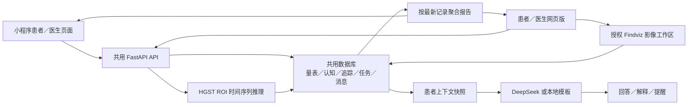
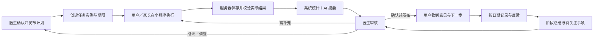

# 小程序优先的 AI 辅助诊断与医患协同升级方案

日期：2026-10-12。范围：当前工作区的项目说明、活动小程序与网页、业务后端、AI 服务、影像与模型工程、部署及已有验证资料。

本文件是分析与待评审设计，不代表新增功能已经实现。本阶段仅新增及修订方案与调研文档，未修改业务代码、数据库、模型权重、运行配置或既有未提交改动。没有启动会执行数据库初始化的服务，也没有写入用户业务数据。

本轮方案调整：面向使用者统一称“用户”，区分成年用户与儿童用户；儿童沿用用户账号，由监护人管理，不另设家长注册入口；主诉、病史、生活影响等背景资料为选填，可跳过、稍后补充；统一 AI 流程智能体承接原 AI 助手的聊天、引导、解释和提醒，并从首期串联业务流程。以下为拟调整设计，现有界面和代码标识尚未改名。

## 1. 推荐结论与设计前提

建议将项目定位为：**以小程序为主要入口、网页版辅助的 ADHD AI 辅助诊断与医患持续协同平台**。用户侧呈现“AI 辅助评估与结果理解”，医生侧呈现“AI 整理证据与辅助判断”，两者通过实际任务、审核记录和随访计划连接。

首期成人与儿童同步推进，这是本轮用户明确选择。两条路径共用同一业务引擎，分别配置成人自评和儿童家长代填、监护授权、测试说明及记录内容。首期支持成人本人，以及由一名主要监护人管理的儿童用户账号；沿用成人／儿童使用入口，不增加独立家长注册入口，只记录账号持有人、实际填写人及监护授权。多监护人、多儿童切换、教师独立填写入口随后增加，基础数据关系应先预留。

优先交付的闭环是：

**选择本人／儿童使用并填写必要基础信息 → 背景资料选填或跳过 → 智能体引导评估和测试 → 生成有来源的评估摘要 → 关联医生并共享结果（也可提前关联、按医生任务评估）→ 医生审核并发布意见 → 按计划记录和反馈 → 智能体汇总阶段变化 → 医生复核并安排下一轮。**

医生在小程序上也必须能够完成接收结果、审核、发布意见和安排下一轮，首期闭环不依赖网页版；网页版提供更适合大屏的工作方式。

### 1.1 三种升级路径的比较

| 路径 | 优点 | 局限 | 判断 |
|---|---|---|---|
| 在现有各页面补 AI 文案和聊天入口 | 改动少，展示容易 | 仍没有结果关联、审核与随访状态，难以证明协同完成 | 适合局部优化，无法满足本次目标 |
| **共用后端增加评估批次、任务执行、审核与随访机制，复用现有页面** | 复用率高，可逐步验收；两端共享结果；AI 能进入明确环节 | 需要迁移部分数据并调整现有提交接口 | **推荐** |
| 重写两端，首先建设复杂的多智能体平台 | 长期扩展空间大 | 成本和不确定性高，当前数据和业务状态不足以支持自治 | 不作为当前阶段方案 |

### 1.2 AI 辅助诊断的产品边界

AI 输出包含资料摘要、筛查信号、数据质量问题、变化描述、待核实问题和安排草案。医生作出专业判断并确认后续安排；用户始终能区分原始记录、系统计算、AI 草稿与医生已确认意见。

ADHD 诊断不能仅依赖量表或观察结果，需由具备相关能力的专业人员综合评估。此处采用这一临床边界设计产品，并不把国外指南当作国内上线资格依据。[NICE ADHD 指南](https://www.nice.org.uk/guidance/ng87/chapter/recommendations)

“已完成测试”“已生成 AI 摘要”“医生已查看”“医生已审核”应分别展示。读取报告或标记已读不能代替医生审核。

## 2. 当前项目的结构与真实实现

### 2.1 代码与产品结构

产品形态只有小程序和网页版。`patient-web/` 与 `doctor-web/` 是网页版中的不同角色入口；`findviz/` 是医生网页使用的影像模块，不另立为产品。

| 目录 | 实际职责 | 升级处理 |
|---|---|---|
| `miniprogram/` | 原生微信小程序，注册 25 个页面；患者流程及医生移动工作台 | 作为主入口继续扩展，复用评估、记录、报告和医患页面 |
| `patient-web/` | 活动患者网页，现有较完整的量表、测试、追踪、报告、AI 和教育页面 | 保留兼容；逐步聚焦产品介绍、小程序引导、资料与报告大屏查看 |
| `doctor-web/` | 医生／研究人员网页，患者工作台、报告、时间序列推理、影像可视化和 DAC | 作为辅助大屏工作台增强审核、分析和管理 |
| `backend/app/` | FastAPI 路由、SQLAlchemy 模型、Pydantic 契约、业务及 AI 服务 | 保持共用单体后端，新增有边界的业务服务 |
| `findviz/` | Flask 影像服务，受控挂载到 FastAPI，提供切片、表面、时间序列等浏览分析 | 专业可选模块，继续在网页承载 |
| `HGST-main/` 与 `backend/app/services/hgst_runtime/` | 研究训练工程及在线部署包推理 | 保留，独立记录来源、版本和演示状态 |
| `archive/legacy-patient-web/` | 历史来源副本，不作为活动入口 | 保留来源，不在此实施升级 |
| `docs/`、`tests/`、各端测试目录、`deploy/` | 说明、契约、既有检查及部署资料 | 更新活动契约与验收，沿用已有部署基础 |

根 README、后端及两端 README、项目阅读索引、接口契约、模型集成与评估协议、部署说明和近期证据用于了解背景；关键判断重新对照当前代码。现有说明存在不同更新时点，代码行为优先于历史说明中的完成宣称。

本轮梳理覆盖全部注册小程序页面、两端活动 HTML 与脚本关系、FastAPI 已挂载路由、业务实体与提交链路，以及 AI／影像主链。图形样式、第三方库、所有研究实验和全部真机交互没有逐项重新验收；没有把静态阅读等同于运行成功。

### 2.2 页面与功能现状

| 业务 | 已有实现 | 主要差距 |
|---|---|---|
| 登录与注册 | 邮箱／工号、密码、JWT；患者和 researcher 角色 | 没有微信身份绑定；researcher 不等同于已核验执业医生 |
| 患者档案 | 成人／儿童、年龄、性别；账号姓名用于患者展示 | 缺主诉、病史、功能影响、资料版本；儿童、家长账号和填写人的关系不完整 |
| 医患关联 | 医生输入患者邮箱绑定；同一患者只绑定一位研究人员 | 没有患者／监护人接受邀请、撤回和交接记录 |
| 患者首页 | 14 天进度、固定量表／认知／追踪卡片、任务与消息计数 | “今日任务”主要是静态入口，未统一反映医生计划及审核状态 |
| 量表 | 成人 ASRS 18 题、儿童 SNAP-IV 26 题，后端计算风险和摘要；本地保存作答草稿 | 没有评估批次、任务 ID、提交去重 ID；缺题目版本、实际填写人和质量证据 |
| 认知测试 | Go/No-Go、Stroop、Flanker、2-back、连线 A/B、数字广度；单项／整套、协议和年龄配置、逐试次／质量信息、失败重试 | 整套接续主要在本地；结果没有绑定医生任务和评估批次；不同设备不能靠本地完成度衔接 |
| 日常记录 | 情绪、专注、症状、睡眠、用药与剂量、不适、活动和事件；简表加展开详情 | 数据按患者与 1–14 天序号唯一，不能独立保存第二轮随访；缺实际记录日期和计划 ID |
| 报告与趋势 | 量表、认知、追踪、影像和预测汇总；认知按来源／协议分组；缺失点不补零 | 缺按一次评估冻结的版本、医生意见及审核；“每类最新结果”可能来自不同评估时期 |
| 我的路径、科普 | 根据已有数据推导下一步；本地教育内容 | 路径是完成度引导，尚非包含医生审核和下一轮计划的业务状态 |
| 医患消息 | 双向文本、消息去重、绑定范围、后台已读接口 | 缺关联任务／评估／问题处理的沟通线程；网页部分阅读状态仍由本地管理 |
| 医生任务 | 小程序与网页可创建量表、认知、追踪、报告任务，指定标题、说明和截止时间 | 患者点击“标记完成”即可完成；缺结果核验、配置细分、周期重复、医生审核与调整记录 |
| 医生工作台 | 绑定患者、筛选、查看汇总、任务、消息与 AI 聊天记录 | 缺待审核队列、可追溯摘要、结构化医生意见和阶段结案 |
| 专业影像 | 医生同源页面申请患者影像会话，上传、浏览、截图及记录解读 | 应从主协同路径按需进入；无需作为每名患者的必经步骤 |
| 安全与管理 | 角色检查、绑定检查、敏感字段和文件 AES-GCM、Paillier 数值统计、DAC 审计 | 细粒度授权仍有占位行为；部分增强接口缺医生患者范围检查 |

### 2.3 现有 AI 能力的分类

| 层次 | 当前能力 | 已接入的位置 | 应如何复用 |
|---|---|---|---|
| 大模型文本辅助 | DeepSeek 网关；患者聊天、报告解释、追踪提醒；缺配置或失败时模板降级 | 小程序主要调用 `/ai/chat`；患者网页调用聊天、报告解释和提醒接口 | 网关保留；增加严格输出契约、按阶段裁剪的上下文、AI 产物持久化及审核 |
| 规则和统计分析 | 自适应难度、异常作答、跨维度关联、趋势外推、关怀信号、工作台摘要、干预模板、自然语言查询 | `/ai-enhanced` 已挂载 16 个接口；活动两端代码未检出 `/ai-enhanced/` 调用 | 逐项校验，再将可信规则接入任务和阶段摘要；不能直接把接口清单当已完成产品 |
| 影像模型 | HGST 接收整理后的 ROI 时间序列，输出分类、概率、模型版本；real／auto／mock 模式 | 医生网页上传和报告链路 | 保留为医生按需使用的研究／辅助证据，演示数据排除出真实临床摘要 |

自然语言查询目前主要是关键词解析及受限数据库查询。患者网页的 `orchestrator.js` 是完成度规则与页面导航，医生网页的“AI 优先决策”是前端规则排序；这些都还不是具备受控工具调用、长期业务状态和审核节点的完整智能体。

HGST 与大模型承担不同职责。Findviz 上传 `.nii` 等影像用于可视化；HGST 接收 `.1D`／`.csv` ROI 数值时间序列。当前没有“上传任意原始 MRI → 自动完成全套预处理 → 给出临床诊断”的链路。

### 2.4 当前数据流

小程序有本地草稿、结果缓存、待同步队列和会话清理机制；服务器结果决定跨端可见状态。现有认知提交有运行 ID 去重，消息有客户端编号去重，这些机制值得保留。当前量表、认知和记录的提交接口并未把结果关联至医生任务。

## 3. 与新定位的差距及前置修整

### 3.1 可以直接保留的基础

保留原生小程序、现有测试引擎、成人／儿童量表页面、日常记录表单、趋势图、消息、任务创建、账号体系、共用 API 与数据库、AI 网关、报告中的认知来源／协议分组，以及医生网页和影像工作区。

保留认知原始指标及 `test_run_id`、本地失败重试、会话切换防止旧请求回写的保护、消息去重、后端敏感内容加密和来源标记。

### 3.2 需要强化的部分

让每个模块知道它属于哪次评估、哪个医生计划、哪项任务，当前由谁填写，结果是否同步，是否需要医生审核。AI 读取这些受限业务数据，生成带证据的产物。网页和小程序展示同一状态，减少前端分别推导“完成”的做法。

### 3.3 需要重新设计的部分

重新设计首页信息优先级、评估起点、儿童监护关系、医患关联确认、任务完成机制、报告审核与发布、周期随访状态和网页介绍入口。`care-pathway` 改为真实业务进度；现有 AI 助手入口统一升级为 AI 流程智能体，复用聊天页面与浮层，在各环节使用同一套业务上下文和受限工具。

### 3.4 当前代码中应先处理的具体问题

以下是本轮静态核查发现，尚未在本轮修复或执行对应运行回归。

| 问题 | 当前依据 | 对升级的影响／处理 |
|---|---|---|
| 任务完成没有实际结果校验 | `care.py:212` 接口直接写 completed；患者任务页有手动完成按钮；提交契约不含任务 ID | 量表、认知和追踪任务改为经服务器验证结果后提交；阅读确认另设确认动作 |
| 任务跳转未携带任务上下文 | `patient-care.js:78` 根据任务类型返回固定页面，未使用任务编号或配置 | 使用类型白名单路由，并传入任务／评估上下文，配置从服务器读取 |
| 14 天记录不能区分多轮 | `tracking_log.py` 唯一键为 patient_id + day_index；提交同序号会更新旧记录 | 增加随访周期与实际日期，保留历史，不用第二轮覆盖第一轮 |
| 部分医生 AI 排序字段不匹配 | `doctor_patients.html:1261` 使用 tracking_completed_days 和 has_cognitive；响应定义为 completed_tracking_days 和 cognitive_test_count | 先统一字段，工作台状态由后端提供；避免把已做任务识别成未做 |
| 增强分析与当前数据契约不完全一致 | 多模态认知评分读取部分旧根字段；部分新指标位于规范化结果内 | 共用认知规范化方法，逐项核对指标、年龄组、协议及缺失值 |
| 部分评分为启发式且有口径问题 | 多模态服务以 78 归一化 ASRS，但本项目 18 题每题 0–4，满分为 72；亚型／confidence 使用固定阈值数值 | 首期不向患者发布亚型、诊断概率或固定置信度；先校验计分及表达依据 |
| 演示预测可能进入扩展影像评分 | `_compute_imaging_score` 读取最新预测概率，未排除 mock | 统一过滤演示结果，传播来源和有效性，不让演示数据变成真实证据 |
| 增强随访尚非落地的计划系统 | 干预计划主要即时生成，效果响应 plan_id=0；干预类型与 PatientTask 枚举不一致；效果查询仅取已完成任务计算分母 | 新建实际计划／任务关系；执行率以应执行的实例为分母；变化不宣称为治疗因果效果 |
| 个性化消息存在第二条存储路径 | `create_personalized_message` 将消息写入 PatientTask(message)，普通聊天读取 CareMessage | 统一消息入 CareMessage，任务仅保留关联，避免提醒在聊天中不可见 |
| 三个增强接口缺医生绑定范围检查 | adaptive_difficulty、trend_predictions、care_alerts 仅在 patient 角色分支检查本人 | 提取统一患者访问依赖，所有患者级 AI 和工具调用都执行范围校验 |
| 细粒度同意检查仍是占位 | `enhanced_security_service.py:289` 固定返回 has_consent=True；真实注册只有 consent_agreed 布尔值 | 用持久化同意及撤回状态替换；真实外部 AI 使用前完成此项 |
| AI 场景标签未真正裁剪外发数据 | 聊天上下文包含完整 snapshot；快照可含姓名、日志备注和影像材料 | 按用途和授权构造最小字段集，敏感原文默认不外发，保留外发范围记录 |
| 漏填识别不是按实际日历 | `_tracking_summary` 由最大 day_index 推导下一天，再从最大已填日开始查漏填 | 新提醒用计划应记录日期与 record_date 计算，识别到期漏填、补录和延迟提交 |
| 临床措辞与实际能力不一致 | 网页部分文案称完整临床路径、高精度神经反应时及后续 GNN 解析 | 依据实际流程重写；展示证据来源、医生确认和未验证范围 |

上述修整与主闭环直接相关；不建议因此重写整个安全工程或同步引入联邦训练。

## 4. 新定位下的产品结构与两端分工

### 4.1 小程序用户侧

建议设置五个主要入口：**今日、评估、协同、报告、我的**。记录从“今日任务”和计划日历进入；统一 AI 流程智能体在当前页面提供下一步、继续任务和解释入口，并复用现有聊天页面，不要求用户每一步主动打开聊天。

| 入口 | 用户实际看到和操作的内容 |
|---|---|
| 今日 | 当前本人／儿童、负责医生、当前阶段、一项最优先任务、预计用时、截止日期、继续上次、待同步状态 |
| 评估 | 当前评估、成人／儿童对应量表、适用认知组合、实际任务完成度；背景资料单列为“选填／稍后补充”，不计入任务未完成 |
| 协同 | 我的医生、已发布计划、任务状态、消息、无法完成原因、需确认的医生新安排 |
| 报告 | 本轮结果、数据完整性、AI 解释、医生已确认意见、历史阶段与下一步 |
| 我的 | 账号与用户健康档案、监护关系、医患授权、外部 AI 同意、通知偏好、设备上的待同步内容 |

首页第一屏直接回答“现在做什么、为什么做、做完交给谁”。弱化固定九宫格和统一 14 天进度；阶段／任务由医生计划和真实数据决定。量表与认知仍保留自助入口，但自助结果不自动完成医生新下发的任务。

成人显示本人资料和自评说明。儿童显示儿童姓名与“由家长代填”，家长完成量表和日常记录；认知任务由儿童操作，家长只在正式测试之外解释流程，记录执行者、协助情况和年龄配置。

### 4.2 小程序医生侧

复用 `doctor-home` 和 `doctor-patient`，新增待审核、待跟进、未执行和异常数据入口。用户详情显示：当前评估／随访周期、带来源的资料摘要、原始结果、AI 待核实问题、任务与沟通记录。

医生可在小程序完成：选择模板并下发任务、查看实际完成结果、确认／编辑／退回摘要、发布用户可读意见、调整计划、指定下次复核。影像深度处理可引导至网页，但不阻塞其他用户的闭环。

### 4.3 网页版

| 场景 | 小程序主要职责 | 网页辅助职责 | 数据衔接 |
|---|---|---|---|
| 首次使用 | 登录、建档、关联医生、成人自评／监护人代填 | 公共介绍页说明核心价值，展示小程序闭环与真实可用入口 | 同一账号和 patient_id；扫码不携带用户隐私 |
| 评估与测试 | 医生任务及标准小程序流程优先 | 保留已有网页历史与兼容功能，适合补录长资料；网页测试必须保留来源／协议 | 指定任务可接受的来源和协议，不能跨端任意替代 |
| 日常管理 | 记录、任务、反馈、通知、持续随访 | 日历和阶段资料大屏查看，已有记录功能保留兼容 | 同一 plan_id、周期和实际日期，服务器状态一致 |
| 用户结果查看 | 日常查看、AI 简释、医生意见与下一步 | 较长报告、历史比较及后续受控导出 | 同一已发布报告版本；未审核摘要有明确状态 |
| 医生判断与协同 | 快速审核、安排与沟通 | 多用户队列、长资料整理、阶段对比、批量模板、影像 | 两端均使用同一审核和计划接口 |
| 管理与研究 | 必要的用户个人授权入口 | 医生资格、模板版本、工作量、授权审计和独立研究模块 | 区分临床协同权限与研究／DAC 权限 |

不立即删除用户网页现有能力。首期修整共享契约与状态，随后降低网页日常流程的展示优先级；新功能以小程序体验为验收主线。

`patient-web/index.html` 当前直接跳登录页，可改为网页版公共介绍入口：主标题突出 AI 辅助诊断与医患协同；展示“小程序填写—AI 整理—医生审核—持续随访”；主要按钮为进入小程序，辅助按钮为用户报告查看、医生工作台。电脑展示二维码，移动浏览器按实际支持情况提供跳转；正式 AppID、码及链接生成需要外部配置，不把未知图片当正式入口。

## 5. 成人与儿童的完整使用流程

### 5.1 轻量建档与关联

1. 用户注册／登录现有账号，选择“本人使用”或“为儿童使用”。只收集当前流程必需的基础信息，例如适用年龄／年龄组和实际填写者身份。儿童账号由监护人管理，记录监护关系与授权，不另设家长注册入口。
2. 显示资料收集、医患共享、外部 AI 分析等用途同意。拒绝外部 AI 仍能进行填写、标准计算、提交和医生审核，使用本地辅助。
3. 主诉／关注问题、病史／既往评估、生活影响、睡眠和相关治疗等资料放在“补充背景（选填）”；用户可整体跳过、只填部分或稍后补充。字段是否有帮助、由谁提供应说明，不用完整病史作为评估入口条件。
4. 用户愿意补充时，智能体可通过简短对话整理字段草稿；用户确认后保存。跳过时保留“未提供”，不推测、不填零、不解释为没有症状；不反复催填。
5. 已有医生的用户，可通过邀请／院内关联码确认医生及共享范围；未关联医生的用户先进入自助评估，结果清楚标明“尚未关联医生，待专业评估”，之后可授权共享已有结果。

### 5.2 评估与结果

6. 自助流程使用经审核的成年／儿童默认模板；医生关联流程由医生确认对应量表、适用认知任务、期限及复核日期，然后发布。本次形成评估批次及具体任务。医生确需某项补充信息时，另下发有原因的具体补充任务，不要求重填整套背景资料。
7. 用户／监护人点击“开始／继续本次评估”，智能体依据服务器进度给出下一步并打开对应任务。量表题目、计分版本和必要作答要求保持标准；选填背景与量表漏答分开处理。智能体可解释操作和中性词义，不暗示选项。
8. 认知测试沿用原测试引擎、年龄配置和协议，允许在任务之间休息、接续。正式试次期间关闭浮层弹出和对话，避免干扰测试。智能体不在试次中改难度或给答案。
9. 网络失败显示“保存在此设备、待提交”，后台任务仍未完成；同步成功后绑定实际结果。认知用既有运行 ID，量表补充提交去重 ID。任务提交由用户操作，状态推进由程序验证实际结果。
10. 达到本轮指定任务要求后，系统计算结果，智能体整理摘要及解释；背景未填时明确“背景资料未提供”，不阻止摘要生成。有关联医生则进入待审核队列；无医生则提供自助结果及后续关联入口。
11. 医生查看原始证据、数据质量和智能体草稿，必要时提出具体补充问题或重测要求；编辑或确认审核意见后发布。用户收到“医生已确认”报告及下一步。已有自助结果需医生确认适用性，不能自动抵扣新下发的不同批次任务。

### 5.3 随访与下一轮

12. 医生发布随访计划，指定记录项、周期、复核节点和问卷。首期沿用 14 天作为可选模板，周期是配置，不把每名用户固定为 14 天。
13. 成年用户记录本人情况；儿童由监护人记录儿童状态，说明信息来源。智能体提示当日任务、入口和记录方式；用户无法执行时选择原因、申请延期或留言，系统保留实际执行状态。
14. 到医生指定的阶段节点，系统计算有效记录天数、漏填、同协议变化和事件时间线；智能体草拟变化摘要、资料不足、执行障碍和待医生关注问题。
15. 医生处理待关注事项并复核阶段摘要，选择继续、调整、补评估或结束本周期，确认下一轮安排。智能体根据已发布计划更新用户侧下一步，用户确认接收。

首期医生也可完全在小程序完成第 6、11、12、15 步；网页版提供更快查看长材料与比较的方式。

### 5.4 一组具体衔接示例

成年用户案例：选择本人使用，只填必要基础信息并跳过背景资料 → 智能体引导完成默认 ASRS／适用认知任务 → 系统保存评估 A 和实际结果，智能体标明背景未提供并解释 → 用户确认关联和共享 → 医生核对结果，必要时仅补问具体问题 → 发布意见 A-v2 和计划 F1 → 智能体引导按实际日期记录 → 阶段到期生成 F1-S1 摘要 → 医生调整 F1 或创建 F2。新一轮 ASRS 属于评估 B，不覆盖 A。

儿童用户案例：监护人使用儿童账号，确认儿童年龄、填写者与监护关系，背景资料可跳过 → 智能体引导 SNAP-IV 监护人填写任务与适龄认知组合 → 量表记录回答人，认知记录儿童为执行者、监护人为提交者 → 两者归入同一儿童评估 → 医生审核后，监护人查看解释并完成随访记录。教师独立回答后续通过限范围邀请增加，保留观察者独立结果，不覆盖或直接平均监护人答案。

## 6. AI 贯穿各环节的具体职责

AI 的上下文由后端提供，本轮结果优先；历史记录仅在允许用途、时间范围和可比条件满足时进入。统计数字先由确定性服务计算，大模型负责整理和说明。首期资料整理以必要基础信息、用户自愿填写的背景字段和明确授权的文本为输入；未提供的背景只标记未知，不推断缺失内容；普通病历附件、OCR 和跨机构资料提取作为后续可选能力，需要另行建设上传、识别、来源确认与授权链路。

| 环节 | 输入数据 | AI 具体任务与输出 | 用户／医生如何使用 | 下一环节与确认节点 |
|---|---|---|---|---|
| 信息采集 | 年龄组、填写者身份、可选背景字段、已授权描述、字段规则 | 智能体说明选填用途、允许跳过，将已提供内容整理为“陈述—草稿—来源”，标记未知和矛盾 | 用户按需补充，医生知道哪些背景尚未提供 | 用户确认后保存资料；跳过仍进入评估；临床含义由医生核实 |
| 初步评估 | 必要基础信息、可选背景、适用配置、关联状态 | 智能体说明筛查流程，给出适用任务和下一步；背景缺失明确标记 | 用户可直接开始，医生调整关联流程模板 | 自助按已审核默认模板进入；医生任务由医生发布；不因选填未填阻塞，也不输出确诊或自造患病概率 |
| 测试与量表 | 本次任务配置、标准说明、作答完整性、时间／质量记录、测试协议 | 操作引导、中性题意帮助、漏答提醒、质量疑点说明 | 用户完成标准流程；医生知道哪些结果要谨慎解释 | 保存原始作答、版本和质量证据；医生决定是否补充／重测；正式题目及试次不由 LLM 改写 |
| 结果分析 | 本次结果 ID、后端计分、有效记录、来源／协议、可比历史、可选真实模型结果 | 生成关键发现、资料不足、跨资料不一致、通俗解释和待核实问题；每项挂证据 ID | 用户理解已做任务；医生快速定位原始证据 | 生成持久化 AI 摘要草稿；结论性判断、临床解释由医生审核 |
| 医生查看与判断 | AI 草稿、原始记录、质量问题、审核历史、医生问题 | 回答“依据是什么”，整理鉴别／补充访谈问题草案及用户说明草稿 | 医生核对、编辑、采纳／驳回；可查看生成前的数据版本 | 医生签署业务审核意见并发布；数据变化触发新版本，不悄悄覆盖旧意见 |
| 医患协同 | 已发布医生意见、计划、任务、用户反馈、允许共享的消息 | 把医生安排转成易懂说明；总结执行障碍；拟任务／回复草稿 | 用户知道何时做什么；医生确认调整和个性化回复 | 医生确认临床安排及 AI 草拟个性化指导后发送；普通事务提醒按批准模板发送 |
| 持续随访 | 计划与应执行日期、实际记录、事件／用药陈述、前后窗口、可比协议、反馈 | 整理阶段变化、漏填原因、资料覆盖率、待关注问题及下一轮草案 | 用户看进展和下一步；医生查看变化证据并调整 | 到期进入复核队列；医生确认继续／调整／结束；下一轮引用上一轮已发布意见 |

### 6.1 AI 产物应具备的最小结构

每份 AI 摘要至少包含：patient_id、评估／随访周期 ID、输入快照版本、时间范围、来源结果 ID、计算规则版本、模型／提示词版本、生成模式、生成时间、有效样本及缺失说明、关键发现、证据引用、待核实问题、草案建议、审核状态、审核者与时间。

说明数据质量和依据覆盖率，不用一个未经校准的“95% 可信”替代这些信息。无足够可比数据时输出“当前不足以比较”，不把缺失当正常或风险中等。

### 6.2 医生审核的分级

- 操作说明、格式检查、漏答提示、后端计算的执行率：无需逐条医生审核，但内容和计算规则应有版本。
- 用户自然语言转结构化资料：用户确认；医生在评估时核实临床含义。
- 原始分数和非结论性解释：可显示“系统／AI 辅助、待医生审核”，与正式意见分区。
- 临床判断、结论、个性化干预、调整复核周期或用药相关建议：必须由医生确认后发布。AI 不直接更改用药安排。
- 随访关注信号：系统建立待处理项，医生确认如何处置；提醒发出不等于处置完成。

## 7. 医患协同闭环机制

### 7.1 责任划分

| 主体 | 负责什么 | 系统保留什么证据 |
|---|---|---|
| 用户／监护人 | 同意范围、确认自己的资料、完成实际任务、反馈困难、查看并确认接收新安排 | 实际填写人、执行者、作答／记录、日期、提交 ID、接收及反馈 |
| 医生 | 确定评估要求、审核证据、临床意见、发布／调整计划、处理待关注项、确认下一轮 | 医生身份与权限、任务／计划版本、采纳和修改、原因、审核及发布时间 |
| AI | 引导、整理、解释、比较与草拟；帮助定位依据 | 输入范围、结果引用、模型及提示版本、降级／失败、工具调用和草稿 |
| 系统业务规则 | 日期、截止、权限、结果关联、去重、提醒频控、待办队列、状态转换 | 状态事件、执行证据、通知发送结果和失败原因 |

### 7.2 任务不再靠用户手动完成

任务状态建议为：**待执行 → 进行中 → 已提交 → 已验收**。医生要求补充时进入“需补充”并创建新执行尝试；医生可取消。逾期是执行属性，不直接删除任务或隐藏未完成项目。

量表任务指定量表及版本、填写者和一次有效提交；认知任务指定任务清单、来源、年龄配置、协议及所需有效结果；记录任务按计划日期生成实例；随访问卷指定内容；报告阅读用“已阅读／已确认接收”。医生审核属于医生操作，不能复用用户 `report_review` 点击完成来证明。

### 7.3 下发、反馈和跟进

- 医生选择模板后预览用户会看到的要求、预计时长、截止、必要／可选项及复核时间，再发布。AI 生成的任务草案不会自动生效。
- 每个任务有结果要求和服务器配置，不依赖客户端传来一个页面地址。用户从同一入口接续；返回时显示真实进度。
- 提交接口验证用户访问范围、任务归属、当前版本、类型、记录日期及结果有效性；保存结果、关联结果和推进任务状态在同一事务内完成。
- 数据质量问题先显示“需关注”，不由 AI 一律判为无效；医生可注明原因接受有限数据，或要求重测。
- 到期未完成保留在队列，允许说明原因、申请延期；医生可重新安排。用户自己勾选、消息已读或 AI 对话不会完成量表／认知任务。
- 同一随访周期内按真实日期计算完成率，分母是截至当前按计划应执行的实例；取消、延期及数据不足另计。
- 阶段完成需医生处理摘要与安排。部分漏填时仍可进入复核，标出数据不足，避免无限等待“满 14 天”。
- 每次继续／调整形成新计划版本；下一周期引用上一周期意见。消息可以绑定某任务、报告或待关注项。

### 7.4 提醒及异常处理

首期以站内任务、消息和医生待办队列闭环；增加持久化定时扫描，计算到期任务、阶段复核和通知。提醒有去重编号、安静时段、每天上限、投递状态和可重试记录，定时扫描不要求 LLM 决定何时执行。

微信订阅消息作为增强通道。当前未见微信身份、订阅授权、模板或后台发送链路；上线前核实主体、类目、模板、用户授权和实际 API 条件，不承诺可以无限主动触达。未授权或发送失败时站内状态仍然完整。[微信订阅消息官方入口](https://developers.weixin.qq.com/miniprogram/dev/framework/open-ability/subscribe-message.html)（本轮官方页未能直接读取，具体限制保留为接入确认项。）

关注项状态为“新建—已指派—已处理／暂缓”，记录负责人和处理原因；非紧急变化可归入阶段摘要，紧急情况提示联系现实医疗支持并进入可用的人工作业机制。需与机构确认值守和升级渠道，不在产品中承诺医生持续在线或所有异常已被接收。

## 8. 统一 AI 流程智能体的实现价值与推荐方案

### 8.1 产品定位与首期实现

统一 **AI 流程智能体**替代现有 AI 助手的产品入口，承接聊天、操作引导、结果解释和提醒，再根据当前用户、角色、评估批次和计划串联业务。复用现有 `ai-chat` 页面、浮层、AI 网关和后端，不并列新增另一套助手。

首期即接入少量受限业务工具：读取当前任务／进度、读取本轮结果、返回下一步页面动作、生成资料或摘要草稿。执行器通过现有后端实现，校验角色、参数和授权，并由程序控制状态；不先建设复杂多智能体框架。第二阶段扩大证据检索、阶段比较和医生计划草拟能力。

### 8.2 同一智能体的三种工作模式

| 模式 | 数据来源 | 可用功能 | 触发方式 | 人工确认 |
|---|---|---|---|---|
| 评估引导 | 必要基础信息、选填背景、当前任务和完成状态、审核过的说明 | 查询进度、给出下一步、打开任务入口、可选资料草拟、解释操作和结果 | 首页／评估页进入、用户问“下一步”、提交后 | 用户确认资料并实际作答／提交；医生确认正式评估要求 |
| 医生分析 | 本轮真实结果、质量信息、授权历史、医生问题、已发布意见 | 汇总证据、解释依据、列待核实问题、草拟用户说明；后续增强可比变化与计划草拟 | 结果提交、医生打开审核页或提问 | 医生确认临床意见、对用户发布的个性化指导和计划 |
| 随访协同 | 已发布计划、实际日期和执行状态、记录、反馈、阶段资料 | 查询今日待办、引导记录、归纳障碍、整理阶段变化、提醒下一轮 | 计划节点、用户进入随访、阶段到期或医生请求 | 用户完成记录／反馈；医生确认临床调整；事务通知采用已批准模板 |

这些是同一智能体按角色和环节切换的职责，不新增三个独立注册或聊天入口。智能体只能使用当前授权对象的上下文；成年与儿童资料不能混用。

### 8.3 首期工具及执行机制

首期工具白名单：读取已授权上下文、查询当前任务及进度、列出本轮结果、按 ID 读取必要证据、生成资料／结果／阶段摘要草稿。前端仅接收白名单页面与对象 ID，执行“开始／继续／查看”动作；返回下一步时先核对服务器实际状态。阶段窗口计算由确定性服务提供，复杂比较和计划草拟在 P2 扩展。

工具的 patient_id、操作者、用途和授权来自服务端会话；LLM 不得自行扩大范围。禁止任意 SQL、任意文件读取、自由外发、修改原始结果、自动代答、替用户提交测试、完成审核或直接发布临床计划。用户确认后的资料保存仍走现有业务接口；智能体生成内容先入草稿。医生审核及发布接口检查人工确认、权限、幂等编号和版本，防止重复发布。

DeepSeek 官方接口提供工具调用能力，但当前项目只处理 completion 文本，没有工具循环。首期需在现有网关增加工具执行器、参数契约、权限检查和调用记录；不以改入口名称代替真实工具能力。[DeepSeek 工具调用文档](https://api-docs.deepseek.com/guides/tool_calls/)

工具与输出使用 Pydantic 契约；分数、日期和状态推进由程序控制。限制调用步骤、预算与超时。资料整理只在用户选择补充时启动，选填跳过后不会反复追问。

### 8.4 跨环节信息衔接

业务链使用 patient_id → 评估批次 → 任务 → 结果 → AI 草稿 → 医生意见 → 随访计划 → 阶段记录 → 下一轮。聊天记录用于交互，不充当正式档案或长期状态存储。

同一智能体每次按当前环节读取最新授权快照、已确认资料、上一阶段医生意见和本次结果，不把未经审核的模型回答当事实。选填内容缺失记录为“未提供”；新资料生成新快照和新产物。审核时检查版本是否有效，过期提示重新核对。用户可以从页面继续流程，不依赖一直聊天。

### 8.5 失败与回退

无模型、超时或工具失败时，保留页面入口、服务器进度、原始结果及规则摘要，清楚显示本地规则引导模式；任务提交和医生操作继续可用。失败生成可重试，按输入版本和产物类型去重。

上传资料和用户消息是待分析内容，不能变成工具权限指令。检查引用记录属于本次授权输入，数值与系统计算一致，不能编造未填背景；异常返回规则摘要。按用途裁剪数据，检查授权撤回。

### 8.6 GitHub 调研后的接入选择

2026-10-12 已核对 Pydantic AI、LangGraph、Healthcare Agent Orchestrator 和 CareFlow 等仓库。首期推荐在现有 DeepSeek 网关增加受限工具执行器，借鉴 Pydantic AI 的工具契约和 LangGraph 的人工确认／恢复方式；后续需要时再引入单一框架。Pydantic AI 当前主分支要求的 Pydantic 版本高于项目锁定版本，直接采用前需要兼容验证。医疗示例用于参考职责和流程；CareFlow 未见明确许可证，暂不复制其源码。

候选比较、具体工具、页面与后端调整、操作流程和验证范围详见[AI 智能体开源调研与接入建议](C:/Users/Lenovo/Desktop/ADHD-AB协作版/docs/AI智能体开源调研与接入建议-2026-10-12.md)。本轮未引入依赖或修改代码。

## 9. 需要调整的页面和模块

以下路径相对于项目根目录，属于计划，不代表本轮变更。

| 页面／模块 | 调整内容 | 优先级 |
|---|---|---|
| `miniprogram/app.json`、导航组件 | 用户五入口；医生待办导航；明确两种角色 | P1 |
| `pages/register`、登录、我的／隐私设置 | 用户／医生入口；本人使用／为儿童使用；监护代填与授权，无独立家长注册；现有账号登录保留 | P1 |
| 新增 `pages/patient-profile`、`pages/care-connection` | 简短基础信息＋选填背景卡片；支持跳过／稍后补充、智能体草稿确认、医生邀请及关联确认 | P1 |
| `pages/home`、`utils/home-dashboard.js` | 从服务器当前计划获取今日任务、下一步、待审核和待同步状态 | P1 |
| `pages/patient-tasks`、`utils/patient-care.js` | 任务详情、配置、进度、结果链接与执行障碍；撤掉测试任务通用手动完成 | P1 |
| `pages/scale`、`utils/scale-session.js` | 任务／批次／填写人上下文、版本、提交去重、质量证据 | P1 |
| 认知中心及六个任务、`cognitive-battery`、结果与提交工具 | 保留引擎；绑定任务和批次；服务器整套进度；设备来源、协议、质量、重试 | P1 |
| `pages/tracking`、趋势、`tracking-data` | 随访周期、实际日期、今日任务和补录；首期用既有14天模板扩展到多轮 | P1 |
| `pages/report`、`report-data`、`pages/care-pathway` | 本轮报告版本、AI 草稿／医生已发布意见、历史周期及下一步 | P1 |
| `pages/doctor-home`、`pages/doctor-patient` | 待审核／待跟进队列、证据与审核、计划发布调整；医生最小闭环 | P1 |
| 用户消息／医生消息 | 将线程关联任务、报告、反馈与关注项，保留去重及后台已读 | P1–P2 |
| `pages/ai-chat`、AI 浮层 | 统一改为 AI 流程智能体入口；P1 接少量受限工具，按进度引导、解释和生成草稿；正式试次不弹出；P2 增强 | P1–P2 |
| `patient-web/index.html`、首页、登录和导航 | 公共介绍、小程序价值与入口；用户辅助大屏定位 | P1–P2 |
| `patient-web/js/api.js`、医生网页 API、已有提交和报告脚本 | 兼容新 ID 与状态，不建立另一套完成逻辑；旧测试结果保留协议 | P1 |
| `doctor-web/doctor_patients.html` 及工作台脚本 | 修正摘要字段、从后台拿待办；任务实际结果与审核入口 | P0–P2 |
| 医生网页报告／分析／影像页 | 长资料、阶段对比、AI 证据与医生意见；影像保持可选且来源可见 | P2 |
| 科普内容模块 | 将已有内容按医生批准版本挂到任务和计划；保留阅读入口 | P2 |
| DAC／管理页 | 医生资格、模板、审计与运行状态分区；研究／安全模块不挤占临床主流程 | P2–P3 |

后端保持单体部署，新增职责清楚的档案与授权、评估批次、任务执行、审核、计划／周期、报告上下文、AI 产物和提醒服务，并在现有 AI 网关增加统一智能体编排与受限工具执行器。将 `ai_service` 当前从用户路由导入的报告聚合函数下沉到共用服务，避免新的业务继续相互导入路由；不做与闭环无关的全仓重构。

## 10. 数据结构设计

产品文案统一称用户；技术上继续用 `User/user_id` 表示登录账号、`Patient/patient_id` 表示被评估档案，保留旧标识并明确区分，避免把账号持有人与儿童混为一人。

### 10.1 推荐新增的核心实体

| 实体 | 关键字段／关系 | 用途和第一阶段范围 |
|---|---|---|
| `PatientAccess` | patient_id、user_id、self／guardian、关系、权限范围、核验状态、有效期 | 身份不再等同于填写人；首期本人或一名主要监护人 |
| `ClinicalProfile`／资料版本 | patient_id、可空背景字段、provided／unknown／skipped 状态、source、confirmed_by、version | 主诉、病史和生活影响选填；区分未提供与明确无相关情况；用户姓名与账号持有人分开 |
| `CareRelationship` | patient_id、doctor_user_id、pending／active／revoked、接受人及时间、scope | 医患关联确认；首期仍一名负责医生，兼容 assigned_researcher_id |
| `ConsentRecord` | patient_id、actor_user_id、用途、版本、granted_at、revoked_at、provider_scope | 真实保存用途同意和撤回；治疗协同、外部 AI、研究用途分开 |
| `AssessmentSession` | patient_id、template_version、阶段、doctor_id、前序批次、状态 | 定义一次基线／复评，固定本次所需任务，避免聚合各类最新值 |
| `CarePlan`／版本 + `FollowupCycle` | patient_id、来源审核、plan_version、周期起止、任务配置、复核节点、previous_cycle_id | 下发计划、持续管理和下一轮引用 |
| `TaskAttempt`／结果关联 | task_id、attempt_no、submitted_by、执行者、result_type/id、submitted_at、质量状态 | 一项任务可对应多个认知结果、多个日期或重测尝试；保留实际证据 |
| `ReviewRecord` | assessment／cycle、input_snapshot_version、意见、决定、审核者、时间、发布版本 | 区分采纳／修改／退回、医生意见和发布；保留历史 |
| `AIArtifact` | patient／批次／周期、产物类型、输入快照、来源 ID、规则与模型版本、模式、输出、状态 | 智能体产物成为可审核对象；另记录运行及工具调用，不只留聊天文本 |
| `CareEvent`／`NotificationDelivery` | 对象与版本、事件类型、幂等键、时间、投递渠道、状态、重试 | 结果提交后生成摘要／待办，以及持久化提醒；可在同库实现 |

实体数量不等于需要十个独立服务。第一阶段可以按现有 SQLAlchemy 模式集中实现，不引入微服务和新增基础设施作为前提。计划配置使用有版本的结构化字段，模板不立即建设大型管理平台。

### 10.2 现有表的扩展

- `Patient`：独立用户姓名、主要资料关系；首期保留 user_id 的旧兼容，不直接解除唯一约束。多儿童支持时再通过受控迁移解除旧的一对一限制。
- `User`：明确账号持有人；医生验证状态与权限；后台 researcher 枚举先保留映射，避免全面改名破坏旧客户端。
- `PatientTask`：补 assessment_id、plan/cycle_id、配置版本、日期和状态版本；标题、说明、优先级等继续复用。
- `ScaleResult`：补 assessment_id、task_id、submitter_id、respondent、source、量表／评分版本、提交 ID、质量记录。
- `CognitiveTest`：补 assessment_id、task_id、battery_run_id、submitter_id；继续保留 test_run_id、协议、年龄组和原始结果。
- `TrackingLog`：补 cycle_id、record_date、timezone、submitted_by、updated_at 和修订记录；唯一键改为被评估档案 patient_id + 周期 + 实际日期。day_index 留作计划内展示字段。
- `CareMessage`：补关联任务／评估／报告／关注项及会话；统一个性化消息存储。研究者／用户的现有消息去重机制保留。
- `AIChatLog`：填充 session_id，记录业务上下文；增加智能体运行及工具调用记录，关联运行 ID、操作者、档案、参数范围、调用状态、证据引用和失败原因；不要代替 AIArtifact 和医生审核表。查看范围按明确同意决定，医生默认看共享摘要而非所有私人对话。
- `ModelPrediction` 和影像记录：维持 source_type、is_demo、模型与上传关系；加入本次评估关联和可使用范围，过滤演示数据。

### 10.3 迁移和历史兼容

历史量表／认知归入“历史未归属评估”而非伪造完整医生任务；历史任务 completed 标识为旧方式完成、缺结果核验，不能自动变成医生已验收。

历史 14 天记录归入单独的 legacy 周期；没有可靠 actual record_date 时保留序号和“日期未知”，不把 created_at 强行解释为真实记录日。第一轮旧数据不可因新周期写入而被覆盖。

历史已授权绑定关系如何转为新授权应有逐户确认或可核验依据，不能一律把旧 assigned_researcher_id 当成用户已接受新的共享范围。

新页面优先用新聚合接口，旧客户端仍能读历史，但缺上下文的旧提交进入历史／自助记录，不能自动完成新的医生任务。上线需明确最低客户端版本；旧 tracking 写入只限定 legacy 周期，不能触碰新周期。

采用版本化数据库迁移及备份流程；保留现有加密字段类型和审计入口。用户切换或以后多儿童切换时，本地缓存键包含账号、用户、周期与协议，继续保留会话租约保护。

## 11. 接口设计与衔接

下列接口是建议契约，不是现已存在的功能。路径最终可以按仓库命名统一，但职责和确认节点需要保持。

| 操作 | 复用／扩展现有接口 | 新增建议 | 关键要求 |
|---|---|---|---|
| 资料填写与确认 | `/auth/me` 返回身份基础 | `GET/PUT /patient/profile`、`POST /ai/intake_draft` | 背景字段可空，保留跳过状态、版本和填写人；AI 草稿经用户确认保存 |
| 医患关联 | 兼容 `/doctor/bind_patient` | `/care/relationships/invitations`、`/{id}/accept`、`/{id}/revoke` | 绑定请求先 pending；实际授权从服务端验证 |
| 用途同意 | 不再只依赖注册布尔值 | `GET/POST /patient/consents`、`/{id}/revoke` | 版本、用途、操作者和撤回；AI 外发前检查 |
| 评估批次 | 复用量表和认知提交引擎 | `POST /care/doctor/patient/{id}/assessments`、`POST /care/patient/assessments`、`GET /care/patient/assessments/{id}` | 医生发布任务；自助只用已审核默认模板；本轮状态与结果清单 |
| 任务发布及查询 | 现有 `/care/.../tasks` | 任务配置／详情、开始／反馈／申请延期 | 任务配置白名单；跨端不传任意可执行页面指令 |
| 量表／认知提交 | 扩展 `/patient/submit_scale`、`/submit_cognitive_test` | 无需另建重复提交管道 | 携带 assessment_id、task_id、提交 ID；验证归属；事务关联结果并更新任务 |
| 追踪提交 | 扩展 `/patient/submit_daily_log` | 周期记录列表和历史修订 | cycle_id、record_date、revision；日期冲突不能静默覆盖 |
| 任务完成 | 兼容旧 `/tasks/{id}/complete` 仅用于旧任务／明确阅读确认 | 服务端统一任务执行校验 | 新测试任务禁止通用手动 complete；按实际结果判定 submitted |
| 统一智能体交互 | 复用 `/ai/chat` 及现有网关，兼容旧聊天 | `POST /ai/agent/run`、运行状态查询 | 服务端提供角色／任务上下文，执行白名单工具，返回下一步动作和草稿，保存调用记录 |
| AI 摘要与解释 | 网关和 `/ai/explain_report` 复用为内部生成逻辑 | `/care/assessments/{id}/ai_summary`、`/care/cycles/{id}/ai_summary` | 返回 job／产物 ID 与状态；版本及证据清单 |
| 医生审核及发布 | 现有医生 report 返回补充字段 | `POST /care/doctor/assessments/{id}/reviews`，阶段复核同类接口 | 人工确认、快照版本、角色权限、发布事务 |
| 计划与下一轮 | 复用任务创建 | `/care/doctor/patient/{id}/plans`、`/{id}/publish`、`/{id}/revisions` | 草稿→医生发布；版本冲突返回 409；下一轮引用来源审核 |
| 队列和首页 | 现有 dashboard／summary 升级 | `/care/patient/dashboard`、`/care/doctor/work_queue` | 服务端输出实际优先任务、阶段、待审核／到期原因 |
| 阶段报告 | 旧 comprehensive_report 保留 | `/care/patient/reports/{id}`、医生对应入口 | 同一版本，两种角色可见字段不同；原始结果与正式意见分区 |
| 消息与关注项 | 现有消息接口扩展关联字段 | `/care/doctor/attention_items/{id}/resolve` | 待处理项必须有负责人和处理状态，不以通知已发结案 |

所有带被评估档案 ID（patient_id）的接口及智能体内部工具共用访问检查：成人本人／已授权监护人／当前有效医患关系及用途。不能因客户端切换 patient_id 获得权限。

AI 生成采用后台任务：提交先完成，再持久化事件，由工作人员或轻量 worker 生成产物。客户端显示“生成中／失败可重试／模板辅助”，避免目前小程序 10 秒请求窗口承担完整大模型等待。首期可用数据库任务表和单独 worker；已有 Redis 配置未参与业务，不必把 Redis／Celery 作为闭环先决条件。

## 12. 按优先级实施与验收

每个阶段都交付可独立验收的软件；以下是产品与工程范围路线，后续才细化成修改代码的执行计划。

| 阶段 | 优先工作 | 交付与验收 |
|---|---|---|
| **P0：整理现有基础与共同规则** | 统一 AI 工作台字段、认知／量表计分口径、演示过滤、用户范围检查、消息路径；确认成人儿童模板、医生权限、用途授权和数据迁移策略 | 两类数据均能正确汇总；未绑定医生不能读他人结果；演示预测不进入真实摘要；本阶段不宣称闭环已完成 |
| **P1：小程序最小完整闭环＋统一智能体** | 本人／儿童使用、必要基础信息＋选填背景、医患确认、批次和结果关联、可重复周期、医生小程序审核与计划；智能体替代 AI 助手，接任务／进度／结果／草稿等少量工具 | 两类用户跳过背景也能评估，并跑通“实际提交→医生审核→随访→阶段复核→下一轮”；智能体下一步与真实状态一致；断网重试无重复；第二轮不覆盖第一轮；无模型时规则引导可用 |
| **P2：智能体增强和网页辅助** | 扩展受限工具、按需资料整理、质量解释、可比变化、医生分析模式、反馈与计划草拟；网页公共介绍与小程序入口、医生队列／对比；按条件接微信通知 | AI 每个关键发现能打开证据；医生可拒绝／编辑；网页与小程序读同一报告和状态；通知失败不丢任务；验证阶段变化和缺失处理 |
| **P3：长期管理与扩展试点** | 教师限范围邀请、多监护人／多儿童、模板管理、运行指标、医生管理、可选影像深化、真实机构验证 | 授权撤回生效、观察者结果独立、临床与研究权限分离；在真实试点数据上评估用途及有效性 |

P1 的顺序为：身份与授权、轻量资料 → 批次／任务／周期 → 复用页面绑定结果 → 医生审核及计划 → 接入统一智能体的少量工具、持久化摘要和提醒 → 两类端到端验收。复杂多智能体框架、官网美化、预测模型扩展和联邦训练均不先于小程序核心链路。

P1 中大模型调用预算有限时，最优先用于资料整理、医生审核摘要和阶段变化说明；无需让每次点击、每道题或每条记录都调用模型。

### 12.1 必须通过的场景

1. 成人任务指定 ASRS；儿童任务指定经确认的 SNAP-IV／填写人；错误类型或年龄／协议不符合要求时不能完成指定任务。
2. 用户不能通过点击完成、提交别人的结果、提交旧批次结果或读取网页而完成新的测试任务。
3. 同一量表／认知提交重试只出现一份结果及一次状态推进；一组认知任务只有达到配置要求才进入待审核。
4. 第一次和第二次随访第 1 天独立存在；补录日期和提交日期分别保存；漏填按真实计划日期判断。
5. 家长、儿童、实际执行者和医生身份各自清楚；未授权监护人及未绑定医生不能访问。
6. 模型超时、无密钥、格式无效时，原始提交成功、规则摘要可见，医生能继续审核；界面清楚标识降级。
7. AI 引用不存在结果、数值错配、不同协议直接比较、mock 来源混入时不能发布错误摘要。
8. 新数据改变已审草稿的输入版本时，医生确认需重新核对；已发布报告留存历史，不静默覆盖。
9. 医生审核和下一轮创建可在小程序完成；网页同时看到同一状态和结果版本。
10. 到期未执行、无法执行、数据质量不足和已取消任务均有合理后续，不自动隐藏或伪造正常结果。
11. 用户跳过全部背景资料仍能进入并完成适用评估；报告将背景记为未提供，不写成无症状，不误计为任务未完成。
12. 智能体根据真实状态继续任务，儿童切换与角色范围准确；工具失败仍可手动操作；未经用户／医生确认不提交测试或发布意见及计划。

工程自动检查应复用已有契约、care、AI、权限、认知与小程序测试基础；重点增加状态、关系、跨周期和权限反例。界面和计时仍需微信开发者工具及 Android／iOS 真机；临床适用性另由专业人员和真实试点验证。

### 12.2 产品衡量指标

首期记录流程转化与人工工作量：建档到有效关联率、指定任务实际提交率、待同步恢复率、重复提交率、提交到审核耗时、计划到有效记录率、周期复核率、下一轮衔接率、AI 摘要修改／拒绝率、错误证据引用率和通知实际投递率。

成人和儿童分开统计；不以聊天次数、访问量或用户点击“完成”的数量作为医患闭环完成度。AI 是否节省医生时间需观察阅读／核对／修改的实际耗时，不预先声称效率提升百分比。

## 13. 尚未实现、外部依赖和待确认事项

### 13.1 尚未实现或仍需重做的能力

本方案中的轻量基础信息与可跳过背景、监护代填授权、医患邀请确认、分用途持久同意、评估批次、结果绑定、医生审核发布、独立周期、AI 证据版本、持久化提醒、统一智能体编排与受限工具、关注项处置，当前均未形成完整实现。

自适应量表服务虽有 CAT 原型，但缺校准题库、有效性证据、前端完整链路；现有完整量表仍应保留。正式量表不由 AI 减题／改题，正式认知测试不由 AI 动态改协议。若将来自适应训练，另设训练用途和协议，不能当成同一评估序列。

阶段变化可先做观察性比较；预测未来风险、自动判断 ADHD 亚型或评价治疗因果效果，需要独立方法与临床验证，不能沿用固定规则数值直接宣称准确。

### 13.2 外部依赖

| 依赖 | 用于什么 | 处理方式 |
|---|---|---|
| 合作医生及成人／儿童方案审核 | 字段、量表版本／翻译／授权、适用年龄、任务组合、解释、随访与异常处置 | 两条模板分别确认，版本记录；正式使用前核验临床适用性 |
| 正式小程序主体、AppID、HTTPS、合法域名及平台配置 | 真实小程序发布、邀请二维码、后续微信身份／通知 | 联调可沿用账号登录；通知及正式入口单独接入验收 |
| DeepSeek 服务配置及数据用途约定 | 远程资料整理和说明 | 核实模型兼容、超时、数据范围、隐私与运行成本；本地模式始终可用 |
| 机构医生核验及工作安排 | 正式临床审核、用户归属、响应时间及异常升级 | researcher 账号不能自动代表已核验医生；配置权限和服务说明 |
| HGST 依赖、部署权重、ROI 来源和独立评估 | 可选影像模型辅助 | 真实／演示明确分开；本轮未重新推理或训练；旧性能数字不当新有效性证据 |
| 数据迁移、备份恢复和运行环境 | 周期／身份扩展和持续提醒 | 先在隔离数据验证，再受控部署；不在本轮修改现有库 |

### 13.3 本方案采用的默认范围与后续确认

- **已确认：成人与儿童同步推进。** 使用者统一称用户；儿童账号由主要监护人管理，无独立家长注册入口；教师、多儿童管理后续扩展。
- **本轮调整：主诉、病史和生活影响等背景选填，可跳过；统一 AI 流程智能体替代原 AI 助手，从 P1 接入少量受限工具串联流程。**
- 需确定首期是竞赛／科研演示还是机构真实试点。这影响医生资格、临床文案、监护核验、处理时限和外部数据条款；不影响推荐的数据／任务架构。
- 需由合作医生确认成人和儿童的具体适用年龄、标准量表版本、任务组合及复核模板；不把当前页面题目与阈值直接认定为已临床校准。
- 默认一位负责医生；是否需要科室团队协作、多医生会诊或转诊交接，后续确认。
- 需确认用户／监护人是否允许医生查看原始 AI 对话。默认仅共享明确授权的摘要及选定记录，避免默认全量公开。
- 默认智能体首期接现有远程 AI 网关及少量业务工具，规则与模板作为回退；院内部署模型和数据外发范围需结合机构要求确定。
- 需确认现有用户规模、历史数据来源及是否存在已投入使用的儿童账号，决定迁移与账号持有人确认方式。

本轮未运行完整测试、未操作真实用户界面、未验证微信发布／通知、未重新验证模型可用性。已有测试与推理记录仅作为历史工程背景；方案所列新增能力都需要在相应阶段实现并验收。

## 附：关键代码证据入口

以下链接便于核对分析依据，指向当前工作区，并非本轮修改位置。

- [项目说明](C:/Users/Lenovo/Desktop/ADHD-AB协作版/README.md)；[小程序注册页面](C:/Users/Lenovo/Desktop/ADHD-AB协作版/miniprogram/app.json)。
- [共用路由](C:/Users/Lenovo/Desktop/ADHD-AB协作版/backend/app/api/router.py)；[静态与影像挂载](C:/Users/Lenovo/Desktop/ADHD-AB协作版/backend/app/main.py)。
- [现有任务实体](C:/Users/Lenovo/Desktop/ADHD-AB协作版/backend/app/models/patient_task.py)；[任务创建与完成](C:/Users/Lenovo/Desktop/ADHD-AB协作版/backend/app/api/routes/care.py:153)；[患者任务页面](C:/Users/Lenovo/Desktop/ADHD-AB协作版/miniprogram/pages/patient-tasks/index.js:29)。
- [现有医患绑定](C:/Users/Lenovo/Desktop/ADHD-AB协作版/backend/app/api/routes/doctor.py:198)；[医生报告](C:/Users/Lenovo/Desktop/ADHD-AB协作版/backend/app/api/routes/doctor.py:355)。
- [量表提交](C:/Users/Lenovo/Desktop/ADHD-AB协作版/backend/app/api/routes/patient.py:539)；[认知提交](C:/Users/Lenovo/Desktop/ADHD-AB协作版/backend/app/api/routes/patient.py:591)；[日常记录提交](C:/Users/Lenovo/Desktop/ADHD-AB协作版/backend/app/api/routes/patient.py:672)；[追踪唯一键](C:/Users/Lenovo/Desktop/ADHD-AB协作版/backend/app/models/tracking_log.py:18)。
- [认知协议分组](C:/Users/Lenovo/Desktop/ADHD-AB协作版/backend/app/api/routes/patient.py:280)；[认知配置](C:/Users/Lenovo/Desktop/ADHD-AB协作版/miniprogram/utils/cognitive-config.js)。
- [AI 患者快照](C:/Users/Lenovo/Desktop/ADHD-AB协作版/backend/app/services/ai_service.py:457)；[聊天上下文](C:/Users/Lenovo/Desktop/ADHD-AB协作版/backend/app/services/ai_service.py:552)；[增强接口](C:/Users/Lenovo/Desktop/ADHD-AB协作版/backend/app/api/routes/ai_enhanced.py)。
- [多模态分析](C:/Users/Lenovo/Desktop/ADHD-AB协作版/backend/app/services/multimodal_analysis_service.py:521)；[干预效果原型](C:/Users/Lenovo/Desktop/ADHD-AB协作版/backend/app/services/intervention_service.py:424)；[同意占位检查](C:/Users/Lenovo/Desktop/ADHD-AB协作版/backend/app/services/enhanced_security_service.py:289)。
- [医生网页规则摘要](C:/Users/Lenovo/Desktop/ADHD-AB协作版/doctor-web/doctor_patients.html:1261)；[真实返回字段](C:/Users/Lenovo/Desktop/ADHD-AB协作版/backend/app/schemas/researcher.py:16)。
- [HGST 模式及推理](C:/Users/Lenovo/Desktop/ADHD-AB协作版/backend/app/services/hgst_runtime/service.py)；[输入预处理](C:/Users/Lenovo/Desktop/ADHD-AB协作版/backend/app/services/hgst_runtime/preprocessing.py)；[独立评估范围](C:/Users/Lenovo/Desktop/ADHD-AB协作版/docs/model-evaluation-protocol.md)。
