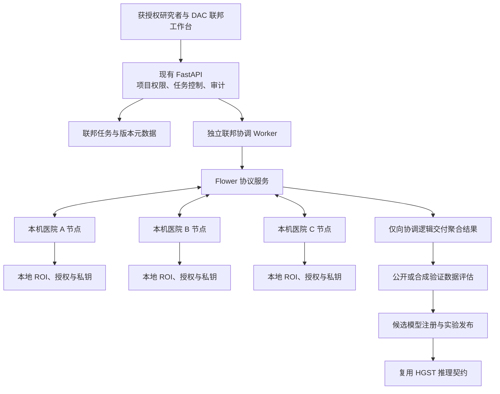

# HGST 联邦研究工程附录：最终计划配套版

日期：2026-10-13。版本：1.0。状态：工程设计，尚未实施业务代码。

权威总计划：[项目升级最终计划](C:/Users/Lenovo/Desktop/ADHD-AB协作版/docs/项目升级最终计划-2026-10-13.md)；执行入口：[W11联邦研究工作包](C:/Users/Lenovo/Desktop/ADHD-AB协作版/docs/项目升级实施工作包-2026-10-13.md)。

本版承接旧工程附录的完整四模块设计，并修正模型输入、同意权威来源、对象加密、用途许可、事务和交付位置。附录中的F00—F07是联邦局部工作包，不是总阶段编号：F00准入检查纳入总P0/W09或W11启动前检查；F01—F06属于总P2B/W11；F07属于总P3/W12。

小程序是业务主端，医生小程序覆盖日常临床业务并读取已生成的影像分析报告；网页提供原始影像和研究管理工作台。研究/DAC权限单独授予，不能用普通医生身份进入训练控制。联邦研究不替代统一Agent，安装不自动训练。

本文件为工程设计附录。旧背景材料见[隐私保护与联邦研究设计方案](C:/Users/Lenovo/Desktop/ADHD-AB协作版/docs/隐私保护与联邦研究设计方案-2026-10-12.md)，其中说明普通业务安全与文章方法的关系、安装不自动训练、文章 S1—S5 的采用程度及差异；本版规范以最终总计划为准。联邦任务仅在研究操作中启动；日常模型先登记来源与用途，未通过准入的辅助输出关闭。当前路线是参考文章流程的工程实现，不等同于复现原文全部原创密码算法。

用户已选定第一版目标：**先在本机完成四块能力的完整闭环，再支持医院独立部署。**

## 1. 可行性与交付目标

工程上可行，当前项目已有 ROI 输入、超图模型、分类训练、权重包、业务账号和 DAC 审计等基础。新增医院节点、联邦协调、更新保护和管理页面，可形成可运行的联邦训练子系统。

第一版完整覆盖四块能力，采用三个独立本机节点进程和一个协调服务，以合成 ROI 数据完成真实的训练、保护更新、聚合、版本生成和实验推理。节点不是三个界面标签，也不能只在服务器内把三个数组求和后宣称完成联邦训练。

初始训练范围为：**固定 HGST 编码器，联邦训练当前结构的 MLP 分类器。** 四块能力全部交付，但第一版不承诺整个 HGST 自监督编码器也参与联邦反向更新。这个选择与当前部署包构建时“编码器提取特征、训练分类器”的流程一致。端到端编码器训练列为扩展阶段，需要另行验证 DHG 运算、BatchNorm 与逐患者梯度的兼容性。

可行性有三个不同的验收层次：

| 层次 | 本方案承诺的目标 | 不能混同的结论 |
|---|---|---|
| 本机原型 | 四块能力真实联动，可重启、可测试、能产出候选模型 | 不代表已存在多家真实医院，也不提供同机管理员之间的物理隔离 |
| 独立医院部署 | 使用同一节点协议，把数据和私钥放到各院服务器 | 需要实际部署、节点身份、授权和运行环境验收 |
| 隐私与模型效果 | 使用有明确机制和预算的保护方案，记录模型评价 | 不预先承诺临床准确率、完整系统抗量子或文章方案已被证明 |

前轮（2026-10-12）只读资源检查记录：约 31.8 GiB 物理内存、32 个逻辑处理器，检查时可用内存约 20.2 GiB，C 盘剩余约 98.3 GiB。具备小规模 CPU 原型的资源基础；这些值不是本轮资源测量或训练速度测试，实施前重新测量。

## 2. 技术路线选择

| 路线 | 特点 | 判断 |
|---|---|---|
| A：固定 HGST 编码器＋联邦分类训练＋成熟安全聚合＋DP 训练 | 与现有推理结构契合，模型输入和部署包可复用；四块能完整落地 | **推荐第一版** |
| B：完整 HGST 编码器与分类器共同联邦训练 | 更新更多层，研究空间更大；需处理自监督损失、超图算子和 BatchNorm，计算验证成本更高 | 在 A 验收后扩展 |
| C：研究文章中的舍入格掩码与门限协议 | 更接近原文创新，但缩放、模数、误差分布与门限细节尚缺定义和证明 | 单独实验适配器，不能作为第一版默认保护机制 |

选择 A 不要求放弃文章的整体框架：仍然保留本地训练、裁剪、量化、保护上传、协作聚合、全局更新五个步骤。密码实现先使用有公开协议及维护实现的路线。

## 3. 总体架构与数据流



把控制消息与训练数据通信分开：业务 API 处理项目、权限、状态、预算摘要和版本；模型下发、密钥份额及受保护更新走联邦协议服务。不能让普通业务接口顺便接收单个节点的明文梯度。

本机 A／B／C 使用不同数据根目录、节点身份和本地密钥目录；真实部署时把同一节点程序及其本地目录移到院内。中央保留项目、轮次、经过约束的预算收据和模型版本，不上传 ROI 原件、患者标签、单患者嵌入或患者名单。

首版仅使用隔离的合成数据；原业务库和患者上传目录不作为默认训练数据源。

## 4. 模块一：医院训练节点

### 4.1 职责与接口

节点负责注册、心跳、接受签名的轮次清单、检查本地授权、读取本地 ROI、提取特征、训练分类器、参加安全聚合、保存隐私账本以及清理中间资料。

节点配置包含机构代码、协调服务地址、项目准入、本地数据根、独立密钥根、特征提取解释器和联邦训练解释器。配置不包含中央数据库口令，也不使用现有患者安全材料充当医院私钥。

用户看到的状态为“待批准、就绪、训练中、离线、已撤销、故障”。被撤销的节点不能接新任务；未完成轮次按终止流程处理。

### 4.2 本地训练流程

1. 校验项目、轮次、节点名单、基础模型摘要和参数结构。
2. 读取本地授权快照，过滤过期或撤回记录；校验每患者仅一份选定训练记录的初始数据契约。
3. 按实际基础编码器绑定的输入契约解析ROI，使用冻结的图谱/ROI顺序、相关估计器、标准化和Lasso参数生成超图；编码器固定权重并处于`eval`模式。研究的Nilearn估计器与部署的`np.corrcoef`目前不等价，必须完成黄金输入对照后才能启用对应模型。
4. 嵌入留在医院节点内部，传给独立训练进程；不经过中央服务。
5. 在 MLP 分类器上执行逐患者梯度裁剪和噪声训练，记录实际逻辑优化步数与累计隐私损失；物理微批次不单独算作一次完整 DP 步。
6. 计算相对基础分类器的更新量，经有界映射、量化后参加安全聚合。
7. 提交签名状态及预算收据，释放内存；必要的本地检查点和账本加密存储。

患者在同一医院有多次扫描时，首版以预先规定的选择规则只纳入一份，禁止把一次扫描当成一个独立患者计算预算。完整的多扫描患者级训练需要后续分组机制。

### 4.3 环境兼容

原设计的HGST目标依赖为Python 3.10、Torch 1.13.1、DHG 0.9.5；实施时登记实际可运行解释器、依赖与模型摘要，不把文本版本当成环境验证。业务环境有独立NumPy和cryptography约束，新联邦与隐私库不安装进这两个原环境。

采用三种运行职责：现有业务环境负责 API；现有 HGST 环境负责本地特征和最终推理；新 Python 3.11 环境负责联邦协议及现代 PyTorch 分类器 DP 训练。跨环境使用带结构验证的数值数组及本地受限 IPC，不能执行网络传入的 Python 对象。

原设计参考当时Flower/Opacus主线依赖元数据选择环境隔离；这些元数据不是本轮安装结果或固定发布版本。隔离策略保留，实际Python/Torch/cryptography要求通过选定发行版解析确认。实施时必须以发布版的依赖解析和锁定文件为准，不能把主线版本当成已安装、已验证的发布版。[Flower 依赖声明](https://raw.githubusercontent.com/adap/flower/main/framework/pyproject.toml)、[Opacus 依赖声明](https://raw.githubusercontent.com/meta-pytorch/opacus/main/requirements.txt)

第一次实施先在独立环境完成“Flower 示例＋DP 分类器＋旧环境数值数组交换”的兼容性检查。通过后锁定精确版本、依赖摘要与启动方式；失败不得升级原 HGST 环境来掩盖问题。

## 5. 模块二：联邦训练协调

### 5.1 项目与实验

项目绑定负责人、机构成员、节点白名单、数据契约、授权用途和允许的模型来源。实验绑定具体基础模型、节点清单、训练轮数、隐私配置、安全聚合配置和评估数据来源。

节点清单和保护配置在一次实验开始后不可原地改变；修改配置创建新实验并继续累计相关数据的隐私消耗。

首版采用三个节点的等权聚合，每个协议权重固定为 1。该值表示机构权重，不伪称实际样本量，中央界面不显示其为“患者人数”。这样避免把私有样本数量用作动态权重而形成额外公开信息。按样本量加权作为后续策略，需先定义计数的公开授权或保护机制。

各节点返回相对共同基础权重的分类器更新 Δθ；SecAgg+ 得到其等权平均后，协调策略执行 `θ_next = θ_base + mean(Δθ)`。策略适配器不得把更新量误当完整下一轮权重。第一轮分类器采用公开种子的新初始化；现有已训练分类器只用于独立对照，不作为可证明 DP 训练的私有初始状态。已有编码器仍按其真实来源状态登记。

### 5.2 任务状态

实验状态：`draft → preflight → ready → running → validating → completed`，异常进入 `failed`，停止请求进入 `stopping → cancelled`，预算不足进入 `budget_exhausted`。

轮次状态：`created → roster_locked → key_exchange → local_training → masked_collect → unmask → aggregate_committed`；任意阶段可进入 `aborted`。

只有聚合结果完整性、结构和预算校验都通过，才能提交新的全局模型。轮次失败保留上一轮已提交模型，不能把半个聚合结果标记为成功。

首版同一时间运行一个实验，节点计算使用一个重型训练槽位，避免三个节点同时创建大批逐样本梯度。各节点仍是独立进程，协议参与保持完整。

### 5.3 持久化与失败处理

使用数据库任务记录和独立 Worker，业务 HTTP 请求不阻塞到训练结束。Worker 以租约和状态版本领取任务，防止重复执行。

轮次与节点消息有唯一的实验、轮次、尝试和消息编号。幂等重发不能提交两次更新。模型结构、基础模型摘要、节点签名或轮次不匹配直接拒绝。

协调服务重启后从最近已提交模型恢复；未完成的密钥交换会话直接终止，新尝试生成新协议材料。不能只恢复模型而清空隐私账本。

初始三节点模式要求三个节点全部完成；任一掉线或超过轮次期限时终止该轮，**不退化为单节点明文更新**。四节点、三节点完成的掉线恢复作为独立部署验收用例，依据所选协议的安全条件配置，不能只降低一个人数开关。

## 6. 模块三：训练更新保护

### 6.1 保护路径

```text
逐患者梯度 → 范数裁剪 → 校准噪声及本地优化
→ DP 训练得到的分类器更新 → 有界映射与整数化
→ SecAgg+ 保护上传 → 整体更新恢复 → 全局分类器更新
```

第一版使用 Flower 的 SecAgg+ 协议工作流及客户端模块，采用官方实现处理掩码、份额和聚合，不自行补写文章未定义的格门限协议。首版安全目标是隐藏各节点的单独更新，允许协调服务看到约定聚合结果；节点诚实执行协议，协调服务在约定流程内好奇观察。恶意节点强行违反训练规则、完全控制节点的同机管理员及任意串谋不在这个原型保证内。[Flower 安全聚合说明](https://flower.ai/docs/framework/explanation-ref-secure-aggregation-protocols.html)

### 6.2 差分隐私的范围

首版实现的是逐患者分类训练的隐私机制和账本，不把“裁剪一次医院总梯度”解释成已完成患者级保护。

固定编码器在本地按单患者计算嵌入，分类器使用 Opacus 支持的逐样本梯度和隐私优化器。编码器不参加 DP 训练，且固定在 `eval` 模式；分类器没有 BatchNorm。完整编码器联合训练须另行验证，不能简单把隐私优化器包在旧模型外。[Opacus 模块兼容说明](https://opacus.ai/tutorials/guide_to_module_validator)

**完整发布模型的保证还受编码器来源约束。** 初始合成演示允许使用现有编码器，但必须记录其来源未独立验证。其分类训练预算不能证明该编码器曾经使用的患者资料也已获得保护。只有编码器来源满足目标数据范围的公开、独立或已有 DP 训练条件，才允许声明相应的完整流程保护范围。

界面必须同时显示“保护机制、保护对象、账本预算、编码器来源状态、随机源状态、研究／部署模式”，不能只有一个绿色“安全”标识。

### 6.3 参数与采样契约

隐私配置包含保护单位、相邻关系、范数阈值 C、噪声倍率、Poisson 抽样率、实际步数、累计 ε、累计 δ、账本算法和预算上限。

为避免真实患者数量本身或抽样率随人数改变而形成未核算公开信息，首版设计公开的每节点容量和固定抽样率：不超过容量的患者各占一槽，空槽采用零损失占位；单患者加入或移除对应实样本与占位槽的替换。梯度求和使用公开的期望批量归一化。该适配器必须经过逐样本梯度、空槽、空批量和预算机制检查，再进入受保护模式；不能直接沿用任意数据加载器的真实人数归一化。

合成演示预设：每节点容量 64、固定抽样率 1/8、每轮 2 个优化步、最多 5 轮、SGD 无动量；每患者梯度裁剪初始 C=1。实验预算输入 ε 上限 10、δ 上限 10^-5，仅作为原型参数。开始前通过账本预检选择满足整体预算的噪声倍率，最低演示噪声倍率为 2；无法满足时拒绝开始或减少计划轮数，不能修改显示数值让它通过。

跨医院是否存在同一患者的重复参与尚未证明时，按顺序组合保守累计各节点 RDP 消耗，再在给定整体 δ 下换算 ε；不能无依据使用“医院数据互不重叠”的并行组合。ε=10 不是通用安全标准，真实试点需针对目标和效用重新评估。[NIST 差分隐私评估指南](https://csrc.nist.gov/pubs/sp/800/226/final)

### 6.4 预算不能在失败后重置

账本按节点的持久保护命名空间和数据范围保存，事件再关联项目；不能只用项目 ID 作为重置边界。节点保留患者在院内的稳定标识和跨项目参与记录，中央不接收这些患者标识。无法证明两个数据范围无重叠时保守组合，新建项目、新建实验、改目录或改数据版本都不能清零同一患者范围的消耗。节点开始训练前预留消耗，训练开始后按实际或保守上界扣账，再传更新。失败、掉线、未知是否已发送、撤回或重试，不自动退还已消耗或无法确认的额度。

节点本地账本和中央预算收据都要持久化。恢复模型、重启 Worker、变更任务编号都不能绕过预算。签名收据证明是谁报告了预算，并不能证明恶意节点实际执行了正确的 DP 算法；首版依赖已批准节点诚实运行。

DP 噪声及协议密钥不得使用公开可复现种子。合成数据生成可以使用固定种子，隐私与密钥随机性分开。真实保护模式要求密码学安全随机源及兼容性验证；Windows 原型若只能运行普通随机源，显示“研究模式”，禁止据此开放真实患者训练。Opacus 的 `secure_mode=True` 需要额外安全随机组件，不能把普通模式视为同等保证。[Opacus 隐私引擎文档](https://opacus.ai/api/privacy_engine.html)

### 6.5 量化与聚合契约

先形成 DP 更新，再做有界映射、量化和编码；这是对受保护输出的后处理，但可能损失模型效用，需要测量。整数化只应用一次缩放，负值按既定编码恢复。

冻结分类器参数顺序、名称、形状、类型与摘要，只传四个 MLP 权重／偏置数组的更新；不传优化器、编码器 BatchNorm 缓冲区或任意 Python 序列化对象。网络数值包禁止 object 数组和 pickle。

SecAgg+ 的重建门限、份额数、有界范围、量化范围、模数范围和参与数量由锁定版本协议验证。三节点演示以完整参与和三份重建条件为基线；安全聚合的重建门限与业务最低参与人数分别校验。每轮及新尝试使用新协议材料，不能跨块、跨轮复用掩码。

验收包含纯数值聚合与协议聚合对比、零／负值、最大范围、长度错误、溢出边界、消息重放、掉线和不足人数拒绝。误差容许界由所选版本的量化精度推导，写入实验清单；不通过时不能生成成功版本。

### 6.6 评估数据也有隐私边界

首版使用合成／明确公开的验证与测试数据，并用固定轮数完成基础对照；最终测试集不参与选模型。若真实试点使用私有验证集，需要另行保护输出指标及模型选择过程并计入预算；训练保护不能自动覆盖额外公开的损失、准确率、患者人数或其他统计。

本地逐患者损失、嵌入、梯度和裁剪统计不写中央日志。全局模型验证指标、模型摘要和协议阶段状态可按已定义范围展示。

## 7. 模块四：获授权研究者／DAC 管理页面

新增“联邦训练”入口，复用医生网页的视觉与登录体系。日常患者评估、追踪、消息和影像操作继续使用现有入口。

| 页面区块 | 普通项目研究者 | DAC／机构管理员 |
|---|---|---|
| 研究项目 | 查看参与项目、创建本人项目、提交实验 | 批准项目、配置成员与节点范围 |
| 节点管理 | 查看项目内节点在线状态与兼容性 | 批准／撤销节点、更新公钥和机构信息 |
| 训练实验 | 配置合成演示、预检、启动／停止本人项目实验 | 查看批准范围内实验和保护策略 |
| 轮次详情 | 查看轮次阶段、节点完成状态、整体验证指标和失败原因 | 查看协议及权限事件，不查看单个明文更新 |
| 隐私与审计 | 查看用途授权、保护范围及预算消耗 | 审查授权、预算与认证日志状态 |
| 模型版本 | 查看候选、比较公开验证结果、实验推理 | 批准实验发布或符合真实部署条件的版本激活 |

患者侧在网页及小程序隐私设置中增加项目授权、用途、到期和撤回入口；医院外部患者的授权由医院本地登记系统管理，节点保存证明，中央只接收版本化授权状态收据。注册时的一个同意布尔值不足以代表参与所有研究。

首版完整训练控制在单独授予研究/DAC角色的网页工作台实现；普通医生的小程序日常业务完整性按总计划另行验收，不能把研究控制权限自动授予医生。患者小程序和网页提供实际的具体研究授权与撤回操作。

所有按钮有服务端权限与状态约束：重复启动返回原任务；预算不足不能开始；停止等待安全终止；候选未验证不能发布。隐藏按钮不代替服务端授权。

## 8. 一个完整操作示例

1. DAC 创建合成研究项目、批准三个本机节点，项目研究者进入工作台。
2. 节点运行本地兼容检查，确认相同编码器摘要、分类器结构、数据契约和协议版本。
3. 研究者选择“受保护的分类器联邦训练”，使用演示数据预设并执行预检。
4. 系统检查节点数量、状态、权限、参数安全范围、预算和内存条件；生成冻结实验清单。
5. 三节点交换协议材料，分别从各自目录读取合成 ROI、提取本地特征，执行 DP 训练。
6. 各节点保护上传分类器更新；中央恢复整体更新，形成下一轮分类器。
7. 工作台显示轮次进度、预算、整体公开验证指标和失败事件。
8. 正常结束形成候选模型，经过结构、有限值、完整性和旧环境加载检查。
9. DAC 批准“实验发布”，使用合成输入在新页面预览 HGST 结果与模型版本。
10. 若测试节点掉线、消息篡改、预算用完或患者撤回，系统执行对应中止流程，保留已提交模型和预算证据。

合成训练模型只能在实验范围发布，不能激活到现有真实患者报告。界面和 API 都执行该规则。

## 9. 数据表与权限设计

新增独立联邦数据模型，不把训练轮次写成现有量表统计审计任务：

| 模型／表 | 核心内容 |
|---|---|
| `FederatedProject` | 项目、负责人、用途、模式、数据契约与审批状态 |
| `FederatedProjectMember` | 用户、机构、项目内操作权限 |
| `FederatedNode` | 机构代码、公钥指纹、兼容版本、心跳、准入／撤销状态 |
| `FederatedProjectNode` | 项目节点白名单及固定权重 |
| `FederatedExperiment` | 基础模型、冻结配置、节点清单、任务状态、状态版本和 Worker 租约 |
| `FederatedRound` | 轮次、基础模型摘要、协议尝试编号、阶段和聚合结果摘要 |
| `FederatedParticipation` | 节点参加状态、消息幂等键、签名收据和失败类型 |
| `FederatedPrivacyLedger` | 节点持久保护命名空间、数据范围、跨项目事件、已花费／保守预留、RDP 历史和配置摘要 |
| `ConsentRecord`／研究扩展 | 统一授权服务的项目/用途同意、版本、有效期和撤回；扩展只引用权威同意，不另存相冲突状态 |
| `FederatedConsentReceipt` | 外部院内授权状态的节点签名、版本与变更状态，不含患者名单 |
| `FederatedModelVersion` | 引用统一ModelVersion；保存联邦参数结构、来源、保护/预算/实验等扩展，无第二套激活指针 |
| `FederatedAuditEvent`、`FederatedAuditHead` | 独立联邦认证事件流及链头；关联原系统状态，不修改旧日志 |

私有配置、账本和收据采用绑定机构/对象/字段/schema/版本的认证封套，读取强制校验归属；旧仅列名AAD标legacy并按总计划迁移。中央不保存节点私钥。索引和关系标识仍按最小访问范围控制，不能声称增加这几张表就实现全库匿名。

患者只能访问自己的授权；研究者只能访问项目成员范围；DAC 只能管理获授权机构／项目范围；节点凭独立身份只接收自己的任务。节点身份与用户 JWT 分开。

## 10. API 与服务边界

业务 API 前缀为 `/api/v1/federated`，细节实现遵循现有 FastAPI 与 SQLAlchemy 模式。

| 接口 | 用途与限制 |
|---|---|
| `POST /projects`、`GET /projects` | 创建／查看当前用户范围内项目 |
| `POST /projects/{id}/approve` | DAC 审批，不可通过普通研究者身份调用 |
| `POST /nodes/enrollment`、`POST /nodes/{id}/approve` | 节点提交公钥登记，管理员批准；私钥不入请求 |
| `POST /nodes/{id}/revoke` | 撤销节点并终止相关未提交轮次 |
| `POST /projects/{id}/experiments` | 创建不可原地改安全配置的实验 |
| `POST /experiments/{id}/preflight` | 验证依赖、节点、保护范围、预算及数据契约 |
| `POST /experiments/{id}/start`、`POST /experiments/{id}/stop` | 幂等启动与安全停止；不在请求内训练 |
| `GET /experiments/{id}`、`GET /experiments/{id}/rounds` | 工作台状态与轮次查询 |
| `GET /projects/{id}/privacy`、`GET /projects/{id}/audit` | 授权范围内预算和事件摘要 |
| `GET /projects/{id}/models`、`POST /models/{id}/publish` | 候选与实验发布；合成版本不得作为真实部署模型 |
| `POST /models/{id}/preview` | 使用指定候选包做实验推理，仍执行上传大小与实验权限 |
| `POST /models/{id}/activate`、`POST /models/rollback` | 后续独立部署模式的审核激活与回滚；首版合成候选调用时拒绝 |
| `GET /projects/{id}/consent`、`POST /projects/{id}/consent`、`POST /projects/{id}/consent/withdraw` | 已注册患者真实持久化的项目授权和撤回 |

节点心跳与签名状态使用独立节点通道；模型与协议消息通过 Flower 运行时。普通 API 不提供“上传明文医院更新”的生产接口。明文聚合对照只能在测试／合成实验中启用，真实数据模式拒绝。

现有患者 10 MiB 时间序列上传限制继续用于患者推理。联邦通信单独设置消息大小、并发、期限和内存上限；协议消息先以 256 MiB 总体大小限制作为资源保护初值，再按锁定版本实测调整。控制 API 本身不接收这么大的模型消息。

## 11. 模型注册、实验发布与回滚

模型版本必须绑定基础编码器与分类器结构、输入契约、代码及依赖版本、训练协议、保护范围、预算摘要和评估数据来源。代码、权重、数据及用途许可在首次相关使用前核验；HGST科研/教育许可不能自动授权商业使用。来源未验证编码器仅在许可允许的合成/研究范围使用，不对真实患者输出临床辅助结果。

复用现有部署包字段，但新增联邦训练元数据；包由中央可信打包器根据已验证数值数组生成。不能从节点直接接收任意 `.pt` 并在 Torch 1.13 环境中加载。

当前 `build_hgst_deployment_bundle` 会自己训练分类器，因此不能直接调用它来包装联邦结果，否则会再做一次集中训练。应拆出纯“已给定编码器与分类器状态 → 验证并打包”的能力，原集中训练功能继续复用这层。

原 `hgst_adhd_bundle.pt` 保留；候选存放在新版本目录。实验预览传入服务端登记的候选路径，不通过修改全局 settings 来临时切换模型。

正式激活采用数据库版本指针与摘要校验：先验证所有推理实例可加载候选，再原子更新指针；失败保留已激活版本。回滚恢复已登记旧版本，不能把权限、授权或隐私账本一起回滚清零。已有患者结果保留其产生时的模型版本。

## 12. 现有安全基础的必要修补

这些工作直接服务于新训练模块；总计划P0/P1的渲染、会话、提交、授权与撤回门禁仍须先完成，不扩大到无关界面重构：

- 为三个 AI 扩展患者查询补齐研究者绑定检查，避免新工作台继续沿用有缺口的访问模式。
- 将模拟同意检查改为真实持久化，并增加项目、用途、版本、到期与撤回；撤回影响后续本地计算及尚未提交的轮次/候选，节点在计算开始、更新发送和轮次提交前重核当前授权，必要时中止该轮，不能承诺抹掉已发布模型中的所有影响。
- 联邦事件使用认证写入与独立链头，避免通过未保护的扩展日志路径写入关键证据。
- 对真实库既有四处日志异常保留原始证据，单独诊断；不能删除／重签成“全部通过”。原型界面显示现有链异常状态，真实数据模式在问题处理证据及授权验收前锁定。
- 训练数据、单患者嵌入与单节点明文更新不接入外部 AI 上下文。其他现有 AI 外发行为继续按独立用途收敛与授权，不因完成联邦训练就宣称已保护所有外发路径。

新增联邦审计仍需要真实部署的独立留存／见证策略，才能加强整体快照回放防护。同一数据库中的认证链头不是外部不可变见证。

## 13. 分阶段实施与交付物

四块是同一闭环的组成部分，按依赖顺序分工作包实施。第一版总验收前四块缺一不可。

| 工作包 | 交付物 | 进入下一步的证据 |
|---|---|---|
| F00：基线与兼容 | 原有工作区保留；旧模型校验；独立环境依赖锁；协议／DP 示例；新环境与旧特征数组交换 | 旧推理仍可用；三类环境隔离；实例代码与数值契约实际跑通 |
| F01：权限、授权与项目 | 患者范围修补；持久同意；项目／成员／节点表；审批与撤销 API | 越权被拒；授权、过期、撤回测试通过；重复迁移无重复记录 |
| F02：医院节点 | 三独立进程、合成 ROI 目录、身份与本地账本、HGST 特征提取 | 进程真实独立；数据和嵌入未进入中央请求；来源摘要一致 |
| F03：协调闭环 | Worker、状态机、租约、轮次、实验合成明文对照、模型候选 | 多轮实际训练；重启、重复启动、超时和中止可验证；非演示数据不能走明文对照 |
| F04：更新保护 | DP 分类训练、采样适配器、SecAgg+、量化验证、预算预留与扣账 | 聚合误差有界；不足人数不释放；预算累计、失败及重启不重置；模式标识准确 |
| F05：工作台与版本 | 获授权研究者／DAC操作、患者同意入口、实验预览、可信打包与版本历史 | 从页面创建任务到新模型预览完整可操作；权限和失败反馈由后端执行 |
| F06：第一版总验收 | 一键启动／停止、隔离测试、四模块演示脚本、结果与资源报告、部署说明 | 合成闭环及全部失败场景通过，现有评估、影像、消息和旧模型无回归 |
| F07：独立医院部署 | 独立节点包、TLS 与节点身份、院内授权适配、安全随机源、数据来源与模型激活门禁 | 实际不同机器和独立管理环境验收；明确隐私范围与真实验证结果 |

不在没有性能数据时承诺固定工期。F00 后可以根据实际依赖、训练吞吐与验收工作量形成进度估算；F07 还依赖医院环境与数据授权。

## 14. 第一版验收清单

- 三个节点均从各自合成 ROI 目录读取数据，中央不出现原件、标签、单患者嵌入或单节点明文更新。
- 从网页创建项目、批准节点、预检、启动、查看轮次、停止、检查预算，到候选实验推理，操作完整。
- 同一初始状态下，无噪声合成数值对照与安全聚合的整体结果落在推导出的量化容许界内。
- 真实 DP 分类训练实际产生逐患者梯度裁剪和噪声；账本使用实际步数，没有硬编码 ε。
- 空槽、空批量、数据容量、患者去重、编码器来源、采样率和归一化与保护定义相符。
- 未授权用户、未批准节点、撤销节点、其他项目成员、过期轮次、结构错误和重放请求被拒绝。
- 一节点掉线时该轮终止；原全局版本保留；不存在自动明文降级。
- 预算不足、失败重试、Worker 重启、新建项目、新建实验、改数据目录和模型回滚均不能清零已消耗预算。
- 固定轮次和公开／合成验证集用于原型评价；未经保护的私有指标不上传。
- 候选包可在旧 HGST 环境加载和推理；合成版本只能实验发布，不能用于真实患者报告。
- 新的认证事件流可校验；旧日志异常和本机模拟标识在界面准确呈现。
- 完成现有后端、小程序和真实模型回归；Ubuntu、TLS 或独立医院尚未验收时明确记录范围。

## 15. 主要风险及对应处理

| 风险 | 处理方式 |
|---|---|
| 新库破坏现有 Torch／DHG／加密依赖 | 独立环境和数值数组契约，先做 F00，不改原依赖解决冲突 |
| 高维分类器通信与内存 | 初始 CPU 单重型槽位、逐样本物理批量 1、5 轮小实验；记录资源峰值再调整 |
| DP 噪声降低模型效果 | 明文合成、仅安全聚合、DP＋安全聚合分组对照；不预先承诺更高准确率 |
| 编码器来源未验证 | 明确标识保护范围，真实模型声明和部署前完成来源检查 |
| 恶意节点或服务器偏离协议 | 初始诚实节点与约定流程的威胁模型；真实试点加强签名清单、节点管理及独立协议审查，不把签名当成训练正确性证明 |
| 用户撤回后已形成模型 | 停止后续使用、记录影响范围；需要重新训练等后续处置时另建任务，账本不清零 |
| 模拟被误称真实多医院安全 | 全部页面、版本和报告标记本机模拟／实验；独立部署另设 F07 验收 |
| 文章原始密码公式仍不完整 | 原文研究适配器默认关闭；正式定义与证明、可复现实验齐全后单独集成 |

当前分类头约 1,180 万参数，单 float32 向量约 45 MiB；协议整数、份额和消息封装会增加开销。三个节点五轮的双向模型通信可能在GiB数量级，此为结构估计，必须实测具体协议实现。原型不是完整规模性能结论。

## 16. 具体文件与验证工作包边界

以下均为拟新增或拟修改路径，本轮不创建业务模块。

| 工作包 | 拟涉及路径与职责 |
|---|---|
| 数据与 API | `backend/app/models/federated.py`、`backend/app/schemas/federated.py`、`backend/app/api/routes/federated.py`；修改模型注册、API router 与数据库初始化 |
| 权限与同意 | `backend/app/services/consent_service.py`、`backend/app/services/federated/access.py`；针对扩展患者查询补范围检查 |
| 协调与事件 | `backend/app/services/federated/projects.py`、`experiments.py`、`rounds.py`、`audit.py`、`model_artifacts.py`；候选调用统一`backend/app/services/model_registry_service.py`，业务层负责状态和权限 |
| 独立运行时 | `federated_runtime/contracts.py`、`server_app.py`、`client_app.py`、`worker.py`、`privacy.py`、`training_head.py`、`node_agent.py`、`legacy_feature_bridge.py` |
| 旧模型兼容 | 复用 `backend/app/services/hgst_runtime/preprocessing.py`、`modeling.py`；在 `service.py` 提取纯打包并增加受控候选推理入口，原默认行为有回归验证 |
| 医生网页 | `doctor-web/federated_training.html`、`doctor-web/js/federated_training.js`、`doctor-web/css/federated.css`；更新 `js/api.js` 与医生／DAC 导航 |
| 患者授权 | 患者网页个人／隐私入口及 `miniprogram/pages/privacy-settings/`；共享真实项目授权 API |
| 配置与运行 | `requirements-federated.txt` 及锁定依赖、`tools/start-federated.ps1`、`tools/stop-federated.ps1`、`deploy/federated/` 节点与协调配置 |
| 单元与权限测试 | `backend/tests/test_federated_access.py`、`test_research_consent.py`、`test_federated_state.py`、`test_federated_privacy_ledger.py`、`test_federated_models.py` |
| 协议与整体验收 | `federated_runtime/tests/` 聚合、采样、预算、协议消息与跨环境契约；`tests/test_federated_e2e.py` 使用临时数据与三个进程 |

工作包测试先写可失败的权限、状态、协议及预算反例，再实现；只有针对新增行为的检查通过才进入下一包。不用镜像实现的空测试宣称密码安全。所有测试用临时库、临时节点密钥和合成数据，不对真实患者库制造数据。

启动脚本只管理本模块记录的进程与端口，隐藏后台窗口，检查实例身份；不能结束占用端口的其他程序。独立节点部署优先用真实机上的服务／容器配置，不依赖 Windows 本机路径。

## 17. 最终判断与当前交付状态

**这个想法可行：四块能力能一起加入当前项目，推荐按 A 路线完成本机闭环，再走独立医院试点。** 当前模型、输入和业务基础提供了明确接入位置；主要新增量是节点与状态协议、隐私账本、真实授权和版本发布。

不能把“本机三个进程能跑”“有加密”“ε 有显示”当作真实多院安全、完整模型 DP 或临床准确率的证明。文章的原创舍入方案作为单独研究分支，不妨碍先交付这四块工程能力。

本次交付为完整设计与可行性方案，已经按用户的研究模块本机首版选择确定路线；整个项目仍以小程序业务和统一Agent为主。未安装新依赖，未实施上述业务代码，未训练或覆盖现有模型，未变更原业务库。后续实施按总计划W11、本附录F00—F06和实际依赖预检结果展开逐文件编码步骤；独立医院另按W12/F07验收。


## 18. 本版补充的强制准入与验收

### 18.1 基础编码器与输入一致性（R03/R15）

登记基础编码器的实际训练入口、权重SHA-256、图谱、ROI顺序/筛选、时间序列条件、协方差估计器、标准化、Lasso/超图参数和依赖。黄金合成输入分别经过研究、节点特征桥、可信打包和部署，特征/超图/嵌入在预先冻结容差内一致。不能只对照最终shape；同名correlation但不同估计器拒绝兼容。

许可记录同时覆盖HGST代码、固定编码器、分类器起点、训练数据和预期用途。无许可或来源证据时不进入对应真实用途；普通日常业务可独立开放。参考[HGST许可](https://github.com/iMoonLab/HGST/blob/main/README.md#license)、[Nilearn输入估计器](https://nilearn.github.io/0.10.3/modules/generated/nilearn.connectome.ConnectivityMeasure.html)。

### 18.2 事件与在途撤回（R05/R12/R14）

控制API的任务状态、关键审计和启动/停止outbox同事务持久化。Worker以实验/轮次/尝试和消息ID幂等处理，外部队列故障可恢复。节点持久账本先预留再训练，协调结果只有完整结构、预算/授权和当前清单检查通过才能提交；跨节点状态采用显式协议收据与保守恢复，不能声称跨医院拥有一个数据库原子事务。

授权或节点撤销后停止新计算，未完成协议按aborted处理。已经消耗或无法判断是否暴露的预算按保守上界保留；新的尝试使用新协议材料。不得把API撤回成功解释成已经擦除所有已形成模型影响。

### 18.3 字段完整性与恢复（R13）

节点账本、收据和敏感配置密文绑定机构、对象、字段与版本；同列不同对象交换必须拒绝。合法旧密文迁移有来源和批次摘要，不追溯扩大保证。节点数据目录、账本与身份命名空间不得因新项目/换目录改变保护范围；真实部署账本/审计头需独立持久留存或见证，恢复旧备份时先复核累计消耗与撤回状态再接任务。

### 18.4 交付和主线衔接（R16/U01—U12）

本附录在docs根目录交付，检查未被Git忽略，并与总计划/工作包一起保存摘要与版本。原ignored路径设计仅作历史，不是本版唯一依赖。F00—F07只描述研究线，总P1已要求医生小程序日常业务完整、用户网页能查看数据和测试、Agent关键节点主动引导、撤回/版本兼容即时生效。

首版研究工作台不影响普通医生移动业务的完整性；具体研究同意/撤回在小程序和网页都可操作。Agent只解释获允许的公开项目状态和审核模型输出，不能获得ROI、标签、特征、梯度或单节点明文更新，不启动训练或激活模型。
