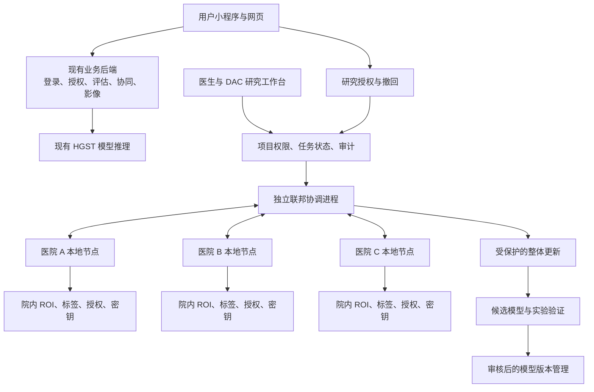

# ADHD 项目隐私保护与联邦研究设计方案

日期：2026-10-12。状态：设计交付，业务代码尚未实施。

**推荐方案：完善现有系统的业务安全，同时增加医院节点、训练协调、更新保护、管理工作台四块联邦能力。先在本机完成真实的模拟医院闭环，再支持医院独立部署。**

这份设计回答三个问题：怎样真正用上《一种隐私保护联邦学习方法》的内容；怎样接入当前项目；怎样让安装、日常使用与科研训练分别具有明确的操作入口。

## 1. 项目完成后是什么样

项目具有两种使用方式，共用账号、授权和模型版本管理。

| 使用方式 | 用户实际操作 | 是否需要训练 |
|---|---|---|
| 日常业务 | 注册登录、量表、认知测试、记录、医生协同、影像分析与现有模型推理 | 不需要，继续使用已登记的现有模型 |
| 联邦研究 | 建研究项目、批准医院、检查条件、启动训练、查看结果与候选模型 | 启动研究任务时才训练，各医院在自己的节点计算 |

开发接入和部署以后，可以先使用日常业务，再按需开启研究任务。安装模块不会自动开始训练，也不会自动把已有患者资料纳入研究。

第一版交付四块完整能力，而不是四个静态页面：三个医院节点进程从各自目录取数据，执行本地训练和受保护上传；协调进程形成新的候选模型；工作台能完成启动、停止、查看和实验推理。

本机演示使用合成数据。它证明工程流程跑通，不代表已经接入真实医院，也不能用来证明临床准确率。

## 2. 到底使用了文章哪些内容

| 文章环节 | 本项目采用的设计 | 采用程度与差异 |
|---|---|---|
| S1：院内处理 ROI、超图建模、本地训练与裁剪 | 每院读取本地 ROI，复用 HGST 特征提取，在分类器训练中做逐患者梯度裁剪 | 采用本地计算和裁剪思路；第一版固定编码器，保留现有 Lasso 超图，未复现原文的 kNN 构图和全模型训练 |
| S2：把更新转换为可聚合的整数表示 | 统一参数结构、数值范围和量化方式，检查负值、精度与溢出 | 采用数值编码目的；使用所选安全聚合协议的数组编码，不宣称复现原文的多项式环映射 |
| S3：本地保护更新再上传 | 独立节点身份及本地密钥，使用安全聚合协议保护单独更新 | 采用保护上传的目标；第一版使用 SecAgg+，原文舍入格掩码另列研究扩展 |
| S4：聚合并保护隐私 | 安全聚合配合显式差分隐私训练，记录并限制多轮隐私消耗 | 采用协作聚合和隐私保护目标；不把舍入误差或参与人数直接视为已证明的差分隐私 |
| S5：恢复整体结果、更新模型、重复训练 | 协调端取得整体更新，生成下一轮模型及候选版本 | 采用迭代流程；首版聚合本地优化后的分类器更新，属于联邦平均类适配，不与原文逐轮聚合原始梯度完全相同 |

登录、权限、数据库加密、上传保护和业务审计属于现有系统的业务安全层。它们服务于新模块，但本身不能被说成已经实现了这篇文章。

对外准确表述为：**参考文章的隐私保护联邦学习流程，结合现有 HGST，采用安全聚合与可核算的差分隐私实现工程接入。**

原文存在重复量化缩放、全局掩码定义、模数与舍入步长、门限协议及隐私证明等尚需澄清之处。因此，第一版不宣称完整复现其原创密码算法，也不宣称整个系统具备抗量子安全。具体推导见[项目适配评估](项目全貌与联邦隐私方案适配评估-2026-10-12.md)。

## 3. 三种路线与推荐选择

| 路线 | 得到的能力 | 工作与限制 | 选择 |
|---|---|---|---|
| 固定 HGST 编码器，联邦训练分类器 | 四块工程能力齐全，可生成兼容现有推理的候选模型 | 要新增节点、协议、隐私账本与工作台；编码器不参与联邦更新 | **第一版采用** |
| 编码器与分类器共同联邦训练 | 更接近文章的全模型训练范围 | 需进一步处理超图算子、自监督损失、BatchNorm 与患者级隐私训练的兼容性 | 四块闭环验收后扩展 |
| 直接复现原文格密码舍入方案 | 研究原文的算法创新 | 需先补全协议、参数、安全与隐私分析，再做可复现实验 | 独立研究扩展，不作为默认保护机制 |

“四块都加入”指医院节点、协调、更新保护和管理能力全部加入；不等于第一版同时完成以上三条技术路线。

## 4. 总体结构

业务后端管账号、项目、授权、状态和版本；训练及安全聚合使用独立进程。请求“开始训练”后立即返回任务编号，页面持续查询状态，不让网页等待整个训练完成。

原始影像、ROI、患者标签、患者名单和单患者特征留在医院节点。协调端接收受保护更新、协议消息、状态收据以及约定可公开的评价结果。中央能看到约定的聚合结果，安全聚合并非让中央看不到一切信息。[Flower 安全聚合说明](https://flower.ai/docs/framework/explanation-ref-secure-aggregation-protocols.html)

三个本机节点有不同目录、身份和密钥，但同机管理员仍能控制这台电脑；实际医院之间的管理隔离在独立部署阶段验收。

## 5. 现有业务安全层怎样补齐

这部分与联邦模块共同交付，但按独立用途控制。

| 工作 | 当前接入位置 | 设计结果 |
|---|---|---|
| 数据访问范围 | 后端角色、医患绑定、AI 扩展接口 | 研究者访问患者资料时执行绑定或明确授权检查；联邦研究再执行项目成员及节点范围检查 |
| 真实授权 | 注册同意与现有隐私设置 | 同意有用途、版本、时间、有效期与撤回记录；注册同意、医患共享、AI 外发和联邦研究授权分别核验 |
| 存储与节点密钥 | 现有 AES-GCM 加密、上传目录与密钥管理 | 复用加密封装；新增节点私钥与本地账本独立保管；持久化特征缓存需加密并设置清理策略 |
| 审计 | 现有业务安全日志与新增联邦事件 | 联邦关键事件经认证写入；已有异常留证诊断，显示实际状态；独立部署增加院内外分别留存的证据 |
| AI 外发控制 | 现有 AI 上下文构建与调用 | 使用字段白名单和单独用途授权；训练资料、患者特征及单节点明文更新不进入外部 AI 上下文 |
| 上传与通信 | 现有受限影像上传、节点协议通信 | 患者影像接口继续按原输入限制；联邦通道单独校验身份、版本、尺寸、期限和消息结构 |

本轮代码核对仍显示三处 AI 扩展查询只有患者自查分支，未补研究者绑定分支；现有增强安全服务的同意检查还返回模拟同意。这两类问题列为接入前的修补项，不沿用为联邦研究授权依据。

儿童用户由监护人管理时，授权记录保存实际授权人及依据，兼容工作区现有儿童账号设计，不另外建立一套家长注册体系。未核实权限与研究适用条件的儿童资料不进入真实训练。

## 6. 四块联邦能力的完整设计

### 6.1 医院节点：负责院内计算

节点支持登记、管理员批准、心跳、兼容检查、接任务、本地训练、保护上传、停止与撤销。界面显示“待批准、就绪、训练中、离线、已撤销、故障”。

一次任务的节点操作：

1. 验证签名的项目与轮次清单，核对基础模型、参数结构、参加医院和保护配置。
2. 检查院内研究授权，排除已过期或撤回记录。
3. 校验 ROI 维度、长度、质量和标签；固定 HGST 编码器，在院内提取特征。
4. 使用逐患者裁剪和噪声训练分类器，保存实际隐私消耗。
5. 形成相对本轮基础模型的更新，经量化后参加安全聚合。
6. 返回状态与预算收据，清理中间资料。

第一版直接使用已预处理的 ROI 时间序列。原始 NIfTI 的运动校正、配准及脑区提取不是当前模型输入解析自动提供的能力；真实医院按冻结的数据契约提供 ROI，完整影像预处理流水线另行扩展。

同一患者有多次扫描时，首版按预先指定规则选一份训练记录，避免把扫描次数当成独立患者数量。院内身份用于去重，不上传中央。

### 6.2 训练协调：负责项目与轮次

项目绑定负责人、机构、成员、研究用途、节点白名单和数据契约。实验绑定基础模型、参加节点、轮数、训练设置、隐私目标和评价数据来源。

实验开始后冻结清单；更改配置需新建实验，并沿用相关数据范围已发生的隐私消耗。任务状态依次为“草稿、检查中、待运行、运行中、验证中、完成”；异常或操作终止分别显示“失败、停止中、已停止、预算不足”。

首版三个节点固定等权，权重代表机构参与份额，不显示为患者人数。节点计算分类器更新，协调端在共同基础模型上加上平均更新，不能把更新误认为完整模型权重。

使用数据库任务记录和独立 Worker，持久化任务租约、轮次、尝试编号、消息幂等键与已提交模型。重复点击开始返回同一任务；协调进程重启保留已完成轮次，未完成协议会话终止后重新建立。

三个节点都完成才能提交本轮。一个节点掉线时终止本轮，保留上一轮模型；不自动改为明文上传或单节点继续。更多节点及掉线恢复在独立部署阶段按协议条件验收。

### 6.3 更新保护：负责训练过程的隐私边界

默认路径：**逐患者梯度裁剪 → 校准噪声与本地优化 → 有界更新与量化 → SecAgg+ → 整体更新 → 下一轮模型。**

安全聚合保护医院的单独更新；差分隐私用于限制约定患者资料对训练输出的影响。两者各自承担职责，不能用“数据没上传”或“有加密”代替患者级隐私分析。

采用 Flower 的公开安全聚合工作流和 Opacus 的隐私训练组件。保护配置、实际步数与累计预算由真实机制计算，界面不硬编码一个“安全分数”。Opacus 提供逐样本梯度、裁剪、噪声和隐私预算工具；安全随机模式需要额外随机组件及运行环境验证。[Opacus 隐私引擎](https://opacus.ai/api/privacy_engine.html)

首版保护范围为分类器训练。固定编码器不参与隐私训练，必须记录其来源；若来源不能证明满足目标资料的保护条件，不能将分类器预算描述为整个 HGST 历史训练都获得了保护。

预算账本按稳定数据范围记录跨实验、跨项目的消耗。重新建项目、换目录、重启、失败重试或回滚模型不清零。开始前预留额度，已执行训练或无法确认是否释放的信息按实际或保守上界扣账。不同医院可能存在同一患者时，按保守组合处理。

每轮使用新协议材料；校验参数顺序、尺寸、基础模型摘要、负值恢复、量化精度、范围溢出和消息重放。网络不传可执行的 Python 序列化对象或任意节点权重包。

本机合成演示可使用研究模式随机源并显著标注。真实数据任务需通过安全随机源和环境验证。首版只公开合成或公开评价集的指标；私有验证指标和模型选择也需定义保护及预算。[NIST 差分隐私评估指南](https://csrc.nist.gov/pubs/sp/800/226/final)

### 6.4 管理工作台：负责实际操作

研究控制工作台设在医生／DAC 网页中，适合配置训练与查看版本；用户授权和撤回在小程序与用户网页中都能操作，后台共享同一记录。医生日常医患协同仍沿用原入口。

| 工作台区块 | 可完成的操作 | 关键限制 |
|---|---|---|
| 研究项目 | 新建、查看、提交审批、管理项目成员 | 只访问本人获授权项目 |
| 医院节点 | 登记、检查在线状态、批准、撤销 | 普通账号不能批准机构节点 |
| 训练实验 | 选择基础模型、检查条件、启动、停止 | 开始前冻结配置，预算不足拒绝启动 |
| 轮次进度 | 查看阶段、完成状态与失败原因 | 不展示单患者资料或单医院明文更新 |
| 授权与隐私 | 查看用途、授权状态、累计消耗和保护范围 | 撤回和过期实时影响后续计算 |
| 模型版本 | 查看候选、比较结果、实验推理、申请发布 | 合成模型只能进入实验区 |
| 安全记录 | 查看项目、节点、任务及版本事件 | 记录失败和异常，不能只展示成功事件 |

后台权限决定操作是否允许，不能依靠隐藏按钮。状态和失败原因用可理解的语言呈现，例如“医院 B 离线，本轮已停止”“研究额度不足，任务未启动”。

## 7. 一个可操作的完整流程

1. 管理员建立“本机联邦演示项目”，批准 A、B、C 三个独立节点。
2. 各节点检查环境、模型和数据契约，从自己的隔离目录读取合成 ROI。
3. 研究者在工作台创建实验，选择固定编码器的联邦分类训练，点击“检查条件”。
4. 检查通过后点击“开始”；页面显示任务编号、各节点状态、轮次和预算。
5. 节点在本地训练并保护上传，协调端形成下一轮分类器，重复至设定轮数。
6. 任务结束后生成候选模型，用独立的合成或公开评价数据检查结果。
7. 管理员批准实验发布，研究者用合成输入预览候选模型输出及版本信息。
8. 在专门的失败验收中关闭一个节点，确认该轮终止、旧版本保留、消耗记录仍在。

真实医院试点增加院内授权核验、独立服务器身份与 TLS、数据来源检查、安全随机源和真实效果验证；完成这些条件后，才允许审核正式模型激活。

## 8. 模型怎样接入现有系统

现有默认模型继续服务于日常推理。联邦任务生成候选版本，先在独立实验入口使用。

每个候选记录输入契约、编码器与分类器结构、基础版本、代码与依赖版本、训练来源、保护范围、预算摘要和评价资料来源。已有结果保留生成时的模型版本。

当前打包函数会自行训练分类器，因此开发时要提取纯打包能力：根据已验证的编码器和联邦分类器状态生成部署包，不在打包时再集中训练一次。

候选由中央可信打包器生成；不直接加载医院发送的任意 `.pt` 文件。发布前验证完整性、参数结构、有限数值、旧 HGST 环境加载和实际推理。

正式激活通过受控版本指针切换，提前检查所有推理实例能加载；失败保持旧版本。回滚恢复旧模型，不回滚授权与隐私消耗。合成训练版本在界面和 API 中均禁止激活为真实患者报告模型。

## 9. 接入当前工程的位置

| 现有基础 | 复用或修改 | 新增部分 |
|---|---|---|
| FastAPI、SQLAlchemy、角色与 DAC | 共用账号、服务组织与数据库迁移；补权限缺口 | 联邦项目、节点、实验、轮次、版本 API |
| HGST ROI 解析、超图和推理 | 固定编码器特征提取、旧环境推理、纯模型打包 | 新分类器训练与数值数组契约 |
| AES-GCM、上传与审计 | 共用加密封装和限制原则 | 节点密钥、本地账本、联邦认证事件 |
| 医生／DAC 网页 | 增加项目权限内的联邦入口 | 研究工作台与候选实验区 |
| 小程序及用户网页隐私设置 | 共用授权查询、同意、撤回 | 项目用途和授权历史展示 |

运行环境隔离为三类职责：业务后端；已有 HGST 特征提取与推理；新联邦及隐私训练环境。先在新环境验证发布版依赖，再锁定精确版本，不通过升级现有 Torch、DHG 或加密依赖来解决冲突。

控制 API 使用 `/api/v1/federated`。节点模型与协议消息走独立联邦运行时，普通患者上传接口不接收医院梯度。通信消息大小、内存、并发和期限单独设置并实测。

核心数据对象为研究项目及成员、节点及项目准入、实验、轮次、参与收据、隐私账本、真实研究授权、院内授权收据、模型版本和认证事件。院内授权收据不包含患者名单；稳定患者标识和本地私钥不存中央库。业务授权采用统一服务，避免与其他项目升级重复建立互不一致的同意状态。

详细表、API、状态机、演示参数、拟修改文件和验证要求见[工程设计附录](superpowers/specs/2026-10-12-federated-hgst-design.md)。

## 10. 分阶段实施与交付

| 阶段 | 必须交付 | 通过条件 |
|---|---|---|
| 一：基础与兼容 | 保存原有基线；独立依赖环境；真实授权与访问范围修补；模型与数组契约 | 原业务和旧模型可用；新环境示例实际跑通；越权、过期和撤回行为正确 |
| 二：本机训练闭环 | 三个独立节点、任务协调、持久状态、多轮训练与候选 | 各节点真实读取自己的合成数据；能产出与旧推理兼容的候选；重复启动和重启可处理 |
| 三：更新保护 | DP 训练、安全聚合、量化检查、预算预留及累计、保护范围说明 | 聚合误差在推导的容许界内；预算机制真实生效；失败不清零、不明文降级 |
| 四：完整操作交付 | 工作台、两端用户授权、实验模型预览、一键启动停止、操作说明 | 从页面完成项目到模型预览；异常能理解并可处理；四块全部联动 |
| 五：医院独立部署 | 节点部署包、独立身份、TLS、院内授权适配、安全随机源、正式版本审核 | 不同机器及管理域验收通过；真实数据来源、保护范围和模型效果完成核验 |

阶段二用于开发过程的明文数值对照，只在合成测试模式运行；第一版本总验收必须包含阶段三的保护能力，不能把中间版本当作最终交付。

不在兼容和性能验证前承诺固定工期。先测现有分类器训练、协议通信与内存峰值，再估算开发和医院部署时间。现有分类器约 1,180 万参数，单个 float32 更新约 45 MiB，需要实测高维更新的协议开销。

## 11. 验收标准

1. 三个节点是独立进程，原始数据、标签与单患者特征没有进入中央训练接口。
2. 四块能力从网页操作到候选实验推理完整联动，有真实训练输出。
3. 每轮模型结构、基础摘要、节点名单、保护配置一致，错误与重放消息被拒绝。
4. 安全聚合与合成数值对照满足量化误差界；超范围或人数不足不释放结果。
5. 逐患者裁剪、噪声、实际逻辑步数与累计预算真实记录；重启、重试和新项目不重置。
6. 未授权用户、未批准或撤销节点、其他项目成员均不能越权。
7. 节点掉线、任务停止或预算不足时按规则结束；原模型保持可用。
8. 用户能查询、同意和撤回具体研究用途；后续计算与未提交轮次正确处理撤回。
9. 候选在旧 HGST 环境加载并完成推理；合成版本只能实验发布。
10. 现有量表、认知测试、记录、消息、影像与推理通过适当回归验证。
11. 公开评价与最终测试分开；不将模拟准确率包装成真实医院效果。
12. 独立部署前，明确同机原型、编码器来源、随机源、节点诚实执行及串谋假设的限制。

## 12. 预期价值与后续扩展

这套设计使项目从使用既有模型的业务系统，扩展为能够组织多医院模型研究的系统。四块能力带来院内训练、跨机构协作、更新保护、可管理实验和模型版本的实际功能。

是否提高模型准确率、跨医院泛化或运行效率，需用质量合格的资料和对照实验验证。评价同时报告模型效果、隐私消耗、每轮时间、通信量与内存，不预设“更安全就更准确”。

后续扩展顺序为：更多医院与掉线恢复；完整编码器联邦训练；私有评价保护；原文格密码方案的独立研究验证。量表、认知测试和随访资料可在明确研究目标、标签与协议一致性后另建模型项目，第一版不把所有业务数据混入影像分类训练，也不把外部 AI 聊天服务当作已被联邦训练保护。

撤回后停止后续使用并记录状态；已经发布模型的影响不能承诺自动抹除。需要重新训练或撤下模型时，启动受控处置流程，历史隐私账本继续保留。

**本次完成的是设计文档。未安装新依赖，未训练或覆盖现有模型，未修改业务代码或业务数据库。**
