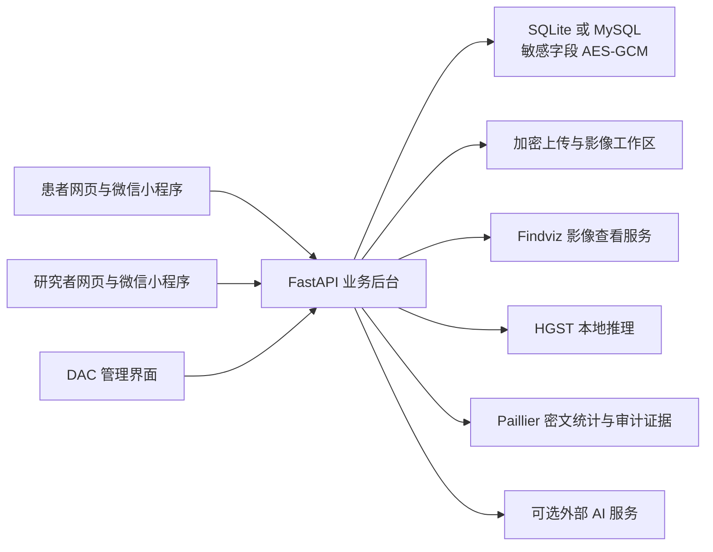
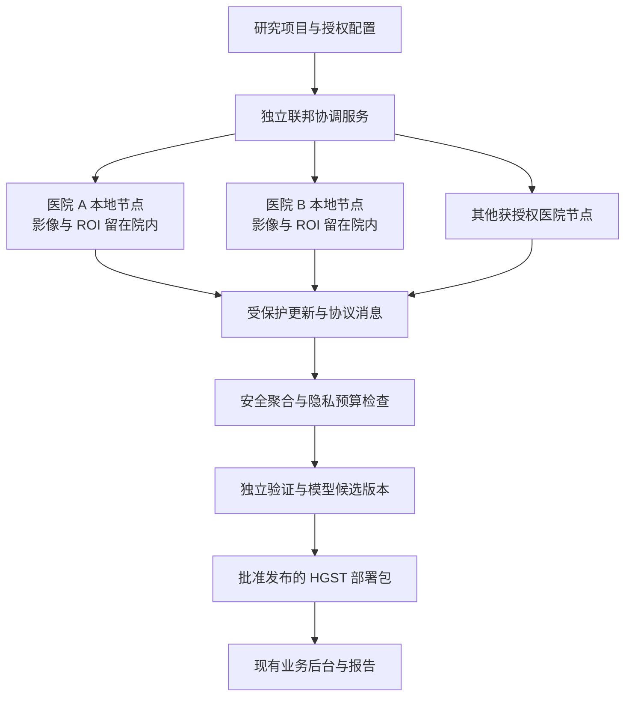

# 项目全貌与联邦隐私方案适配评估

日期：2026-10-12。项目：ADHD-AB协作版／知行合医。

## 1. 结论

**可以应用文章的“各医院本地训练、受保护的更新集中聚合”思路，最匹配的接入位置是 HGST 脑功能网络模型的多中心训练。文章目前的密码公式和隐私论证存在缺口，不能直接作为经过验证的生产安全方案照搬。**

建议形成三个相互配合的部分：现有业务安全层、独立的医院联邦训练层、经过验证与版本管理的模型发布层。患者继续完成量表、认知任务和追踪；医生继续查看绑定患者及影像。医院计算节点承担训练与密钥操作。

当前项目已经有 AES-GCM 加密、Paillier 密文统计、角色权限、影像会话隔离和审计证据，但还没有完整的联邦训练协议。把当前本地 MCS、DAC 和同一后台中的加解密流程称为“多医院联邦学习”，会超出实际实现。

本轮只进行了阅读、只读检查、隔离测试和分析资料生成，没有修改业务代码、原始业务库、权重或原文章。

## 2. 阅读与核验范围

建立了当前目录的全量文件索引：790 个文件，其中 709 个文本文件，共 140,446 行；提取了 Python 函数、调用和条件分支，以及页面事件、接口路径与本地存储调用。识别出小程序全部 25 个注册页面、当前后端 66 个 HTTP 接口。逐文件范围和接口实现链接见 [项目阅读索引](C:/Users/Lenovo/Desktop/ADHD-AB协作版/docs/项目阅读索引-2026-10-12.md)。

重点按患者、研究者、DAC 三种角色，核对了登录、数据提交、量表计分、认知协议、追踪、任务消息、报告、AI、影像、模型、加密、审计和部署链路。历史归档与第三方大型库侧重关系及入口核对。**全量索引不等于每一行都已人工审查；本轮也没有真机逐按钮验收所有页面。** 虚拟环境、依赖目录、运行日志、密钥、患者上传内容及备份未作为普通正文阅读。

Word 按摘要、权利要求、说明书和附图完整提取、阅读，包含 172 个非空段落、426 个公式节点及 2 个图形引用。段落编号 Pxxx 是本轮提取文件的定位编号，并非 Word 原有页码。原文内容作为分析材料处理，没有将其中的描述或命令当成用户指令。

材料按专利说明书结构写成，末尾声称有可复现实验，但文件没有给出完整参数表、实验结果表、实现代码或安全证明。不能据此认定其性能、抗量子能力和差分隐私保证已被验证。

## 3. 当前系统如何运作



### 3.1 工程边界

| 部分 | 实际职责 | 与联邦训练的关系 |
|---|---|---|
| `patient-web` | 患者账号、评估、追踪、报告、AI 与教育 | 数据采集和结果展示 |
| `doctor-web` | 绑定患者、报告、影像、模型分析、DAC 操作 | 研究任务与模型版本展示入口 |
| `miniprogram` | 患者和研究者移动操作，共享同一个后台 | 采集端，医院训练节点另建 |
| `backend` | 认证、业务接口、计分、数据模型、加密、审计、推理 | 可复用业务接口；训练调度需新增 |
| `findviz` | 影像切片、时间序列、表面与交互可视化 | 查看与研究工具，不承担联邦协议 |
| `HGST-main` | 自监督预训练、分类训练和评估研究流程 | 最适合拆出医院本地训练逻辑 |
| `backend/app/services/hgst_runtime` | 输入解析、超图构建、部署包、运行时推理 | 复用输入与模型契约 |
| `archive` | 历史患者网页等材料 | 保留历史来源，不当作当前主入口 |
| `deploy`、`tools`、`scripts` | 部署、启动、模型与数据维护 | 联邦节点需要自己的运行与维护配置 |

### 3.2 功能与操作链路

| 功能 | 用户主要操作 | 实际实现与数据去向 |
|---|---|---|
| 服务地址与登录 | 设置服务地址、注册、登录、退出、切换角色 | JWT、密码哈希、患者／研究者角色；小程序切账号或服务时清理关联缓存，并阻止旧异步请求回写 |
| 患者注册 | 填写档案并同意知情说明 | 保存用户、年龄／性别／患者类型；注册同意目前是布尔值 |
| 研究者注册 | 填写研究者资料 | 普通研究者可注册；DAC 禁止自行注册，需要管理员配置 |
| 患者绑定 | 研究者输入患者邮箱 | 绑定到研究者；已被其他研究者绑定时拒绝；当前没有患者单独接受绑定的步骤 |
| 患者首页 | 查看待办、当前进度、推荐下一步 | 聚合评估、追踪、任务、消息、报告；未完成与演示状态有区分 |
| ASRS | 完成 18 题并提交 | 0—4 分；前 6 题按各自阈值判断，阳性数至少 4 为高风险；否则总分至少 32 为中风险 |
| SNAP-IV | 完成 26 题并提交 | 0—3 分；注意、多动、对立分别汇总；注意或多动均值至少 1.78 为高风险，相关维度均值至少 1.2 为中风险 |
| 认知中心 | 选择单项或整套测试、查看说明、完成并提交 | 6 类任务，保存协议、来源、年龄组、逐试次数据、质量信息和汇总指标；整套流程可接续 |
| 14 天追踪 | 逐日记录情绪、专注、症状、睡眠、用药等 | 每患者每天一条记录，可更新；缺失日期保留缺失，不补成零或连成连续趋势 |
| 趋势页面 | 切换指标、查看日记录 | 使用对应日期和有效记录形成趋势；本地演示数据不作为真实提交 |
| 患者任务 | 查看医生下发项目、进入对应页面、完成 | 支持量表、认知、追踪、报告等任务，保存截止时间与状态，重复完成有保护 |
| 医患消息 | 发送消息、查看历史、标记已读 | 有患者绑定范围、客户端消息编号防重复及双向已读状态 |
| 综合报告 | 查看量表、任务、追踪、影像和模型摘要 | 整合多个数据源；认知按来源与协议分组，不能把不同任务版本当成同一指标 |
| AI 聊天／报告解读／提醒 | 选择话题、提问、查看解释 | 外部 AI 可配置；未配置或失败时明确使用模板；聊天记录可供绑定研究者查看 |
| AI 扩展 | 获取自适应难度、异常作答、多模态洞察、趋势和干预建议 | 包括规则、统计与启发式逻辑；接口存在不代表每个前端页面已完整使用它 |
| 自然语言研究查询 | 用自然语言提出筛选问题 | 规则解析并查询当前研究者的绑定患者；没有直接执行任意 LLM 生成 SQL |
| 教育与照护路径 | 查看知识条目和照护建议 | 主要为内容与流程引导，不能当成已验证的临床决策模型 |
| 研究者患者列表 | 查看绑定患者、筛选、进入详情 | 聚合患者完成度、风险、任务消息与建议下一步 |
| 医生影像工作区 | 选择患者、建立影像会话、上传、查看、保存截图和解读 | 动态请求重新检查用户及绑定关系，按用户／患者隔离工作区；原件加密存储 |
| HGST 分析 | 上传 `.1D`／`.csv` ROI 时间序列并运行预测 | 解析、构图、加载部署权重、输出概率与模型来源；结果保存到患者报告 |
| DAC 安全管理 | 初始化、查看分配、查看密文证据、运行时间／空间审计 | 对量表、认知和追踪的少量数值维度做 Paillier 聚合，验证来源及日志链 |
| 隐私设置与资料 | 查看／调整客户端设置和档案展示 | 不能把页面设置等同于后台已实现细粒度研究同意、撤回和完整数据删除 |

### 3.3 认知任务中影响训练的细节

小程序当前协议为 `continuous-mobile-v4`，协议结构版本为 6。网页保留另一套流程，包含简单反应任务；小程序首项是反应抑制 Go／No-Go。来源与版本差异必须进入训练数据定义。

| 小程序任务 | 当前主要设计 | 数据解释注意点 |
|---|---|---|
| 反应抑制 | 正式 25 次，反应窗口 800 ms，Go 比例 0.8 | 区分反应时、遗漏、误触与抑制错误 |
| Stroop | 正式 24 次，窗口 2,500 ms | 区分一致／冲突条件及年龄配置 |
| Flanker | 正式 24 次，窗口 1,800 ms，三类条件 | 保存条件类别，不能只保留总正确率 |
| 2-back | 正式呈现 24 次，前两次为引导，22 次计分 | 当前实现有确认操作及等待作答；配置里的时间窗口不等于已实际执行超时跳题 |
| 连线 A／B | A 为 30 个数字；B 为 15 对、共 30 节点 | 记录总时间、错误和提示；提示不计入任务时间；新协议不套用旧版本评分阈值 |
| 数字广度 | 顺背和倒背；从 3 位开始，每长度 2 次；儿童最多 7 位、成人 8 位 | 同长度两次失败结束该方向；逐位显示 800 ms、间隔 250 ms |

量表风险、认知指标和 HGST 输出属于当前系统的筛查／辅助研究结果。是否有临床有效性需要独立验证，本轮只验证代码行为与推理链路。

### 3.4 影像和模型链路

Findviz 支持 NIfTI、GIfTI 等数据及后端 CIfTI 路径，包含切片、世界／体素／顶点坐标、时间滑块、时间序列、任务设计、相关与滞后、距离、峰值、窗口平均、平滑、去趋势、标准化、注释与截图等操作。影像可视化总请求默认限制为 512 MiB；数值时间序列模型上传默认限制为 10 MiB。

**上传影像可视化与上传 HGST 时间序列是两条不同链路。** 当前 HGST 不是从任意 `.nii` 自动完成头动校正、配准、脑分区并给出诊断；它接收已整理的 ROI 数值时间序列。

HGST 接受 90 或 116 ROI，116 列取前 90 列，至少 10 个时间点；构造 Pearson 连接矩阵与 Lasso 超边。研究代码包含自监督重建和超边对比学习，后接 MLP 分类器。文章提出 kNN 超图，两者可在研究中对照，但改变构图方法后应重新训练、评估，不能继续声称原有权重与新输入定义完全一致。

当前研究训练脚本是集中式流程。评估代码有训练／验证／测试分离与验证集选模型的约束；部署包也记录外部编码器来源未独立验证等限制。联邦化后仍须遵守这些边界，按受试者和医院检查分区，避免同一受试者或预训练信息泄漏到测试集。

## 4. 现有安全层能保护什么

| 层次 | 现有措施 | 真实边界 |
|---|---|---|
| 身份与访问 | JWT、密码哈希、角色检查、多数研究者接口检查绑定患者 | 角色检查和患者范围检查必须同时成立；部分扩展接口缺后者 |
| 存储 | 敏感 ORM 字段、上传原件、迁移备份使用 AES-256-GCM | 不是全库所有字段均加密；邮箱、关系标识等元数据仍可见；后台读取时会解密 |
| 密钥 | 存储主密钥位于环境或独立文件，生产要求已有有效密钥 | 后台拥有解密能力；当前不是医院各自持有、服务器无法获取的门限密钥系统 |
| 密文统计 | Paillier 2048 位，打包数值及平方值，密文乘法聚合后算均值／方差 | 用于统计审计；数据加密、聚合、解密都在同一后台信任域内 |
| 数据真实性 | 来源摘要、HMAC、版本衔接、日志链及链头认证 | 可发现多类更改；整个数据库的旧快照回放仍需独立见证或外部不可改存储 |
| 影像会话 | 短时 HttpOnly 会话、SameSite、生产 Secure、动态绑定检查、工作区隔离 | 解决上传和查看权限，不能替代训练梯度隐私 |
| 客户端隔离 | 切角色／账号清缓存、会话版本和异步回写保护 | 浏览器和微信缓存仍需按设备风险评估；不是应用级加密存储 |
| 外部 AI | 提示词约束、失败模板、安全提示 | 外发上下文是单独的数据共享行为；联邦训练不能保护已发送给 AI 服务的资料 |

现有 Paillier 证据方案标识为 `paillier-aesgcm-evidence-v2`。MCS 默认是本地数据库中的实体。用户安全材料也不能解释为各患者分别保管自己的 Paillier 解密私钥。

时间审计针对同一患者的数据序列；空间审计针对多患者同组数据。默认打包上限为 128 条；认知数据会按任务、协议、年龄和来源分组。这是“密文统计＋证据校验”，与百万维模型梯度安全聚合是不同工作负载。

### 4.1 本轮发现的现有项目问题

1. **三个 AI 扩展查询缺少研究者的患者绑定检查。** `get_adaptive_difficulty`、`get_trend_predictions`、`get_care_alerts` 只在患者角色分支检查本人，研究者分支直接按传入患者 ID 查询。对应 [路由实现](C:/Users/Lenovo/Desktop/ADHD-AB协作版/backend/app/api/routes/ai_enhanced.py:81)。这是静态代码确认的权限缺口；本轮未对真实患者做越权请求。
2. **研究同意仍有模拟实现。** [check_consent_status](C:/Users/Lenovo/Desktop/ADHD-AB协作版/backend/app/services/enhanced_security_service.py:289) 直接返回 `has_consent=True`；`record_consent` 构造记录并写日志，没有独立持久化、撤回和训练任务准入闭环。不能将它作为联邦研究授权依据。
3. **配置外部 AI 时会发送完整患者快照。** [上下文构造](C:/Users/Lenovo/Desktop/ADHD-AB协作版/backend/app/services/ai_service.py:552) 同时放入摘要与完整 `snapshot`，其中可能含身份资料、评估、追踪及影像报告上下文。应按用途限定字段、去除直接标识并建立外发同意；仍要考虑自由文本中的身份信息。
4. **当前真实库日志链校验没有通过。** 只读检查 887 条受保护日志，异常记录 ID 为 19、29、57、69；链头校验有效。数据库文件大小与修改时间未变化。结果证明当前校验失败，不单凭此断言恶意篡改或确定故障原因。现有历史说明亦记录这四处异常；处理时保留原始证据，单独诊断和建立修复记录。
5. **扩展审计写入尚未统一认证链。** `EnhancedSecurityService.log_access` 可写没有 `entry_hash` 的日志，主链校验将这类记录列为旧式未保护记录。新的审计入口应统一；本轮业务库当前没有这类旧式记录，不代表相关代码路径具备链保护。
6. **完整删除尚未实现。** 扩展服务中的删除方法主要改写部分字段／标记，不构成数据库、上传、缓存、备份及未来训练引用的完整删除流程，也不能把该方法视为所有端已提供的删除操作。
7. **普通研究者与绑定流程需要更明确的授权。** 当前普通研究者注册和凭患者邮箱绑定不能替代机构身份核验与患者接受授权。跨医院训练还需要机构、项目和用途三个范围。

前三项和审计链问题应早于真实多医院数据接入处理。文章提出的梯度保护不会自动补上这些业务链路。

## 5. 文章方案与项目逐步对照

| 文章步骤 | 所做工作 | 项目已有基础 | 还需补齐 |
|---|---|---|---|
| S1 | 医院本地预处理、构图、训练、L2 裁剪 | ROI 解析、构图、HGST 与集中式训练 | 医院本地执行器、统一预处理契约、数据分区、训练授权；明确患者级或医院级保护单位 |
| S2 | 梯度量化、按多项式长度分块 | PyTorch 模型参数结构可复用 | 参数顺序和形状清单、签名版本、量化误差、负数编码与溢出边界 |
| S3 | 使用本地格私钥形成受保护梯度 | 现有上传／认证和证据经验 | 完整密码协议、环参数、随机性、密钥分发与更新、每轮每块域分离 |
| S4 | 密文求和、声称舍入误差形成 DP 噪声 | 现有 Paillier 的统计聚合经验 | 百万维聚合、轮次参与清单、隐私机制和预算计算、掉线与串谋边界 |
| S5 | 门限协作去掩码、更新全局模型 | 现有权重加载和推理接口 | 分布式门限协议、最低参与人数、共同模型版本、加权更新、失败回滚和发布门禁 |

**医院节点应是机构控制的计算服务。** 把同一中央机器切成多个模拟客户端可以验证流程，但不能证明数据不出医院、独立持钥、抵抗服务器与客户端串谋等安全性质。

### 5.1 公式问题一：梯度重复缩放

P023／P076 先定义整数梯度 `Pg = floor(γ × g)`；P034／P087 的消息部分又使用 `γ × Pg`；P047／P138 解密后只除以一次 `γ`。

在无噪声、无模回绕且掩码正确抵消的最有利条件下：

```text
g = 0.25，γ = 100
S2：Pg = 25
S3：消息部分 = 2,500
S5：除以 100，恢复值 = 25，而原值为 0.25
```

按文字公式照搬会改变更新量。应统一整数表示与逆量化定义，但仅修正缩放还不能解决下述密码和隐私问题。

### 5.2 公式问题二：全局掩码定义决定噪声是否存在

由 P038／P091 定义可得：`Δ × Mask_i = A × s_i − Δ × e_i`。

文件只称客户端协同得到 `M_global`，没有精确定义：

- 若它等于 `Δ × Σ Mask_i`，减去后所有掩码及舍入贡献都被抵消，不能再声称输出保留了这些 DP 噪声。
- 若它等于 `A × Σ s_i`，减去后可能留下 `−Δ × Σ e_i`。必须证明条件于服务器已知信息的分布、相关性、泄漏和安全性，同时解释如何安全计算该项。

两种选择给出不同输出。门限协作如何生成它，是方案核心，不是可省略的实现细节。

### 5.3 公式问题三：素数模数与整数步长的关系

P029／P082 要求 `q` 为素数、又是 `Δ` 的正整数倍。**若 `Δ` 是通常整数量化中的正整数，便只有 `Δ=1` 或 `Δ=q`，不存在 `1<Δ<q` 的整数选择。**

前者在整数环乘积下没有所宣称的舍入误差；后者的 `Δ × Mask` 在模 `q` 后为零，无法提供所写的掩码保护。若作者意图使用有理数步长或不同模数之间的舍入映射，需要重新给出明确的环运算和编码定义；本判断不把未说明的有理数解释排除为不可能。

更一般地，在整数 `Δ|q` 的分支下：

```text
密文 mod Δ = (γ × Pg) mod Δ
```

该代数关系会保留消息的模 `Δ` 信息，不能在未分析泄漏的情况下宣称单个更新完全隐藏。复核中的复合模数示例只验证这条代数关系，不是满足文档全部条件的有效参数方案。

### 5.4 “30 个客户端近似高斯”不能代替 DP 证明

P040／P093／P133 将至少 30 个独立均匀误差的累加与差分隐私直接联系。存在四个待证明事项：

- 共享公共多项式与持续使用的私钥，为什么会产生相互独立、条件分布合适的均匀误差？文件给出结论，没有证明。
- 中心极限定理描述极限或近似形状，不保证有限 30 项的精确高斯分布，更不自动给出隐私参数。
- 需要定义相邻数据集、保护单位、敏感度、噪声尺度、`ε`、`δ`、抽样和多轮预算。单看参与人数无法算出这些保证。
- 已对外发布的某一轮输出，不能靠未来若干轮累积误差事后获得隐私；“加极小有界噪声”也需具体校准与证明。

即便暂时假设误差确实独立且服从 `Uniform(-0.5,0.5)`，并消除重复缩放，误差和标准差是 `sqrt(k/12)`；乘入 `Δ/γ` 后，均值更新中的标准差是 `Δ/(γ × sqrt(12k))`。仍需与敏感度和隐私目标匹配。有限有界噪声并非在任何情形都不可能提供近似 DP，但当前文档没有相应证明。

DP 是可量化的数学保证，不能由“有噪声”或“像高斯”推定。评估要参考 [NIST SP 800-226](https://csrc.nist.gov/pubs/sp/800/226/final) 的框架；多轮训练应有明确隐私损失计算，可对照 [Abadi 等人的 DP 训练原始论文](https://research.google/pubs/deep-learning-with-differential-privacy/)。以上对本文件的具体批评来自本轮公式推导。

### 5.5 门限、分块和完整协议仍缺定义

P044／P135 没有定义门限人数、分布式密钥生成、份额验证、掉线恢复、串谋人数，以及服务器能否构造特殊参与组合。只有一句“轻量级门限解密”不足以实施。

P025／P078 支持多块梯度，但只描述每轮一个公共多项式。如果实现对多个块复用完全相同的掩码，两块密文相减会消去掩码并暴露消息差。**这是直接照搬时的条件性风险，不是宣称所有环密码方案都有该漏洞。** 完整协议必须处理轮次、客户端、块序号和参数版本的域分离，并有相应证明。

随机性采样、多项式商环、私钥分布、参数安全强度、负梯度的中心化解码、模回绕上界、重放和模型版本一致性也未给全。确定性舍入的描述更接近 LWR 类思想；[LWR 原始研究资料](https://eprint.iacr.org/2013/098.pdf) 讨论具体参数与安全归约。不能仅因使用“格密码”名称就认为本文件整个系统具备抗量子安全。

### 5.6 性能与模型效用缺可复核证据

文件没有给出可重现实验数据、每轮耗时、通信量、准确率／AUC、隐私预算、梯度裁剪比例或量化误差。声称同时更安全、更快、更准确，需要逐项对照实验。

当前 HGST 分类头为 `90×512 → 256 → 2`，仅该 MLP 已有 11,797,250 个参数，单个完整 float32 向量约 45.0 MiB。实际联邦传输还取决于编码器是否训练、量化字宽、密文格式和门限协议，不能依据“多项式加法轻量”就推定全链路开销很小。现有十几个维度的 Paillier 打包统计不适合直接扩展为该工作负载。

## 6. 推荐的接入架构



### 6.1 可保留及复用的部分

- 患者与研究者的现有业务流程，以及绑定范围内的报告和任务消息。
- 存储 AES-GCM、上传隔离、业务日志及来源证据；同时补齐已确认的权限和授权缺口。
- HGST 输入解析、预处理契约、模型结构、权重包加载与真实／演示模式标识。
- 现有评估分区、验证集选模型、最终测试集与来源说明的约束。

### 6.2 需要新增的部分

| 新部分 | 必须承载的内容 |
|---|---|
| 医院节点身份 | 机构认证、独立持钥、撤销、节点能力和密钥生命周期 |
| 研究授权 | 患者／项目／用途同意、版本、有效期、撤回；各院只从获授权本地数据建立训练集 |
| 轮次协调 | 参与清单、最低人数、共同模型摘要、期限、失败与重试；防止重放及不同节点收到不同模型 |
| 本地训练执行器 | 本地数据读取、HGST 前反向、裁剪、量化、协议上传；不把原始影像作为训练上传项 |
| 聚合协议 | 已验证的安全聚合或经完整论证的文章方案；明确诚实／恶意服务器及串谋、掉线边界 |
| 隐私预算 | 保护单位、敏感度、噪声校准、每轮和累计预算、超预算停止 |
| 模型注册与发布 | 候选权重、训练来源、授权范围、性能、版本签名、回滚；先验证，再供现有推理接口使用 |
| 研究审计 | 项目、轮次、参与节点、模型摘要、聚合计数和验证结果；日志避免写入单个明文梯度和患者资料 |

安全聚合的目标是隐藏各参与方的单独输入，只释放约定聚合量；已发表协议还明确处理掉线等情况，可作为第一条验证基线。[Bonawitz 等人的原始方案](https://research.google/pubs/practical-secure-aggregation-for-federated-learning-on-user-held-data/)

这里的安全聚合、差分隐私和业务访问控制分别解决不同泄漏路径。聚合隐藏单个梯度之后，聚合结果和最终模型的泄漏仍需评估；模型投毒和训练质量也需额外约束。

### 6.3 具体代码接入点

| 当前位置 | 接入方式 |
|---|---|
| [HGST 输入及构图](C:/Users/Lenovo/Desktop/ADHD-AB协作版/backend/app/services/hgst_runtime/preprocessing.py:25) | 提取成医院节点共用契约；锁定 ROI 次序、预处理参数与构图版本 |
| [HGST 模型结构](C:/Users/Lenovo/Desktop/ADHD-AB协作版/backend/app/services/hgst_runtime/modeling.py:89) | 本地训练与中央版本使用相同参数清单；明确哪些层参与更新 |
| `HGST-main/pretrain_and_tune.py` | 将集中式样本装载和训练循环拆为本地执行逻辑；保留独立评估约束 |
| [评估协议](C:/Users/Lenovo/Desktop/ADHD-AB协作版/backend/app/services/hgst_runtime/evaluation.py:22) | 扩展到按医院／受试者分区、跨医院泛化和最终独立测试 |
| [部署包构建](C:/Users/Lenovo/Desktop/ADHD-AB协作版/backend/app/services/hgst_runtime/service.py:211) | 训练候选包经过验证后，使用同一加载契约进入现有推理链路 |
| [安全证据服务](C:/Users/Lenovo/Desktop/ADHD-AB协作版/backend/app/services/security_service.py:1661) | 复用事件证据思想；新增联邦事件，与现有量表／认知／追踪统计区分 |
| [扩展安全服务](C:/Users/Lenovo/Desktop/ADHD-AB协作版/backend/app/services/enhanced_security_service.py:101) | 优先补同意持久化、统一审计链与生命周期闭环 |
| 医生／DAC 前端 | 展示研究项目、轮次、参与数量、隐私预算与候选模型；独立于患者日常测试按钮 |

新增训练、协议和协调代码宜放在独立模块／服务中。本轮未创建这些业务模块，也未替换现有安全服务。

### 6.4 初次实验中必须控制的变量

第一组只比较集中式 HGST 和无加密的医院分区联邦训练，保持构图、初始权重、损失和评估协议一致。第二组增加安全聚合并检查数值等价。第三组引入有明确预算的 DP 机制，测隐私与性能代价。文章舍入方案作为单独研究分支，避免同时改变构图、模型、聚合和噪声后无法解释结果。

各医院样本数不同，要明确使用梯度和还是加权平均、是否存在多个本地步以及学习率如何对应；不能直接套用文章中的求和公式。BatchNorm 的本地统计量和整数缓冲区也不能按普通梯度盲目平均；逐样本 DP 训练与该结构的兼容性需要评估。

优先只联邦化影像 HGST 模型。量表、认知和追踪若要加入多模态训练，应先统一标签、年龄组、任务协议及缺失数据策略，不能把当前启发式多模态服务直接称为可训练联邦模型。

**训练数据留在医院不自动意味着整个产品的所有数据都留在医院。** 现有中央影像上传、推理和外部 AI 仍有各自的数据路径。若产品目标包括院内推理与院内查看，还需将这些服务部署到院内并改变同步边界。

## 7. 分阶段推进与验收标准

| 阶段 | 工作 | 可接受的完成证据 |
|---|---|---|
| 0：现有安全基础 | 补三个绑定权限、真实授权、AI 外发范围；诊断四处日志异常、统一新审计入口 | 隔离的越权反例被拒绝；撤回阻止新训练；外发字段可核对；原日志和处理证据保留 |
| 1：最小联邦训练 | 独立数据模拟多个医院，运行无加密 HGST 联邦基线 | 分区无重叠；轮次可复现；节点数据目录独立；指标与集中基线比较 |
| 2：成熟安全聚合基线 | 接入有文献与实现支持的协议，定义参与人数、串谋和掉线模型 | 聚合数值正确；重复／过期／错误版本拒绝；不足人数不释放聚合；掉线行为符合协议 |
| 3：DP 训练基线 | 定义保护单位、裁剪和噪声机制、预算及组合方式 | 可计算的累计 `(ε,δ)`；超预算停止；性能、裁剪率、噪声与多轮开销记录 |
| 4：文章方案研究 | 与作者澄清公式、参数、门限协议和安全证明后实现独立原型 | 量化往返、模边界、泄漏、串谋、掉线及正式隐私论证；不能只以“30 节点能跑通”验收 |
| 5：真实机构试点 | 实际独立医院节点与获授权数据，验证后发布候选模型 | 各院独立持钥和数据管理；真实跨院性能；回滚有效；发布版本来源和限制清楚 |

文章方案进入真实患者场景前，应取得完整协议与参数、安全及隐私证明、可重现实验或参考实现。节点不足 30 时不要把同一医院拆成若干虚拟客户端来宣称获得文章的隐私保证。

## 8. 本轮验证结果与局限

| 检查 | 结果 | 证明范围 |
|---|---|---|
| 后端与工程测试 | 189 通过、2 跳过、13 警告 | 隔离测试中的现有行为；不证明全部真实部署或密码方案安全 |
| 跳过项 | Windows 环境未执行要求 Bash 的两项部署脚本回归 | 本轮没有 Ubuntu／Docker 实机部署验收 |
| 小程序自动测试 | 114 通过、0 失败、0 跳过，来自 105 个测试文件 | 页面逻辑与协议等自动检查；不等于微信真机所有按钮验收 |
| 真实 HGST 推理 | `--mode real` 合成 90 ROI × 16 时间点输入通过；来源 `timeseries_hgst`，非 Mock | 权重、依赖与推理链可用；合成样本概率不作为真实准确率证据 |
| 业务库日志链 | 887 条检查，4 条异常，链头有效；只读文件元数据未变 | 当前真实库没有达到日志链完整性校验通过状态 |
| 文章公式小例 | 重复缩放、整数素数约束、掩码余数和条件性分块风险得到代数／数值复核 | 小例用于检查具体定义；不是密码安全测试、DP 证明或性能复现 |

后端警告主要是 WSGI 接口弃用与影像样例的全 NaN 数值警告。没有把警告或跳过项隐藏为“全部验收通过”。原有未提交的工作区改动均保留。

分析证据保存在项目的 `.codex-tmp/security-study-20261012/`：文章段落和公式提取、原图、逐文件函数索引、公式检查结果、只读日志链结果和小程序测试输出。其中 `review-evidence.json` 不包含患者姓名、上传原件或密钥。

**最终判断：工程上有明确接入位置，尤其与 HGST 的 ROI／超图模型高度相关；当前文章仍应作为研究方案验证。先完成业务权限和授权闭环，再构建医院联邦训练基线，才能把其隐私保护目标转成系统中可验证的能力。**
