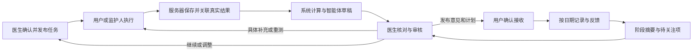
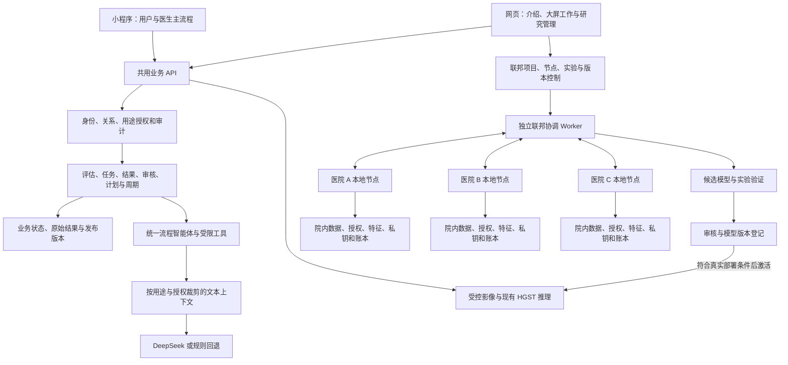

# ADHD 项目升级总方案

**小程序优先 · AI 辅助诊断与医患协同 · 统一流程智能体 · 隐私保护与联邦研究**

日期：2026-10-12。状态：整合设计交付，尚未实施业务代码。

本方案合并产品升级方案、智能体开源调研、隐私保护与联邦研究方案及其工程附录，并纳入本轮全部用户意见。用于统一产品目标、页面、流程、数据、权限和实施顺序；原文件作为分析依据和技术细节来源保留。涉及“现有”的判断来自这些文件的代码核对与历史证据，本次整合未重新进行运行验收。

本轮仅新增本总方案，未修改业务代码、数据库、配置、模型、依赖或既有未提交改动，未开始训练。

## 1. 总体定位与已经确定的要求

项目定位为：**以小程序为主要入口、网页版为辅助，围绕 AI 辅助诊断和医患持续协同构建业务闭环，同时提供具有独立授权、更新保护和模型审核的联邦研究能力。**

面向普通使用者呈现“AI 辅助评估、结果理解与持续管理”；面向医生呈现“证据整理、审核判断与协同安排”；联邦研究在获授权的网页工作台中进行。

| 要求 | 总方案采用的设计 |
|---|---|
| 产品形态 | 只有小程序和网页版；医院节点、Worker、模型服务是后台运行组件 |
| 产品主次 | 小程序承载完整日常流程；网页承担介绍引导、大屏分析、医生工作和研究管理 |
| 使用者称谓 | 统一称“用户”，区分“成年用户／儿童用户”；报告可称“被评估者” |
| 是否已经患病 | 注册与使用不要求确诊；自助评估和医生审核结果分别标识 |
| 成人与儿童 | 首期同步推进，共用流程引擎，使用不同适用模板、填写人和测试配置 |
| 家长账号 | 不增加独立家长注册入口；儿童用户账号由监护人管理，记录账号持有人、被评估儿童、实际填写人和授权 |
| 资料填写 | 主诉／关注问题、病史、生活影响、既往评估、睡眠及相关治疗背景均为选填，可整体跳过、部分填写或稍后补充 |
| 必要信息 | 只收集当前流程必需的年龄／年龄组、本人／儿童使用、实际填写人等；现有认证要求及标准量表必要作答仍按规则执行 |
| AI 入口 | 原 AI 助手统一升级为 AI 流程智能体，从首期参与流程；复用原聊天页面和浮层 |
| 医患协同 | 从双向消息扩展为任务、执行证据、AI 摘要、医生审核、计划调整和下一轮跟进 |
| 隐私基础 | 访问范围、用途授权、存储、AI 外发和审计共用基础服务，临床协同与研究权限分别判定 |
| 联邦首版 | 先在本机用三个独立节点与合成数据跑通四块完整能力，再支持医院独立部署 |
| 实施顺序 | 先完成小程序最小业务闭环；随后增强 AI、网页和完整联邦研究；安全与真实授权从基础阶段建设 |

选填资料未填时保存为“未提供／已跳过”，不能写成“没有症状”或零值，也不计入量表／测试未完成。用户主动愿意补充时，智能体可整理草稿；医生确需信息时下发具体补充问题，不强制重填整套背景表。

## 2. 当前基础与升级范围

### 2.1 可以复用的项目基础

| 部分 | 现有基础 | 总方案处理 |
|---|---|---|
| 小程序 | 25 个注册页面；量表、六类认知任务、记录、报告、消息、任务和医生移动页面 | 保留原生实现与测试引擎，围绕当前任务重新组织入口 |
| 用户网页 | 量表、测试、追踪、报告、AI 和科普 | 保留历史与兼容能力，突出小程序入口和大屏资料查看 |
| 医生／DAC 网页 | 用户工作台、任务消息、报告、影像、HGST 推理和安全管理 | 增加审核队列、阶段分析、研究工作台与模型版本 |
| 共用后端 | FastAPI、SQLAlchemy、JWT、Pydantic、业务接口 | 延续共用业务后端，新增清晰的服务与契约 |
| 量表与认知 | 成年 ASRS、儿童 SNAP-IV；Go/No-Go、Stroop、Flanker、2-back、连线 A/B、数字广度 | 保留，补批次、任务、填写者、提交与协议版本；适用性由专业人员确认 |
| 数据与客户端 | 本地草稿、待同步、会话隔离、认知运行 ID、消息去重 | 延续保护，服务器决定跨端实际状态 |
| AI | DeepSeek 文本网关、聊天／解释／提醒、模板回退、规则与统计原型 | 网关增加受限工具和结构化产物；经核对的规则进入实际流程 |
| 影像与模型 | Findviz 可视化、HGST ROI 解析、构图、部署包和推理 | 专业可选模块；与联邦候选版本衔接 |
| 安全 | 敏感字段与文件 AES-GCM、部分范围检查、Paillier 统计证据和 DAC 审计 | 补真实授权及权限缺口，复用封装和证据思想 |

Findviz 是网页版内的专业模块，HGST 是模型工程；二者不增加产品形态。已有 Paillier 统计及本地 MCS 不是完整的多医院联邦训练。现有 `/ai-enhanced` 原型也不能按接口数量视为两端已完成产品。

### 2.2 一眼可见的新增、修改与弱化

| 类型 | 页面／功能 | 调整后 | 阶段 |
|---|---|---|---|
| 新增 | 轻量健康档案 | 必要基础信息＋可跳过背景；区分填写者与被评估者 | P1 |
| 新增 | 医生关联确认 | 邀请、核对共享范围、接受、撤回及关系记录 | P1 |
| 新增 | 评估批次 | 一轮量表、认知任务和摘要有统一归属 | P1 |
| 新增 | 医生审核发布 | 查看证据、编辑／退回、发布意见和下一步 | P1 |
| 新增 | 持续随访计划 | 周期、日期、任务、反馈、阶段复核和下一轮 | P1 |
| 新增 | 真实用途授权 | 医患共享、外部 AI、研究用途分别同意和撤回 | P0–P1 |
| 新增 | AI 证据与运行记录 | 来源 ID、输入版本、工具调用、草稿和审核状态 | P1 |
| 新增 | 联邦四块能力 | 医院节点、训练协调、更新保护、研究管理工作台 | P2B |
| 新增 | 候选模型与实验预览 | 版本、来源、保护范围、实验发布与受控激活 | P2B–P3 |
| 修改 | 用户首页 | 今日优先任务、继续上次、待审核和待同步 | P1 |
| 修改 | 原 AI 助手 | 统一流程智能体，能读取任务和结果并提供操作入口 | P1 |
| 修改 | 医生任务 | 指定实际结果要求；执行状态与审核分开 | P1 |
| 修改 | 日常记录 | 从固定序号扩展为周期＋实际日期，第二轮独立保存 | P1 |
| 修改 | 报告与照护路径 | 从各类最新汇总扩展为本轮版本、医生意见和实际下一步 | P1 |
| 修改 | 医患消息 | 保留消息，关联任务、反馈、报告和待关注事项 | P1–P2A |
| 修改 | 网页介绍与医生工作台 | 主推小程序，大屏承接审核、长材料、对比与研究 | P1–P2 |
| 修改 | 隐私／DAC | 后台真实授权、项目权限、认证事件和实际异常状态 | P0–P2B |
| 取消／替换 | 测试任务通用“标记完成” | 服务器核验实际提交；阅读确认单独保留 | P1 |
| 取消／替换 | 强制完整背景问卷 | 选填卡片和按需补充 | P1 |
| 不新增 | 独立家长注册、第二套 AI 助手 | 监护代填授权；统一智能体入口 | 全程 |
| 弱化 | 固定九宫格、所有人统一 14 天、网页日常入口 | 保留可用内容，按任务和计划呈现 | P1–P2A |
| 收敛 | 未验证概率／亚型／高精度文案、演示模型混入真实报告 | 展示真实来源、适用限制和医生确认；演示只在实验区 | P0 起 |

### 2.3 共同前置问题

需先修补三个增强 AI 查询的档案范围检查、占位同意、AI 外发全量快照、任务完成无结果验证、周期记录覆盖、摘要字段不匹配与评分口径问题。旧任务、旧记录和已存在账号不能直接标记为新流程已审核或已授权。

此前适配评估记录过旧业务日志链四处校验异常。这是历史核对证据，本次未重新校验。实施时保留原始日志并诊断、留存处理记录；不能删除／重签为全部通过。真实研究准入需有该问题的处理证据及授权验收。

## 3. 产品结构与两端分工

### 3.1 小程序用户侧

设置五个主要入口：**今日、评估、协同、报告、我的**。

| 入口 | 用户看到什么 | 主要操作 |
|---|---|---|
| 今日 | 当前本人／儿童、阶段、优先任务、预计用时、期限、待同步 | 开始／继续、今日记录、查看医生新安排 |
| 评估 | 当前批次、适用量表和认知组合、实际进度；背景标“选填” | 跳过背景、完成任务、提交、按需补充 |
| 协同 | 已关联医生、已发布计划、任务反馈、消息和待确认安排 | 接受邀请、反馈困难、申请延期、留言、确认接收 |
| 报告 | 原始结果、系统计算、AI 解释、医生意见和历史阶段 | 查看证据、区分待审核／已确认、进入下一步 |
| 我的 | 健康档案、监护关系、授权历史、通知偏好、设备待同步 | 补充资料、管理共享、同意或撤回 AI／具体研究用途 |

智能体在当前页面提供“下一步、继续、解释”入口，复用聊天页面；用户可通过普通按钮走完整流程。正式计时试次关闭对话弹出，记录由任务和日历进入。

### 3.2 小程序医生侧

复用医生首页与用户详情，增加待审核、待跟进、未执行和待关注队列。医生在小程序即可下发评估、审核结果、发布意见、调整随访和创建下一轮；网页缺席时主业务仍成立。

### 3.3 网页辅助侧

| 场景 | 小程序优先承担 | 网页辅助承担 | 共享方式 |
|---|---|---|---|
| 产品了解 | 登录和实际使用 | 公共介绍页展示小程序价值、二维码／进入入口 | 正式入口依赖 AppID 与平台配置；码不携带健康资料 |
| 用户评估与日常管理 | 填写、量表、测试、记录、任务、反馈 | 保留兼容；长资料补充、报告大屏查看和历史比较 | 同一档案、批次、任务、周期和报告版本 |
| 医生审核 | 必要审核和计划操作 | 多用户队列、长材料、阶段对比和模板 | 同一审核／发布接口 |
| 影像与模型 | 查看医生确认的相关解释 | Findviz、ROI 模型推理、来源与版本 | 影像按需；不同输入链路分别校验 |
| 管理与研究 | 用户自己的具体授权及撤回 | 医生核验、研究项目、节点、训练、预算、候选模型和审计 | 研究按机构／项目／角色独立授权 |

网页日常功能优先兼容现有用户，逐步降低展示优先级；不直接删除历史测试和报告。网页和小程序来源、设备及协议保留，跨端结果只有符合具体任务要求时才可被接受。

## 4. 角色、账号与权限

| 主体 | 负责的操作 | 权限边界 |
|---|---|---|
| 成年用户 | 本人评估、记录、共享与授权 | 自己的被评估档案和允许用途 |
| 儿童用户的监护人 | 管理账号、填写观察量表与记录、医生互动、授权 | 经核验的监护关系与具体范围；认知任务由儿童执行 |
| 医生 | 配置任务、核对证据、确认意见与计划、跟进问题 | 有效关联或明确授权的用户；医生身份需核验 |
| 项目研究者 | 获批项目配置实验、查询状态、实验模型预览 | 项目成员、研究用途和节点白名单；不自动获得临床资料访问权 |
| DAC／机构管理员 | 项目／节点批准、授权审查、模型发布及管理 | 获授权的机构／项目范围，管理身份不是全量资料通行证 |
| 医院节点 | 本地数据准入、训练、保护更新及预算 | 独立节点身份；私钥和院内稳定标识留在本地 |
| AI 流程智能体 | 引导、资料整理、解释、摘要、草拟 | 服务端限定上下文和工具，无独立临床审核或训练发布权 |

技术上保留 `User/user_id` 为登录账号、`Patient/patient_id` 为被评估档案；公开称谓调整不要求全仓重命名。`researcher` 旧枚举继续映射，医生资格、项目研究和 DAC 权限分别核验。首期一位负责医生、一名主要监护人管理一名儿童；多医生、多儿童和教师入口在后续扩展。

## 5. 完整使用流程

### 5.1 成年用户

1. 注册／登录，选择“本人使用”，填写必要年龄和身份；可跳过全部背景资料。
2. 智能体根据适用模板给出“开始评估”或“继续医生任务”，展示用时、说明和当前进度。
3. 完成量表和指定认知任务；提交后实际结果关联本次评估。断网时显示待同步，不伪装已提交。
4. 系统计算结果，智能体整理解释、证据和不足。未关联医生时显示自助结果和关联入口；可以先评估后共享。
5. 已有关联医生的结果进入待审核；医生可补问具体问题、要求重测、编辑或确认意见。
6. 医生发布意见和随访计划，用户确认接收，从今日任务完成记录并反馈执行障碍。
7. 阶段到期生成变化摘要，医生复核并调整安排，形成下一轮批次或周期。

### 5.2 儿童用户

1. 监护人选择“为儿童使用”，管理儿童用户账号，确认儿童年龄、实际填写者、监护关系和用途授权；不进入另一个家长注册流程。
2. 背景可跳过；观察量表由监护人填写，记录其信息来源。儿童按照适龄说明完成认知任务，记录执行者、提交者和协助情况。
3. 智能体使用儿童模板和说明，结果归入同一儿童评估；不混入监护人自身资料或成年阈值。
4. 医生审核后，监护人查看意见、执行记录计划、反馈困难和接收下一轮安排。
5. 教师独立观察、多监护人和多儿童后续通过范围限定的关系与邀请接入，观察者结果独立保存。

两类业务首期同时验收。儿童资料是否能参与研究另按具体研究适用条件核验，不能因为儿童功能上线就默认纳入训练。

### 5.3 医生

确认关联 → 选择成年／儿童模板及具体任务 → 发布 → 查看实际提交和质量 → 核对 AI 草稿及原始证据 → 编辑／退回／确认 → 发布意见和计划 → 查看执行与阶段变化 → 处理问题 → 确认下一轮。

自助结果可授权给医生查看；是否足以支持某项医生任务，由任务要求和医生确认共同决定，不自动抵扣新的不同批次任务。

### 5.4 联邦研究者与管理员

管理员建项目并批准节点 → 节点检查本地数据／授权／环境 → 研究者配置实验与预检 → 人工点击开始 → 三节点本地训练与保护上传 → 协调完成多轮聚合 → 公开／合成评价 → 候选登记 → 管理员批准实验发布 → 实验推理。正式模型激活在独立医院部署和来源、保护、效果核验后另行批准。

普通使用无需训练；安装研究模块不会自动开始训练，也不自动读取业务库、上传目录或历史资料作为训练集。

## 6. AI 在七个环节中的参与

| 环节 | 数据来源 | 智能体具体输出 | 用户／医生怎样用 | 衔接与确认 |
|---|---|---|---|---|
| 信息采集 | 必要基础信息、自愿背景、获授权文本、字段规则 | 简短说明、字段草稿、来源与未知项 | 用户按需补充，医生知道信息覆盖范围 | 草稿经用户确认保存；跳过仍可评估 |
| 初步评估 | 年龄／填写人、适用模板、关联状态 | 适用项目、操作说明和下一步入口 | 用户开始默认模板；医生确定关联流程要求 | 自助只用已审核模板；医生正式任务由医生发布 |
| 测试与量表 | 当前任务、标准说明、作答进度、协议和质量 | 中性操作帮助、必要漏答提示、接续入口 | 用户完成标准任务；医生看到质量问题 | 不代答、不改题或试次；程序保存实际作答及结果 |
| 结果分析 | 系统计分、真实结果 ID、质量、来源与可比历史 | 关键发现、通俗解释、资料不足、待核实问题和证据 | 用户理解本轮，医生快速定位依据 | 形成持久摘要草稿；临床解释需医生审核 |
| 医生判断 | 原始证据、AI 草稿、授权历史、医生问题 | 依据说明、核对问题和用户说明草稿 | 医生编辑、采纳或驳回 | 医生确认发布；新资料触发版本重核 |
| 医患协同 | 已发布意见与计划、执行状态、共享反馈／消息 | 把安排转成易懂步骤，归纳障碍、拟回复 | 用户知道何时做什么；医生调整具体安排 | 个性化指导和计划调整由医生确认；事务提醒按批准模板 |
| 持续随访 | 计划日期、实际记录、同协议窗口、事件与反馈 | 阶段变化、覆盖率、未执行原因、待关注问题和下一轮草案 | 用户看进度，医生看变化证据 | 到期复核，医生确认继续／调整／结束，进入下一轮 |

标准分数、期限、完成率和状态由程序计算；智能体负责整理和解释。缺失不填零，不同协议不直接比较；不用未经验证的亚型、患病概率或固定“可信度”代替证据。AI 草稿、系统结果与医生已确认意见分别展示。

## 7. 统一 AI 流程智能体的实现方案

### 7.1 首期技术选择

使用 **现有 FastAPI＋DeepSeek 网关＋受限工具执行循环＋持久业务状态**。保留 `ai-chat` 页面和浮层，统一为一个智能体入口；按角色与环节提供评估引导、医生分析、随访协同三种模式。

| 开源参考 | 借鉴点 | 采用方式 |
|---|---|---|
| [Pydantic AI](https://github.com/pydantic/pydantic-ai) | 工具参数、依赖上下文、结构化输出和人工确认 | 首期优先借鉴；直接引入 SDK 前验证选定版本与现有依赖兼容 |
| [LangGraph](https://github.com/langchain-ai/langgraph) | 状态恢复、中断、人工审核与分支 | 后续复杂流程备选，首期不同时引入两套框架 |
| [Healthcare Agent Orchestrator](https://github.com/Azure-Samples/healthcare-agent-orchestrator) | 医生侧资料时间线、职责划分 | 参考职责，不迁入 Azure／Teams 全套架构 |
| [CareFlow](https://github.com/ibharath-ofcl/Agent-Acentra---Agentic-Hospital-Discharge-Follow-up-Coordinator) | 医生批准、任务激活、随访提醒 | 参考交互；前轮调研未见明确许可证，不复制源码 |

这是前轮 GitHub 调研结论，本轮未重新运行这些项目或解析依赖。依赖版本与许可采用前再核验；原研究文档保留完整筛选范围。

### 7.2 首期工具和控制

| 工具 | 实际作用 | 执行边界 |
|---|---|---|
| 查询任务／进度 | 查本批次未完成、期限和待审核 | 服务端身份与档案范围；只读 |
| 读取本轮结果／证据 | 取已允许的系统结果、协议和质量 | 不任意扫描数据库，不改原始作答 |
| 返回下一步动作 | 给白名单页面、任务 ID、解释 | 用户点“开始／继续／查看”；后台再验状态 |
| 整理可选资料 | 将主动提供内容转成字段草稿 | 用户确认保存，未填不推测 |
| 生成评估／阶段摘要 | 归纳真实证据和缺失 | 草稿区、证据校验，临床意见待医生确认 |
| 后续计划／回复草拟 | 给医生可编辑草稿 | 不开放自主临床发布工具 |

每次运行读取当前授权快照，记录运行 ID、输入版本、业务对象、工具调用和失败原因。首期建议最多三次工具执行步骤，同时限制工具总数、时间和 token；实际数值联调后调整。

现有 DeepSeek 文本请求需扩展工具 schema、调用 ID、参数、工具结果回传和输出校验。若启用思考模式，按选定接口版本保留所需内部传输字段；界面不展示内部思考。权限来自服务端会话，不让模型选择操作者、扩大 patient_id 或决定是否已获授权。

长期状态在业务数据库中，每次页面进入、提交和计划节点触发短运行；无需维持整段随访的大模型进程。人工确认后读取最新状态续接，不沿用过期草稿。

### 7.3 与联邦研究的关系

智能体首期串联日常评估与协同，不承担联邦算法。后续可为获授权研究人员解释经过允许的项目状态与已公开指标；不接收 ROI、患者标签、特征、单患者梯度或单医院明文更新，不调用开始真实训练、修改隐私预算、批准节点或激活模型等管理工具。

联邦研究训练的是 HGST 的分类模型，不是 DeepSeek 大模型，也不是“训练小程序智能体”。研究产生的正式模型版本经审核后成为可选辅助证据来源，智能体只解释允许使用的输出。

### 7.4 失败回退

模型或工具失败时，保留手动页面、服务器进度、原始结果和规则摘要，标明本地规则模式。提交和医生审核不依赖 AI 成功；生成任务可重试并去重。正式计时试次不弹出智能体，不动态改正式题目、试次或难度协议。

## 8. 医患持续协同机制

任务状态：**待执行 → 进行中 → 已提交 → 已验收**；需补充建立新尝试，医生可取消；逾期作为执行属性保留。服务端校验任务归属、版本、类型和实际结果，在同一事务中保存、关联和更新状态。

量表任务对应有效作答；认知任务对应指定清单及有效结果；记录任务对应周期和实际日期；报告阅读只确认接收，不能代表医生审核。用户手动勾选、消息已读和 AI 对话不会完成测试任务。

每个计划有版本、复核时间和负责医生；记录采用实际日期，14 天仅是可选模板。执行率以截至当前应执行的任务实例为分母；漏填、延期、取消和不足分别显示，不自动填“正常”。

消息保留并关联任务、评估、报告或关注项。用户可反馈“无法完成”原因、申请延期；医生处理后形成有原因的新安排。关注项有负责人和“新建、已指派、已处理／暂缓”状态，通知已发不等于问题已处理。

首期站内待办、消息和医生队列即可闭环；定时扫描负责期限、频控、去重和重试。微信订阅消息作为增强通道，依赖真实主体、身份、用户订阅和模板联调；通知失败不改变任务事实。

## 9. 共同架构与数据边界

| 数据路径 | 数据去向 | 必要限制 |
|---|---|---|
| 日常评估／记录 | 小程序或网页 → 共用业务后端和数据库 | 本人／监护／医患范围、用途、版本、加密及审计 |
| 外部 AI 对话 | 业务后端 → 允许的模型服务 | 单独同意、最小字段；直接标识和敏感自由文本需处理；不含训练私密材料 |
| 现有影像查看／推理 | 经授权上传 → 项目影像／HGST 服务 | 上传与会话限制、医生访问和来源；与联邦通道分开 |
| 联邦研究 | 医院本地数据 → 本地特征／训练 → 受保护更新与协议消息 | ROI、标签、患者名单、单患者特征及节点私钥不进入中央训练接口 |
| 候选模型输出 | 经验证的版本 → 实验预览；批准后才进入正式推理 | 模型来源、保护范围、评价和发布状态必须可查 |

“训练资料留在医院”只约束联邦研究路径。现有中央业务数据、影像上传和外部 AI 有各自去向；若需要所有查看／推理也留院内，须另设计院内部署与同步边界。安全聚合允许中央取得约定整体结果，不代表中央看不到任何信息。

## 10. 统一隐私、授权和审计

### 10.1 共同安全能力

| 能力 | 具体设计 | 不应混同的用途 |
|---|---|---|
| 访问校验 | 登录账号＋被评估档案关系＋用途；研究再加机构／项目／节点范围 | 已绑定医生不等于研究准入；项目研究权限不等于可看所有健康资料 |
| 存储保护 | 复用 AES-GCM，按范围保护业务字段、原件、本地特征缓存与私有配置 | 不是全库匿名，后台授权读取仍可能解密 |
| AI 外发 | 按场景构造字段白名单，记录同意和外发范围 | 联邦 DP 不保护已发送给模型服务的文本 |
| 节点密钥 | 院内独立保存私钥，中央只保存公钥指纹／身份 | 不使用用户安全材料冒充医院独立密钥 |
| 更新保护 | 安全聚合隐藏单独医院更新，DP 限制约定患者数据影响 | Paillier 数值统计不能直接代替高维联邦保护 |
| 审计 | 业务与联邦关键事件经认证记录，原异常保留；独立部署增加外部留存／见证 | 单库认证链不能自动提供外部不可变证明 |

### 10.2 一套授权记录，多个明确用途

建立统一 `ConsentRecord` 权威记录：档案、实际授权人、监护依据、用途、数据范围、项目／机构／供应商范围、条款版本、起止及撤回。用途至少区分医患共享、外部 AI、具体联邦研究；必要业务处理使用相应规则，不能把它伪装为任意研究授权。

研究原方案中的 `ResearchConsent` 作为项目研究扩展／关联视图，引用同一权威记录，不再维护独立冲突的同意布尔值。已有注册同意不能转换成“同意全部研究”。医院外部用户由院内授权系统管理；中央收取版本化、签名且不含患者名单的状态收据。

用户在小程序“我的→隐私与授权”查看用途、共享对象、条款和历史，单独同意、拒绝或撤回；网页可操作同一记录。拒绝外部 AI 仍能标准评估、提交和医生审核；不参加研究不影响日常使用。

### 10.3 撤回与资料生命周期

| 撤回对象 | 后续动作 | 历史处理 |
|---|---|---|
| 医患共享 | 关系／范围失效，医生新请求拒绝 | 已发布记录按适用规则留存；不自动恢复旧授权 |
| 外部 AI | 阻止新外发和未执行的生成，转本地模式 | 已发给供应商的数据按约定处置；不声称可以自动收回 |
| 研究用途 | 节点排除后续计算；未提交轮次核对授权版本，受影响尝试中止 | 消耗账本保留；已发布模型影响不承诺自动抹除，必要时走重训／撤下流程 |
| 资料删除申请 | 核对数据库、上传、缓存、备份和训练引用，按适用保留要求处理 | 与单一字段标记分开；既有删除原型不视为完整实现 |

节点收到授权变更后，院内维护稳定标识并更新本地范围；中央记录变更收据。断线、过期或无法核对最新状态时停止新真实计算／提交，不默认为仍获授权。模型回滚不回滚同意与隐私账本。

## 11. 联邦研究四块能力

### 11.1 首版技术路线和范围

**固定现有 HGST 编码器，在医院节点联邦训练 MLP 分类器；使用 Flower SecAgg+ 保护单独更新，使用 Opacus 进行逐患者裁剪、噪声训练和预算核算。**

本机首版用三个独立进程、三个隔离目录、独立身份／密钥和合成 ROI，执行真实训练与受保护聚合。四块能力全部交付；同机管理员的控制不属于真实医院管理隔离。

复用现有 ROI、Pearson 与 Lasso 超图契约。输入为已预处理 ROI，不将原始 NIfTI 自动预处理承诺为现有能力。固定编码器使用既定来源和 eval 模式；首轮可证明保护的分类训练采用公开初始化，已有私有训练分类器仅作独立对照。编码器来源状态始终记录，不把分类训练预算追溯到其历史训练。

### 11.2 四块能力的操作与职责

| 能力 | 必须实现的操作 | 输出与控制 |
|---|---|---|
| 医院节点 | 登记／批准、心跳、兼容检查、本地授权过滤、ROI 校验、特征提取、DP 训练、保护上传、停止与撤销 | 独立本地资料／私钥／账本；状态、签名收据和受保护更新；每患者首版选一份扫描 |
| 训练协调 | 项目与成员、节点白名单、实验预检、冻结清单、多轮任务、租约、幂等、停止／恢复 | 同一基础摘要与参数；节点等权，更新量正确加回共同基础模型；失败保留上轮 |
| 更新保护 | 逐患者裁剪与噪声、采样契约、一次缩放量化、SecAgg+、预算预留和累计、重放／结构验证 | 中央只得约定整体更新；不足参与不释放；无自动明文降级；账本真实核算 |
| 管理工作台 | 项目审批、节点批准、预检／开始／停止、进度、预算、授权、审计、候选和实验预览 | 服务端权限，不只隐藏按钮；失败原因可理解；合成模型仅实验发布 |

实验状态：草稿 → 检查中 → 待运行 → 运行中 → 验证中 → 完成；失败、停止中、已停止和预算不足单独呈现。轮次包括清单锁定、协议准备、本地训练、受保护收集、恢复整体结果与提交。

首版三节点都完成才能提交；节点掉线时终止该轮，保留上一轮。重启后从已提交模型续接，未完成密钥会话终止并重新建立材料。消息有实验／轮次／尝试／幂等编号。新增更多节点与掉线恢复须按所选协议安全条件验证。

### 11.3 保护路径与预算

逐患者梯度 → 范数裁剪 → 校准噪声与本地优化 → 相对基础模型的有界更新 → 一次量化／数组编码 → SecAgg+ → 整体更新 → 下一轮分类器。

首版固定公开容量与采样契约，每患者一份记录，空槽与真实记录替换、期望批量归一化和逻辑优化步数需要适配验证。采样、相邻关系、裁剪阈值、噪声倍率、RDP 账本、累计 ε／δ 和上限写入冻结清单，不能用显示值冒充实际预算。

合成预设沿用技术附录：每节点容量 64，抽样率 1/8，每轮两步、最多五轮、SGD 无动量，裁剪初值 C=1；ε 上限 10、δ 上限 10^-5 仅为原型输入，噪声按整体预算预检选择，最低演示噪声倍率为 2；无法满足预算则拒绝启动或减少计划轮数。参数可运行性与效用仍需实测，这些数值不是通用安全标准。

账本以稳定院内数据范围保存跨实验／项目消耗，新项目、换目录、重启、失败、重试或模型回滚不清零。训练前预留，实际已执行或释放情况不明时按实际／保守上界扣账；跨院患者是否重叠未证明时保守组合。中央收据不包含稳定患者标识。

首版用合成或明确公开评价集，最终测试集不参与选模型；私有指标和模型选择需后续单独保护及计入预算。真实数据需安全随机源及环境验收；普通随机源合成模式标记研究模式。

### 11.4 与原文章的关系

| 原文章环节 | 本项目设计 | 采用差异 |
|---|---|---|
| S1 本地处理／超图／训练／裁剪 | 本地 ROI、HGST 编码、分类器逐患者训练 | 首版固定编码器、Lasso 超图，未完整复现 kNN 与全模型训练 |
| S2 整数编码 | 统一结构、有界范围、一次量化和负值恢复 | 使用安全聚合数组契约，不宣称原文多项式环映射已复现 |
| S3 保护上传 | 院内独立身份／密钥、SecAgg+ | 原文格掩码作为独立研究扩展 |
| S4 聚合与隐私 | 安全聚合＋显式 DP 及跨轮账本 | 不把舍入误差或参与人数当作隐私证明 |
| S5 全局更新与迭代 | 聚合本地优化后的分类器更新 | 为联邦平均类适配，与原文逐轮原始梯度求和存在差异 |

统一表述为“参考原文隐私保护联邦学习流程，结合 HGST，用安全聚合与可核算 DP 做工程接入”。原文缩放、掩码、参数与门限问题保留研究澄清；首版不宣称完整原创密码复现、完整模型 DP 或整个系统抗量子安全。首版假设批准节点诚实执行、协调端按约定流程工作，任意恶意节点、串谋及同机管理员控制另需研究。

## 12. 模型推理、候选与发布

| 模型／能力 | 何时使用 | 数据与版本 |
|---|---|---|
| 标准量表与认知计算 | 用户提交后 | 标准／协议版本，由程序计算 |
| DeepSeek 文本智能体 | 获授权的引导、整理和解释 | 文本模型／提示版本，非 HGST 联邦训练结果 |
| 现有 HGST | 医生按需运行现有登记模型 | 已整理 ROI，来源、real／mock 和生成版本可查 |
| 联邦候选分类模型 | 研究工作台实验预览 | 基础编码器、联邦分类器、保护范围、预算、评价及代码／依赖摘要 |
| 审核激活模型 | 真医院条件和独立效果核验后 | 受控激活指针，失败保留旧模型，已有报告保留原生成版本 |

联邦候选先进入独立实验区，不覆盖原默认权重。合成候选在页面与 API 均不能用于真实用户报告。正式报告只解释符合用途的真实结果，演示和 mock 排除。

现有部署包构建会训练分类器，需拆出“已验证编码器和分类器状态→纯验证打包”，避免联邦结果被重新集中训练覆盖。中央可信打包器接收受校验数值数组，不直接加载医院任意 `.pt` 或网络 pickle；候选需在旧 HGST 环境实际加载推理。

正式激活前验证各推理实例可加载，再原子切换版本指针；回滚只恢复已登记模型版本，不回滚权限、授权或隐私消耗。原模型保留，输入契约、来源及版本完整登记。

## 13. 页面与功能修改清单

下列路径是拟实施位置，P2A 为 AI／网页增强，P2B 为完整联邦本机研究；本轮未创建这些业务模块。

| 页面／模块 | 保留 | 修改／新增 | 阶段 |
|---|---|---|---|
| `miniprogram/app.json`、导航 | 原生小程序 | 用户五入口、医生待办入口，用户称谓 | P1 |
| 登录、`pages/register` | 现有认证 | 本人／儿童使用、账号与儿童区分、监护授权；医生资格分开 | P0–P1 |
| 拟增 `pages/patient-profile` | 既有基础字段 | 轻量档案、可跳过背景、智能体草稿确认 | P1 |
| 拟增 `pages/care-connection` | 现有绑定能力 | 邀请、共享范围、接受和撤回 | P1 |
| `pages/home`、`home-dashboard` | 缓存／会话保护 | 真实今日任务、继续上次、待审核与待同步 | P1 |
| `pages/patient-tasks`、`patient-care` | 任务列表 | 配置、批次、状态、实际结果、执行障碍与延期 | P1 |
| `pages/scale`、`scale-session` | 原量表与计分 | 适用模板、填写人、题目版本、提交 ID、任务关联 | P1 |
| 认知中心和六类任务 | 引擎、协议、试次、质量与去重 | 批次／任务绑定、服务器整套进度、来源；试次禁弹出 | P1 |
| `pages/tracking`、趋势 | 记录表单与指标 | 周期、实际日期、补录、修订和计划日历 | P1 |
| `pages/report`、`care-pathway` | 结果展示与来源分组 | 本轮冻结版本、AI 草稿／医生意见、历史及下一步 | P1 |
| 医患消息页 | 文本、去重和已读 | 关联任务、反馈、报告与关注项 | P1–P2A |
| `pages/ai-chat`、浮层 | 聊天交互 | AI 智能体统一入口，进度工具和动作卡 | P1–P2A |
| `doctor-home`、`doctor-patient` | 移动工作台 | 待审核／待跟进、证据核对、退回／发布、计划与下一轮 | P1 |
| `pages/privacy-settings`、我的 | 个人设置 | 真实用途、共享对象、研究项目、历史与撤回 | P0–P2B |
| `patient-web/index.html` 与导航 | 已有网页入口 | 公共介绍、展示小程序闭环、扫码进入；资料／报告辅助 | P1–P2A |
| 用户网页评估／记录／报告 | 旧能力与历史 | 适配新 ID 和服务器状态，不重复推导完成 | P1–P2A |
| `doctor-web/doctor_patients.html` 与工作台 | 既有列表 | 字段修整、审核队列、计划执行与阶段比较 | P0–P2A |
| 医生网页分析／影像 | Findviz、HGST | 可选证据、版本与用途；研究实验入口与真实推理区分 | P2 |
| 拟增 `doctor-web/federated_training.html` 及脚本 | 网页视觉和登录 | 项目／成员、节点、实验、预算、候选、日志与预览 | P2B |
| DAC／管理页面 | 统计与审计 | 资格、项目／节点批准、版本发布、原异常留证 | P0–P3 |
| 科普模块 | 现有内容 | 批准版本与任务／计划关联 | P2A |

## 14. 后端、运行环境与数据结构

### 14.1 服务组织

业务后端继续共用单体服务：身份与访问、授权、评估、任务执行、审核、计划／周期、报告、智能体、事件／通知。共用报告聚合服务，减少从路由互相导入业务函数。

新增联邦项目、节点、实验、预算摘要、模型注册和认证事件服务；训练和安全协议由独立 Worker／运行时执行。业务 API 控制状态，不承担长时间训练，数据库任务记录提供租约、版本和幂等。

| 运行职责 | 承载内容 | 兼容策略 |
|---|---|---|
| 现有业务环境 | API、页面共享、智能体、权限和任务状态 | 保留当前依赖基线；SDK 引入前单独验证 |
| 现有 HGST 环境 | 旧特征提取和推理／候选加载 | 保留既定 Torch／DHG，不为联邦库升级旧环境 |
| 新联邦训练环境 | Flower、现代分类器训练、Opacus、协议与节点 Worker | 独立环境、数值数组契约和受限本地 IPC；先解析发布版依赖并锁定 |

影像特征、协议和训练数据不通过外部 AI。网络不接收可执行 Python 序列化对象；启动脚本仅管理本模块已确认身份的进程，不结束无关占端口程序。真实医院部署使用院内服务／容器配置，不依赖本机 Windows 路径。

### 14.2 核心数据对象

| 对象 | 关键内容 | 整合关系 |
|---|---|---|
| `User`、`Patient`、`PatientAccess` | 登录账号、被评估档案、self／guardian、关系与权限 | UI 称用户，技术 ID 保持；首期兼容旧一对一 |
| `ClinicalProfile`／版本 | 可空背景、provided／unknown／skipped、来源与确认人 | 选填状态明确，不伪造无症状 |
| `CareRelationship` | 医生、pending／active／revoked、范围和接受记录 | 兼容 assigned_researcher_id，但新授权独立确认 |
| `ConsentRecord`、研究扩展 | 用途、项目／对象范围、授权人、版本、有效期／撤回 | 唯一权威同意；研究扩展引用它 |
| `AssessmentSession` | 本轮模板、前序、状态、可空关联医生 | 自助与医生流程共用引擎，有明确类型和批准模板 |
| `PatientTask`、`TaskAttempt`／结果关联 | 配置、批次／周期、尝试、执行者、提交者、result_id | 实际证据驱动提交与验收 |
| `ScaleResult`、`CognitiveTest` | 本轮、任务、来源、版本、提交 ID、质量与原始结果 | 继续保留运行去重和协议分组 |
| `CarePlan`／版本、`FollowupCycle`、`TrackingLog` | 计划、周期、前序、实际日期、记录／提交时间、修订 | 唯一键 patient_id＋cycle_id＋record_date |
| `ReviewRecord`、报告版本 | 输入快照、决定、意见、审核人和发布时间 | 医生读过、AI 生成和正式审核分开 |
| `AIArtifact`、`AgentRun`／工具调用 | 草稿、引用、快照、模型／规则版本、模式、运行与失败 | 私人对话与共享摘要分开；不作为正式病历事实来源 |
| `CareMessage`、关注项、`CareEvent`／通知 | 业务关联、负责人、状态、幂等与投递 | 统一消息存储和闭环事件 |
| `FederatedProject`／成员、项目节点 | 用途、机构、角色、数据契约、白名单和审批 | 研究准入不复用医患绑定直接通过 |
| `FederatedNode` | 身份、公钥指纹、兼容、心跳及撤销 | 中央不保存私钥 |
| `FederatedExperiment`／轮次／参与 | 基础摘要、冻结配置、租约、尝试、状态、收据 | 更新一致、幂等、不提交半轮结果 |
| `FederatedPrivacyLedger` | 稳定本地范围、RDP 历史、预留／实际消耗、配置 | 跨项目持久累计；中央只收受限摘要／收据 |
| `FederatedConsentReceipt` | 节点签名的院内授权状态与版本 | 不含患者名单，引用研究用途 |
| 模型注册、`FederatedModelVersion` | 编码器／分类器、来源、输入、代码、保护、预算、评价和发布 | 统一版本服务，联邦专有字段做扩展，避免两套激活指针 |
| `FederatedAuditEvent`／链头 | 认证事件、对象版本与历史问题关联 | 独立事件域，共用认证原则，真实部署另有留存／见证 |

### 14.3 迁移与历史兼容

历史量表／认知保留“未归属评估”，旧 completed 保留旧完成方式／缺证据，不能自动升级为已验收。旧 14 天数据单列 legacy 周期，真实日期无法核对时显示未知，不强行用创建时间补造。

旧研究者绑定、注册同意不自动代表用户接受新共享或研究用途。历史模型来源如实登记，不追溯宣布获得 DP。旧客户端缺 task_id／assessment_id 的提交只进入兼容历史／自助范围，不完成新任务；旧追踪不得写入新周期。

迁移使用备份、版本化脚本和隔离验证；保留原加密类型。本地缓存键带账号、档案、批次／周期和协议，继续使用会话切换保护。首期不直接解除一对一约束，多儿童迁移在后续处理。

## 15. 接口与事件衔接

下面是职责契约，路径为拟新增／扩展，尚未实现；原技术路径使用 `patient` 不影响界面用户称谓。

### 15.1 日常业务与智能体

| 接口组 | 复用／拟新增 | 关键约束 |
|---|---|---|
| 档案 | `GET/PUT /patient/profile`、`POST /ai/intake_draft` | 可空背景、版本、填写人；草稿确认 |
| 关联 | `/care/relationships/invitations`、accept／revoke | pending 后用户确认，医生身份与范围核验 |
| 统一授权 | `/patient/consents`、具体同意／撤回 | 用途、条款、范围、版本、有效期与实际授权人 |
| 评估 | 医生创建与 `/care/patient/assessments` 自助创建 | 自助只用批准模板；本轮状态和结果清单 |
| 任务 | 现有 care tasks＋详情／开始／反馈／延期 | 白名单配置和服务器状态 |
| 提交 | 扩展现有量表／认知／日记录接口 | 批次、任务、周期、填写人、提交 ID；事务关联真实结果 |
| 智能体 | `/ai/agent/run`、运行状态；兼容 `/ai/chat` | 当前上下文、授权工具、动作卡和草稿，限次限时 |
| 摘要 | 评估／周期 AI summary | 后台任务、版本、引用与质量，失败可重试 |
| 医生审核 | assessments reviews、阶段复核 | 真实医生确认、输入版本、幂等发布 |
| 计划／报告／首页 | plans publish／revisions、版本报告、dashboard／work_queue | 两端同状态，下一轮引用审核与计划版本 |
| 消息／关注项 | 现有消息扩展、attention_items resolve | 负责人和实际处理，非通知即结案 |

提交后先持久化真实结果和事件，再由 Worker 生成摘要、待办与通知；不让小程序短请求等待整个大模型调用。返回任务／产物 ID 和状态，页面按需查询。

### 15.2 联邦控制与用户研究授权

控制前缀为 `/api/v1/federated`，普通业务 API 不接收医院明文梯度。

| 接口组 | 拟操作 | 关键约束 |
|---|---|---|
| projects／members | 创建、列表、审批、成员 | 用户的机构／项目范围，审批角色分开 |
| nodes | enrollment、approve、revoke、状态 | 独立节点身份；私钥不入请求；撤销影响未完成轮次 |
| experiments | 创建、preflight、start、stop、状态／rounds | 清单冻结、预算／人数／兼容检查、异步、幂等、安全停止 |
| privacy／audit | 预算和事件摘要 | 不展示单患者、单医院明文更新或未经保护私有统计 |
| models | 候选列表、publish、preview、后续 activate／rollback | 合成只能实验；激活需真实部署门禁；模型版本单一权威 |
| project consent | 查询、同意、withdraw | 调用统一 ConsentRecord 服务，不写另一套冲突状态 |

模型、协议、心跳和签名状态走专用节点／联邦通道。消息尺寸、并发、内存和期限单独实测；既有用户 ROI 上传限制继续适用于用户推理，不按模型通信尺寸放宽。

## 16. 统一实施路线

旧产品方案、联邦附录各自的 P 编号是局部工作包；以下统一编号作为总实施顺序。先按共同依赖推进，P2A 与 P2B 可以分批验收；人力有限时优先 P1 主业务和 P2A 必需增强。

| 阶段 | 产品／智能体 | 隐私／研究 | 退出条件 |
|---|---|---|---|
| **P0：共同基础与契约** | 保存基线；修正字段／计分／演示过滤；确认成年儿童模板和提交规范 | 修补档案范围、真实用途授权、AI 外发、旧审计异常处理；冻结模型／数组契约并做独立环境可行性检查 | 原业务与旧模型可用；权限与同意可验证；尚不宣称新闭环完成 |
| **P1：小程序最小完整闭环** | 轻量建档、关联、批次、实际结果、医生审核、可重复周期、阶段复核；智能体少量真实工具和规则回退 | 共用同意与访问服务、监护记录、证据／运行日志、用户隐私入口 | 成年／儿童都能跳过背景，完成“任务→提交→审核→随访→复核→下一轮”；小程序医生可独立操作 |
| **P2A：AI 与网页辅助增强** | 可比变化、医生分析、计划草拟、反馈摘要；网页介绍、小程序入口、大屏队列／长资料／对比；条件具备后微信通知 | 字段外发与证据检查、撤回传播、版本化共享，完善生命周期操作 | 两端同报告和状态；AI 证据可打开；医生可拒绝／编辑；通知失败不丢任务 |
| **P2B：本机完整联邦研究首版** | 网页研究工作台、用户具体研究同意与撤回、实验模型预览 | 三节点＋协调＋DP／SecAgg+＋预算＋管理四块全部联动；候选纯打包和旧环境加载 | 合成数据真实受保护训练，从页面到候选预览完整；失败不明文降级；合成模型不进入真实报告 |
| **P3：机构试点与长期管理** | 真实协同验证、教师／多监护／多儿童、模板和医生管理 | 真实医院独立服务器／身份／TLS、院内授权、安全随机源、数据来源／效果评估及正式模型审核 | 不同管理域验收；真实模型可受控激活和回滚；儿童研究条件单独确认 |
| **P4：研究扩展** | 经验证的更多辅助场景 | 更多节点与掉线恢复、编码器联合训练、私有评价保护、原文格协议独立研究 | 每项有独立协议、保护与有效性证据，不沿用原型结论扩大声明 |

P1 工程顺序：身份／授权与轻量资料 → 批次／任务／周期 → 复用页面绑定结果 → 医生审核与计划 → 统一智能体工具、摘要和提醒 → 成年／儿童端到端验收。

P2B 工作包顺序：独立依赖与契约验证 → 项目／节点准入 → 本地特征及训练节点 → 持久协调与合成数值对照 → DP 采样／预算和安全聚合 → 工作台、版本／预览 → 四模块与失败场景总验收。中间明文数值对照仅用于合成测试，不是完整联邦首版交付，也不能用于真实资料。

不先建设复杂多智能体、全模型联邦训练或原文密码复现。没有兼容与性能数据时不承诺固定工期；源设计估算当前分类头约 1,180 万参数、单个 float32 更新约 45 MiB，协议封装还会增加通信与内存，需实测后估算。

## 17. 验收与衡量

### 17.1 日常核心闭环

1. 成年与儿童均能跳过背景资料，仍完成适用评估；未提供不变成无症状。
2. 量表、认知按适用年龄、填写者、来源和协议匹配任务；不靠手动完成或旧结果完成新任务。
3. 同一提交重试只保存一份有效结果并推进一次状态；断网待同步真实可见。
4. 第二轮第一个记录日与第一轮独立存在；真实日期、补录和提交时间分别保存。
5. 智能体查询的当前任务和下一步与后台一致；被评估儿童与账号持有人不混用。
6. 无模型、超时、格式或工具失败时，普通页面、提交和医生审核继续可用且降级明确。
7. AI 数值和证据可核对，演示结果与不同协议误比较被阻止；过期草稿重新核对。
8. 医生意见、计划与下一轮由医生确认；小程序完成全部必要操作，两端看到同一版本。
9. 无法执行、逾期、取消和不足均有后续处理，不自动隐藏或伪造完成。

### 17.2 权限与隐私

1. 未授权监护人、无有效医患关系者、非项目成员、未批准／撤销节点均不能越权。
2. 普通业务、外部 AI 和具体研究用途分别核验；拒绝研究或 AI 不阻止日常评估。
3. 原始私人 AI 对话默认不向医生全量共享；工具不能扩大档案范围，外发字段可核对。
4. 撤回／过期影响新请求、未执行任务和研究未提交轮次；状态冲突时不默许。
5. 原日志异常及处理证据保留，关键新事件认证；不以一个“安全分数”表示所有保护。

### 17.3 联邦四块与模型

1. 三节点是独立进程，真实读取自己的合成目录；原件、标签、单患者特征和节点私钥不进入中央接口。
2. 页面能建项目、批准节点、预检、开始／停止、看轮次／预算、候选并实验推理。
3. 清单、参数顺序／形状、基础摘要、消息版本和尝试一致；重放、结构与负值／溢出错误拒绝。
4. 安全聚合与合成数值对照满足推导量化界；不足人数或掉线时不提交本轮、不明文降级。
5. 逐患者裁剪／噪声与逻辑步数真实记录；空槽／采样／归一化匹配定义；ε／δ 可核算。
6. 新项目、换目录、失败重试、Worker 重启或模型回滚不清零隐私账本。
7. 编码器来源、随机源、保护对象、预算及本机／真实部署模式可见；私有评价不未核算外发。
8. 候选经可信打包，在旧 HGST 环境实际加载推理；合成版本在 API 和界面均不能正式激活。
9. 独立医院部署前检查管理隔离、TLS、节点诚实与串谋假设、授权来源及真实效果。
10. 现有量表、认知、记录、消息、影像和原模型通过适当回归；不把测试文件存在当运行通过。

业务衡量使用有效提交率、同步恢复、审核耗时、计划执行、阶段复核和下一轮衔接；成年／儿童分开。AI 衡量摘要修改／拒绝、证据错误和医生实际核对耗时。研究评价同时记录模型效果、隐私消耗、耗时、通信及内存，不预设准确率或效率提升。

## 18. 尚未实现、外部依赖与后续确认

### 18.1 仍属于拟实施能力

评估批次、真实监护／共享与用途授权、实际结果绑定、医生审核发布、多周期计划、AI 证据与工具编排、持久提醒、联邦节点／协调／保护／工作台、跨实验隐私账本和候选版本闭环均需后续实现。现有接口和原型只作为复用基础，不能等同本设计已经完成。

### 18.2 外部依赖与待确认

| 事项 | 需要确认的内容 | 影响阶段 |
|---|---|---|
| 首期用途 | 竞赛／科研演示或真实机构试点，医生响应和值守安排 | P0、P3 |
| 成年／儿童专业模板 | 量表版本／授权、适用年龄、任务组合、解释和复核；儿童研究适用条件单独确认 | P0–P3 |
| 微信平台 | 主体、AppID、HTTPS／域名、二维码／跳转、身份和订阅通知条件 | P1–P2A |
| 模型服务 | DeepSeek 接口与用途约定、超时／预算、外发范围；是否采用院内模型 | P1–P2A |
| 开源接入 | SDK 发行版、许可和 Pydantic／FastAPI 依赖兼容；不把主线检查当安装通过 | 引入前 |
| 联邦依赖 | Flower／Opacus 发布版、旧特征交换、随机组件、量化门限与高维通信性能 | P0、P2B |
| HGST 与训练来源 | 编码器／权重来源、ROI 契约、患者去重、标签与分区、独立评价 | P2B–P3 |
| 医院部署 | 独立服务器、节点身份／TLS、院内授权与撤回适配、管理责任 | P3 |
| 数据生命周期 | 存量账号／儿童关系、备份、保留和删除范围、第三方已外发数据处置 | P0 起 |
| 原文章算法 | 完整参数、掩码、门限、安全／隐私推导与可复现实验 | P4 独立研究 |

以上确认影响具体上线配置，不改变已经确定的“小程序主入口、两类用户同步、背景选填、统一智能体和四块联邦本机首版”设计。

## 19. 来源文件与整合决定

| 已阅读材料 | 在本方案中的用途 |
|---|---|
| [产品升级方案](C:/Users/Lenovo/Desktop/ADHD-AB协作版/docs/小程序优先-AI辅助诊断与医患协同升级方案-2026-10-12.md) | 项目基础、两端分工、七环节 AI、任务／审核／周期、页面／数据／接口 |
| [智能体开源调研](C:/Users/Lenovo/Desktop/ADHD-AB协作版/docs/AI智能体开源调研与接入建议-2026-10-12.md) | GitHub 候选、工具执行器、首期选择和兼容限制 |
| [隐私保护与联邦研究方案](C:/Users/Lenovo/Desktop/ADHD-AB协作版/docs/隐私保护与联邦研究设计方案-2026-10-12.md) | 四块能力、本机优先、业务安全、训练与模型边界 |
| [联邦工程设计附录](C:/Users/Lenovo/Desktop/ADHD-AB协作版/docs/superpowers/specs/2026-10-12-federated-hgst-design.md) | 协议状态、采样／预算、依赖隔离、模型打包和逐模块实现位置 |
| [项目全貌与联邦适配评估](C:/Users/Lenovo/Desktop/ADHD-AB协作版/docs/项目全貌与联邦隐私方案适配评估-2026-10-12.md) | 现有安全证据、原文差异、输入／协议和历史验证范围 |

本次整合统一了四个容易冲突的设计：授权记录只有一个权威来源；临床医生与研究者权限分开；智能体从 P1 接入，联邦训练不替代文本智能体；总阶段编号统一，联邦首版四块验收要求完整保留。

源文件中的详细外部文献、原文公式和逐文件工作包作为附录依据。此次没有重新检索外部版本、运行旧测试、读取真实用户资料、训练模型或验证发布环境；总方案的新增能力需按上面的阶段实际实施和验收。
