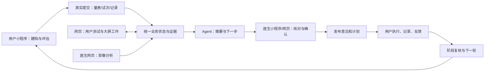

# ADHD 项目升级最终计划：小程序优先、统一 Agent 与医患协同

> **For agentic workers:** REQUIRED SUB-SKILL: Use superpowers:executing-plans to implement this plan task-by-task. Steps use checkbox (`- [ ]`) syntax for tracking. 本文件是总计划；具体执行单元见配套实施工作包，联邦研究按独立工程附录执行。

**Goal:** 在现有项目上，以小程序为主要使用端，通过一个统一 Agent 串联用户评估、医生工作、沟通、计划执行和持续随访，并修正审查发现的16项问题。

**Architecture:** 保留现有 FastAPI、数据库、量表、六类认知任务、影像与前端基础，新增统一身份授权、评估批次、结果归属、审核发布、计划周期和持久事件服务。小程序与网页调用同一业务服务；Agent 通过受限工具读取当前状态、生成动作与草稿，临床意见和个性化安排由医生确认。联邦研究使用独立运行环境和授权域，产出的受审核模型作为辅助证据接入。

**Tech Stack:** FastAPI、SQLAlchemy、现有数据库及版本化迁移、微信小程序原生页面、现有用户/医生网页、DeepSeek 网关与受限工具执行器、独立后台 Worker；HGST 保留隔离环境，联邦研究的 Flower、Opacus 等依赖在独立环境验证后锁定。

日期：2026-10-13。版本：1.0。状态：**最终规划文件；新增业务能力仍需实施与验收。**

配套文件：[实施工作包](C:/Users/Lenovo/Desktop/ADHD-AB协作版/docs/项目升级实施工作包-2026-10-13.md)、[联邦研究工程附录](C:/Users/Lenovo/Desktop/ADHD-AB协作版/docs/联邦研究工程附录-最终版-2026-10-13.md)。

## 1. 定位与版本依据

项目的主要形态是：**用户主要在小程序中使用，医生也能在小程序中完成日常医患工作；网页承担配套和大屏工作；统一 Agent 贯穿整个流程。**

用户小程序负责建档、评估、测试、报告、日记录、任务、医患沟通与随访。医生小程序覆盖医生网页的日常业务功能；原始影像查看、交互可视化与影像处理留在网页，已经生成的影像分析报告、结论与说明在小程序可读。

用户网页保留查看自身数据、报告和完成量表/测试的能力。医生网页保留用户资料、综合报告、医患业务和影像工作。网页也能使用统一 Agent；各端使用同一授权、数据和业务版本。

本计划整合以下材料，并以用户在后续交流中确认的要求修正旧表述：

| 材料 | 本次处理 |
|---|---|
| [原总方案](C:/Users/Lenovo/Desktop/ADHD-AB协作版/docs/项目升级总方案-2026-10-12.md) | 保留评估、审核、随访、隐私及联邦主线；重写两端分工、Agent 和阶段依赖 |
| [审查报告](C:/Users/Lenovo/Desktop/ADHD-AB协作版/docs/项目升级方案审查报告-2026-10-13.md) | 将 R01—R16 全部转换为实施与验收要求，见第15节 |
| [小程序产品方案](C:/Users/Lenovo/Desktop/ADHD-AB协作版/docs/小程序优先-AI辅助诊断与医患协同升级方案-2026-10-12.md) | 复用页面、七环节 AI、成人/儿童流程；首期医生移动业务范围按本计划扩大 |
| [Agent 调研](C:/Users/Lenovo/Desktop/ADHD-AB协作版/docs/AI智能体开源调研与接入建议-2026-10-12.md) | 借鉴工具与结构化输出设计；不同时引入多套编排框架 |
| [隐私与联邦方案](C:/Users/Lenovo/Desktop/ADHD-AB协作版/docs/隐私保护与联邦研究设计方案-2026-10-12.md) | 保留四模块本机首版、独立医院后续部署、用途授权和保护边界 |

文档优先顺序：**本总计划 → 本版实施工作包/联邦附录 → 旧方案及旧工程附录。** 配套文件负责展开，不得放宽总计划的产品、授权和发布条件。旧文件保留作历史依据；旧文件的阶段编号不再决定本次实施顺序。

审查覆盖主要业务链路、核心实现和局部合成反例，并未达到全项目每一行、所有交互均完整验证。旧测试通过不能证明新能力已经实现；本计划也不预先承诺临床准确率、效率提升或真实多院安全。

## 2. 已确认需求与交付映射

| 编号 | 固定要求 | 实施与验收位置 |
|---|---|---|
| U01 | 小程序是主要产品和优先投入方向，首期后继续深化 | 第3、12节；W07、W08、W10；A01、A07、A10 |
| U02 | 用户主要在小程序完成评估、记录、报告、沟通和随访 | 第4节；W03—W07；A01—A06 |
| U03 | 医生小程序覆盖医生网页日常业务，原始影像操作例外 | 第3、4节；W06、W07；A07 |
| U04 | 已生成的影像分析报告和结论在医生小程序可读 | 第3、10节；W07、W09；A07、A09 |
| U05 | 医生网页查看影像、用户资料和综合报告，并完成大屏业务 | 第3、10节；W07、W09；A07、A09 |
| U06 | 用户网页能看自己的数据，也能做量表和测试 | 第3、6节；W07；A08 |
| U07 | 一个统一 Agent 串联功能、用户与医生，网页也可用 | 第5节；W08；A10、A11 |
| U08 | Agent 在关键流程节点主动给出下一步，也能随时提问 | 第5节；W08、W10；A10 |
| U09 | 成人和儿童首期同时支持；背景选填；无需先有确诊 | 第4、7节；W02、W03、W06；A01、A02 |
| U10 | 儿童首期不另设家长注册；一位主要监护人管理一名儿童 | 第4、8节；W02；A02、A12 |
| U11 | 联邦首版完成本机三节点四模块闭环，后续独立医院部署 | 第11、12节及附录；W11、W12；A15 |
| U12 | 日常业务、医生、研究与管理权限分开，安装不自动训练 | 第8、11节；W02、W11；A13、A15 |

## 3. 两端功能与角色范围

### 3.1 功能矩阵

“支持”指在当前角色有效授权范围内提供可操作入口和同等业务结果；移动端可以分步排版，不得因此缺失关键操作。

| 功能 | 用户小程序 | 用户网页 | 医生小程序 | 医生网页 | 首次验收 |
|---|---|---|---|---|---|
| 注册、登录、档案、身份和用途同意 | 支持 | 支持 | 支持本人账号/权限 | 支持本人账号/权限 | P0/P1 |
| 本人/儿童量表和认知测试 | 主入口 | 保留并对齐可用协议 | 发布、查看和要求重测 | 同左 | P1 |
| 背景资料、结果、历史、综合报告 | 查看自身范围 | 查看自身范围 | 查看关联授权范围 | 同左，大屏阅读 | P1 |
| 医患邀请、接受、共享与撤回 | 支持 | 支持 | 支持 | 支持 | P1 |
| 患者列表、工作队列、批次和任务管理 | 接收自己的任务 | 接收自己的任务 | 全部日常操作 | 同左 | P1 |
| 原始结果核对、审核、退回、补问、发布意见 | 查看已发布内容/答复 | 同左 | 支持 | 支持 | P1 |
| 制定计划、调整计划、阶段复核和下一轮 | 接收、执行、反馈 | 支持对应业务 | 支持 | 支持 | P1 |
| 日记录、执行反馈、消息与关注项 | 主入口 | 支持 | 查看、回复、处理 | 同左 | P1 |
| Agent 动作、解释、草稿与聊天 | 重点展示 | 配套展示 | 重点展示 | 配套展示 | P1 起 |
| 原始影像、切片、三维/Findviz 交互、ROI 上传与处理 | 结果入口 | 已有允许入口 | 不提供原始影像操作 | 专业操作入口 | P0/P1兼容 |
| 已完成的影像分析报告、模型版本、说明 | 获准发布范围 | 同左 | 可读、可纳入审核 | 同左 | P1 |
| 可比变化与多阶段总结 | 主入口 | 配套查看 | 支持复核和调整 | 支持大屏对比 | P2A |
| 普通角色可见的用途记录和操作记录 | 支持自身范围 | 同左 | 支持授权范围 | 同左 | 随相关功能 |
| 联邦项目、节点审批、研究训练与模型管理 | 具体研究授权 | 具体研究授权 | 普通医生无此权限 | 另有研究/DAC角色的工作台 | P2B/P3 |

医生小程序与网页的日常功能清单必须逐项验收，包括任务、审核、计划修改、消息、关注项和随访。不能仅以“能看患者列表和报告”认定医生端完成。

医生同时获得研究或管理角色时，额外权限由独立授权决定。研究/DAC控制台的首期交付在网页；它不属于普通医生日常业务权限，不通过 `researcher` 技术枚举自动授予。

### 3.2 小程序信息组织

用户角色按“首页、评估、记录、沟通、我的”组织；报告可以从首页、评估和个人历史进入。首页重点显示当前档案、今日任务、待同步、医生已发布内容与 Agent 下一步卡。

医生角色按“工作台、患者、沟通、我的”组织，患者详情包含资料、评估、报告、计划、随访和已完成影像分析报告。导航根据角色切换；切换角色与档案时停止旧请求、隐藏敏感旧内容。

复用已有 `home`、`scale`、六类认知、`tracking`、`tracking-trend`、`report`、`doctor-home`、`doctor-patient`、`ai-chat`、`privacy-settings` 等页面。新增审核和计划页面承接实际业务状态，不重新做一套独立数据系统。

## 4. 统一的实际使用流程

### 4.1 成人用户

1. 注册或登录，建立本人档案，记录必要年龄和基本身份；没有 ADHD 诊断也可使用。
2. 背景资料自愿填写，可全部跳过。Agent 说明适用模板、预计操作和下一步。
3. 未关联医生时，创建 `self` 评估；已接受医生任务时，进入对应批次与项目。
4. 用户完成实际量表答案及认知试次，客户端保存本地待提交记录，服务端核验、计分并关联本次尝试。
5. 无医生时查看明确标注的自助结果；关联医生后，可以按授权共享原批次，医生决定证据是否需要补充。
6. 医生查看真实证据及 AI 草稿，进行证据审核、补问、要求重测或形成专业意见。
7. 医生发布意见与计划；用户查看并确认接收，按日期执行记录和任务，反馈困难。
8. 周期到期生成阶段材料，医生复核后继续、调整或结束，并决定下一轮。

共享历史自助结果不改变其原有批次或尝试。医生要求新的正式任务时，新建项目/尝试；不能把历史结果改贴新任务 ID。

### 4.2 儿童与监护人

1. 现有注册入口增加“本人使用/为儿童使用”，不新增独立家长注册流程。登录账号与被评估儿童档案仍是两个不同对象。
2. 首期限定一位主要监护人管理一名儿童，记录关系证明、确认方式、有效期和同意；儿童档案中的年龄与监护人年龄分开。
3. 观察量表由适用模板要求的实际观察者填写；认知任务由儿童执行。每次保存执行者、填写者、提交者、协助情况和当时年龄。
4. Agent 用适龄说明引导，不能替儿童或监护人生成答案；背景仍可跳过。
5. 医生审核儿童证据，发布给获授权监护人的意见与计划；监护人执行记录并反馈，进入阶段复核。

成人和儿童在 P1 同时完成端到端验收。教师、多儿童、多监护人协作在 P3 扩展；儿童业务上线不表示儿童自动加入研究。

### 4.3 医生日常工作

医生在小程序或网页确认医患关联 → 选择批准的模板和任务 → 发布评估 → 查看实际提交与质量 → 核对 Agent 摘要和原始证据 → 补问/重测/审核 → 发布意见及计划 → 沟通和处理执行问题 → 阶段复核 → 发布下一轮。

影像原件操作在医生网页完成，分析产物记录在服务端。医生回到小程序后可查看已生成报告、来源、模型版本和状态，并纳入综合审核。

### 4.4 主流程图

## 5. 统一 Agent 的产品与执行契约

### 5.1 一个 Agent，连接同一业务流程

保留现有聊天、浮层和规则说明基础，统一为一个 Agent 服务和入口。它按当前角色、档案、任务和阶段提供不同视图；用户私人对话、共享反馈、医生草稿仍有各自的可见范围。

Agent 的长期状态来自服务端业务对象。聊天历史帮助对话理解，不能替代任务、同意、审核和计划记录。用户端与医生端不靠互传整段聊天完成协作，而是通过有范围的证据、共享反馈和正式发布事件衔接。

### 5.2 首期主动节点

用户选择的交互方式固定为：**关键流程节点主动给出下一步，也能随时提问。** P1 即交付下表，不将主动 Agent 全部留到 P2A。

| 触发节点 | 用户看到什么 | 医生看到什么 | 状态依据/人工控制 |
|---|---|---|---|
| 进入首页/当前档案 | 继续评估、待同步、查看已发布意见等动作 | 当前待审核、待回复、待复核队列 | 当前授权和服务端状态；动作再次核验 |
| 开始量表或测试前 | 适用项目、中性操作说明、实际填写者确认 | 已发布任务配置与进度 | 批准模板；不改标准题目 |
| 完成并提交一项 | 已保存/待同步、剩余项目和继续入口 | 实际结果到达与质量提示 | ACK 与真实结果关联；不以本地完成冒充提交 |
| 本轮材料齐备 | 自助解释或“等待医生审核” | 证据摘要、未知项、审核入口 | 持久生成草稿；医生核对 |
| 医生补问/要求重测 | 具体问题或新尝试入口及原因 | 处理进度 | 医生确认请求，用户实际答复 |
| 医生发布意见/计划 | 通俗解释、今日任务、查看来源 | 发布状态和接收状态 | 只解释已发布版本；用户确认接收 |
| 用户反馈困难/出现质量异常 | 提交反馈、联系医生或中性操作建议 | 有来源和负责人的关注项 | 规则触发与批准模板；临床改变需医生确认 |
| 周期到期 | 阶段进度、待复核、下一步 | 覆盖率、可比变化、下一轮草稿 | P1规则摘要，P2A深化比较；医生复核 |
| 随时打开聊天 | 围绕当前任务、已发布结果与使用方法提问 | 围绕已授权证据及工作队列提问 | 相同 Agent；按角色取上下文 |

主动动作卡包含业务对象、原因、目标页面、版本和状态。相同事件只生成一次有效动作；状态已变化时刷新或撤销。正式计时试次隐藏浮层和弹窗，测试完成后恢复。

### 5.3 工具白名单与执行权限

| 工具 | 首期行为 | 确认与限制 |
|---|---|---|
| `get_current_tasks`、`get_progress` | 查询当前任务、批次和周期 | 只读；对象由服务器绑定 |
| `get_authorized_evidence` | 读取允许的结果、报告、质量与证据引用 | 只读；临床共享与私人聊天分开 |
| `suggest_next_action` | 返回批准页面和业务动作卡 | 不自动开始测试；用户点击后核验 |
| `draft_profile_fields` | 将用户主动提供的背景整理成字段草稿 | 用户逐项确认后保存；跳过保留未知 |
| `draft_assessment_summary`、`draft_cycle_summary` | 持久化有来源的解释/摘要草稿 | 数值由程序计算；不能成为已审核报告 |
| `draft_review_questions`、`draft_plan`、`draft_reply` | 给医生提供可编辑草稿 | 医生确认具体内容及接收方后发布/发送 |

禁止 Agent 自行诊断、替用户答题、修改真实试次、自动发布临床意见/计划、变更授权、开始训练、批准节点、修改预算或激活模型。工具草稿写入和普通业务写入分开；对模型请求的工具参数仍执行服务端校验。

模型提供工具调用请求，应用负责执行和回传结果；工具调用格式可解析不等于具有权限或临床正确性。[DeepSeek 工具调用说明](https://api-docs.deepseek.com/guides/tool_calls/)

### 5.4 一次 Agent 运行

1. 验证操作者、档案访问、医患关系、用途同意及有效期；记录授权版本、输入对象版本和运行 ID。
2. 只装载当前所需字段与证据摘要。默认不外发姓名、联系方式、原始影像、ROI、试次原件、研究数据或整段私人历史。
3. 外部 AI 需要独立用途同意和字段白名单；用户拒绝时提供规则模式，评估、提交和医生审核继续可用。
4. 初始上限为三轮模型/工具循环、六次工具调用、后台单次运行60秒；模型单次超时20秒。token 与费用额度由部署配置限制并记录，不宣称该数值已做性能验证。
5. 校验结构、引用、分数和动作：不存在的证据、越界对象、缺失补零、未经验证的概率和诊断措辞均拒绝进入可发布产物。
6. 写入草稿或返回前重新核验授权和输入版本；已撤回、输入更新或关系失效的运行停止，旧草稿不能发布。
7. 失败返回明确状态和规则替代；业务操作先独立完成，AI 超时不回滚用户已提交结果。

患者描述、备注、上传说明、网页文本和模型输出均视为不可信内容，不能通过其中的指令扩大工具权限。动作 ID 由服务端解析映射，不执行模型生成的任意链接、脚本、SQL 或程序。

### 5.5 产物与医生确认

`AIArtifact` 保存草稿类型、证据 ID/版本、输入摘要、授权版本、模型/规则版本、状态和编辑记录；`AgentRun` 保存模式、耗时、调用与失败，不保存无必要的外部模型内部思考。

显示分为“系统计分/原始结果”“AI 草稿”“医生已发布意见”。医生可以编辑、拒绝、要求重测；确认提交必须携带 `expected_version` 与输入快照摘要。数据更新或授权变化后返回409并要求重新核对。

P2A 增强 Agent 的长周期总结、医生回复和计划草拟、执行困难归纳及可比变化解释。小程序仍是重点；网页同步承接相同业务产物和必要操作。

## 6. 评估、提交、任务与周期契约

### 6.1 一轮评估与项目

新建 `AssessmentSession` 表示一轮评估，类型为 `self` 或 `doctor_assigned`，有档案、模板/版本、当时年龄、前序批次、授权范围及可空负责医生。

引入 `AssessmentItem` 表示本轮量表/认知项目。自助评估使用它，不伪造医生账号去满足旧 `PatientTask.researcher_id` 必填约束。医生评估中，`PatientTask` 引用 `AssessmentItem` 并保留真实发布者；计划任务引用周期和计划版本。历史任务结构保留兼容标记。

`TaskAttempt` 保存每次实际尝试、执行者、填写者、提交者、协议和状态；重新测试产生新尝试，旧证据不覆盖。

### 6.2 分开记录执行、质量和审核

| 对象 | 状态/维度 | 终态说明 |
|---|---|---|
| AssessmentSession | `draft → active → evidence_ready`；之后按来源流转 | 自助为 `closed_self`；医生流程为 `under_review → reviewed`；另有 `suspended`、`cancelled` |
| AssessmentItem/TaskAttempt 执行 | `not_started → in_progress → submitted` | 本地离线为客户端 `pending_sync`，不视为服务器已提交；允许明确 `cancelled` |
| 结果质量 | `pending_validation`、`valid`、`limited`、`invalid` | 质量无效仍保留原始证据和原因，可要求新尝试 |
| 医生验收 | `not_required`、`pending_review`、`accepted`、`needs_repeat`、`rejected` | 自助为 not_required；临床任务仅医生可 accepted |
| 计划版本 | `draft → published → acknowledged` | 新修订替代未来安排；旧已发布内容保留；撤回关系可 suspended |
| FollowupCycle | `scheduled → active → due_for_review → reviewed → closed` | 未完成、暂停、取消有真实原因和责任出口 |
| AttentionItem | `open → acknowledged → resolved` 或 `closed_with_reason` | 通知发送成功不等于问题已解决 |

不能用一个 `completed` 同时代表本地结束、有效提交、医生验收和诊断。用户在首页看到对应事实及下一步。

### 6.3 提交幂等与不可变归属

所有新提交含 `submission_id`、`patient_id`、`assessment_id`、`assessment_item_id`、`attempt_id`、`run_id`（适用时）、`protocol_id/version/config_digest`、`actor/performer/respondent`。医生任务另有 `task_id`；日记录另有 `cycle_id`、真实 `record_date` 与修订号。

服务端先核验归属和权限，再规范化允许的别名/数值表示，计算包含业务上下文和实际内容的摘要。任务由用户能访问的服务器对象确定，不能相信客户端声明的完成状态。

| 情况 | 结果 |
|---|---|
| 同 submission/run、上下文和规范化内容完全相同 | 返回原结果和原状态；仅推进一次 |
| 同 ID 更换档案、批次、项目、任务、尝试、协议或实际内容 | 409冲突，不能返回旧成功或重绑定 |
| 同 ID 并发提交 | 唯一约束与事务保证只产生一个结果；另一请求核对原记录 |
| 用户真正重测 | 新 attempt/run，保留前次结果 |
| ACK 丢失或超时 | 按 submission ID 查询/原样重试，得到真实已提交状态 |
| 老客户端缺少新归属字段 | 进入明确 legacy/自助历史范围，不推进新正式任务或新周期 |

量表答案和认知逐条试次由服务端核验、计分；既有 `gonogo/reaction` 等兼容别名规范化后再摘要，不因为等价写法误报冲突。新 API 明确201首次创建、200完全相同重试；旧路由兼容其旧状态码，但必须拒绝冲突内容。

### 6.4 事务与事件

同一个数据库事务包含：结果/记录 → 结果关联 → 执行与审核待办状态 → `CareEvent` 事务性 outbox → 本操作关键审计。提交前失败全部回滚；提交后事件留在数据库，即使外部队列发送失败也可恢复。

Worker 用事件 ID 去重，采用租约、重试次数和退避。摘要、关注项和通知有业务唯一键；崩溃恢复不得重复发布意见、丢失待办或覆盖新版本。通知采用至少一次投递和可去重收件箱；第三方通知若无幂等能力，不承诺绝对只送达一次。

敏感读取先持久记录访问申请及授权检查，再返回资料；无法持久记录关键审计时不披露资料。读取结果状态可恢复记录。普通观察日志不能在业务已提交后统一将成功改成503并让客户端无法判断；写入状态可按 submission 查询。

### 6.5 离线队列与跨端继续

小程序用按 submission/attempt/run 索引的持久队列保存不可变提交，包含账号、档案、批次、协议与会话信息。每一 ACK 只删除对应条目；不同尝试不能覆盖。队列满、存储失败、退出或授权失效均显示实际状态与恢复入口，禁止静默丢弃。

先落本地成功再显示“待同步”；重连逐项重试。服务器正式完成以 ACK/查询为准。账号退出时从活动命名空间移除待提交内容并取消重试；选择保留恢复数据需使用受保护且有明确所有者的存储，不能在另一账号自动恢复。

跨端继续获取服务端已保存版本。未同步草稿只属于原设备，界面说明同步状态；同一量表草稿两端并发修改使用修订检查，不能无提示覆盖。正式认知试次不跨设备接续，换设备开始新尝试。

### 6.6 周期记录

新记录主键范围为档案＋周期＋真实日期；记录当日状态、原始记录时间、实际提交时间及修订。14天可以是一个批准的计划周期，第二轮仍有独立 `cycle_id`，不复用 day_index 1—14覆盖第一轮。

缺失保持为空；补录明确标注，不能伪装当天实时记录。计划调整后只改变未来安排，已执行证据保留其当时计划版本。逾期、无法执行、取消和中断均有原因及后续处理。

## 7. 专业结果与比较规则

### 7.1 模板准入

成人 ASRS、儿童 SNAP-IV 以及六类认知任务复用现有基础。上线前冻结适用年龄、实际填写者、原始措辞、来源/许可、计分、任务组合、质量判据与解释版本。教师观察与家长观察不合并为同一个填写者来源。

背景信息用 `provided`、`unknown`、`skipped` 及来源/确认人表示。未提供不能变成“无相关病史”“无症状”或0。医生需要某项信息时补问具体项目，不将全部背景改为注册/评估必填。

### 7.2 医生确认的具体含义

| 报告类别 | 可以表达什么 | 发布要求 |
|---|---|---|
| `self_screening` 自助筛查 | 标准计分、筛查提示、证据不足与建议联系专业人员 | 系统结果；明确非诊断 |
| `evidence_review` 证据审核 | 材料是否有效、是否需补问/重测 | 医生核对证据；不自动变为诊断 |
| `screening_opinion` 医生筛查意见 | 基于现有资料的专业筛查意见及下一步 | 医生编辑确认；注明局限 |
| `clinical_assessment` 临床评估意见 | 获得临床评估所需资料后的综合判断 | 合格专业人员、专业模板、临床记录引用 |
| `diagnosis` 诊断结论 | 在该机构合规诊疗流程中的诊断 | 资质、规定证据及诊疗流程齐备；首期演示环境禁止此类型正式发布 |

诊断发布需要模板规定的访谈/临床记录、必要的多场景信息与专业审核，不由量表、单次认知测试或“医生点击确认”单独触发。可引用院内已有记录，不要求用户在平台注册时填完所有病史。[NICE ADHD 指南](https://www.nice.org.uk/guidance/ng87/chapter/recommendations#diagnosis)

模型输出属于辅助证据，展示适用范围、来源和局限。不输出未经验证的患病概率、固定可信度、亚型或治疗效果。

### 7.3 可比性门禁

可比性判定由程序执行并返回可比/有局限/不可比及原因。至少核验：

- 量表版本、适用年龄、填写者关系、来源、回忆窗口、作答完整性与缺失。
- 认知任务协议/版本、配置摘要、刺激布局、输入方式、设备/环境、计时质量、实际试次、练习与重复暴露、重测间隔。
- 周期日期、覆盖率、补录、计划变化及外部事件。

记录设备条件不保证不同设备已校准。没有经验证的可比条件时只并列显示原始结果，AI 不解释为改善或恶化。

现有 ASRS/SNAP 说明使用近六个月回忆窗口，14天重测存在大量窗口重叠，不能直接解释为这两周治疗效果。保留标准措辞；短期随访以批准的日记录/短期指标和执行情况为主，量表重测按专业安排解释。

用户网页继续提供测试。若某个网页简版缺少正式协议要求的试次/计时，标为练习或非等价历史，不完成该正式任务；P1 发布前补齐开放的正式任务协议，不能把网页全部测试能力删除来回避兼容。

## 8. 身份、医患授权与撤回后的责任

### 8.1 权威身份与用途授权

保留 `User` 为登录账号、`Patient` 为被评估档案，新增 `PatientAccess` 表达 self/guardian 访问。`researcher` 旧枚举继续兼容；医生资格、研究项目成员、机构管理与 DAC 权限分别核验。

医患关系采用 `pending → active → revoked/expired`，邀请需双方按流程确认，范围包含可共享对象/时间/用途。旧按邮箱绑定不能自动视为已接受新共享。

`ConsentRecord` 是用途授权的唯一权威来源，包含实际授权人、对象/项目范围、版本、条款、有效期、撤回和当时身份依据。基本使用、临床共享、外部 AI、具体研究分别记录；拒绝研究或 AI 仍可做日常评估。

每次请求、排队任务开始、产物保存和发布均重新检查当前状态，缓存命中也不得绕过。私人 AI 对话默认不向医生全量共享；用户可确认共享特定反馈摘要。

### 8.2 监护关系生命周期

监护关系需有可核查的建立、到期/失效、账号恢复、交接和成年转换流程。失效立即停止新增敏感读取/提交；历史记录按当时合法访问范围和留存规则保留。

恢复或交接由具备机构权限的流程核验，不靠修改 patient_type 或年龄获得权限。成年转换保留原档案及历史执行者，确认本人控制和新的用途同意，终止默认监护访问；不能把监护人账号自动改成成年本人账号。

临床模板年龄分组与法律上的不满十四周岁规则分开处理。真实儿童资料使用需监护同意、专门规则及相应影响评估；责任机构完成文件和流程核验后开放真实资料入口。[个人信息保护法第31、55条](https://www.cac.gov.cn/2021-08/20/c_1631050028355286.htm)

### 8.3 医患共享撤回与在途业务

撤回事务写入授权修订和业务事件，使相关医生的新请求立即失败，并将其未完成审核、后续任务、当前计划和关注项标记为 `suspended` 或撤回失效。正在生成的草稿重新检查授权后不得保存为可见共享产物或发布。

用户仍可查看依法保留的自身结果和历史已发布内容，明确显示当前计划已暂停及原因。用户可继续独立自助或重新接受另一位医生邀请；不能将已暂停医嘱改写成 Agent 的自助治疗安排。

需交接时产生责任交接记录：对象清单、原负责范围、用户授权、新医生接受、交接时刻和处理状态。新医生未接受前不视为交接完成。原医生是否仍有机构依法留存/处置权限由独立依据决定，不能沿用已撤回共享令牌。

在无有效医生的周期中，系统提供暂停/自助/重新关联出口，不继续把关注项分给无权访问的人。研究撤回停止后续计算和未提交轮次；已经发布模型的影响不能承诺即时消除，需记录处置及是否重训。

### 8.4 医生响应与关注项

每个临床关注项有负责医生/获授权机构工作队列、期望处理窗口和实际状态。值守时间、替班和超时升级由机构配置，用户界面如实显示，不能由“AI主动提醒”推导出24小时有医生响应。

紧急情况按机构批准的固定流程提示现实医疗联系途径，不能仅进入普通待办等待 Agent 或医生上线。未部署有效值守流程的演示模式明确说明服务范围。

## 9. 旧能力修补、加密与迁移

### 9.1 网页渲染与会话

P0 修补医生患者姓名、用户记录备注及所有消息/报告/AI文本的渲染路径。普通文本使用文本节点；富文本使用单独允许列表和安全渲染器。内容安全策略作补充，不依赖限制姓名字符或存储加密。

网页页面和请求绑定账号、档案、角色、会话修订号；使用跨标签通知与提交/响应复核，账号变化使旧标签失效。旧401只清理发起请求的原会话，不删除新登录；迟到成功不回写新账号。小程序保留已有会话租约并核验新业务使用它。

### 9.2 密文对象归属

现有列名 AAD 保留为 legacy 读取格式；它不能单独证明密文属于哪个患者、记录或版本。新敏感实体采用版本化密文封套，将档案 ID、对象类型/ID、字段、schema/数据版本绑定到认证数据，或提供等价且强制核验的记录完整性机制。

更换对象、字段或版本的密文必须拒绝解密，API 查询前仍检查对象权限。更新业务版本时重新封装；生成对象 ID 后在同一事务写入，禁止在对象身份未确定时使用空 AAD。

历史迁移使用隔离备份、来源核验、批次摘要和可重复迁移；原本未绑定对象的密文不能被追溯宣称具有该保证。全库旧快照回放需要持久版本头及真实部署独立留存/见证，单靠同库认证字段不够。

### 9.3 存量与缓存迁移

| 旧数据 | 新处理 |
|---|---|
| 未归属量表/认知 | 标记 legacy，保留来源和可核实日期；不自动完成新任务 |
| 手动 completed 旧任务 | 保留旧完成方式/证据不足，不改成医生 accepted |
| day_index 1—14 记录 | 独立 legacy 周期；不可核实真实日期显示未知，不从创建时间补造 |
| 按邮箱旧医生绑定 | 记录历史关系，用户重新接受范围明确的共享 |
| 注册时泛同意 | 不替代外部 AI 或具体研究同意 |
| 无归属旧量表/网页测试缓存 | 隔离或清理；不认领给当前账号，不附新 task/assessment ID |
| 有明确 owner 的新草稿 | 校验账号、档案、批次/任务/尝试、模板/协议、填写者及时间后才能恢复 |
| 历史模型 | 如实登记来源、输入与未验证项，不追溯标记DP或临床验证 |

迁移先备份、隔离演练、核对条数/摘要/关系，再正式执行；重复执行不新增重复关系。恢复数据库时不得回滚已撤回授权、审计见证或已消耗隐私账本，应使用独立持久记录复核后开放服务。

## 10. 影像与 HGST 模型接入

### 10.1 网页操作、两端报告

保留受控 ROI 输入、模型推理与 Findviz 原始影像可视化；医生网页完成上传/选择、处理状态查询和影像交互。模型/影像原件权限与普通报告读取权限分别校验。

影像报告包含报告 ID/版本、档案、输入摘要、处理状态、模型版本、用途、结论/局限及专业审核状态。医生小程序只获取允许的报告内容和审核入口，不获取可绕过限制的原始影像直链或会话。

运行失败、无模型、来源未验证、演示数据明确标注。历史已生成的报告可按有效授权查看并保留当时来源状态；新的真实分析和正式综合引用需通过对应模型准入。实验候选和合成结果不进入真实综合报告；模型推理完成不等于医生审核完成。

### 10.2 预处理与权重匹配

研究路径使用 Nilearn `ConnectivityMeasure`，默认协方差估计与部署的 `np.corrcoef` 不相同。不能把两者都叫 correlation 就视为等价。[Nilearn ConnectivityMeasure 文档](https://nilearn.github.io/0.10.3/modules/generated/nilearn.connectome.ConnectivityMeasure.html)

每个基础编码器冻结并绑定：权重摘要、实际训练入口、图谱、ROI顺序/筛选、时间序列条件、估计器、标准化、Lasso参数、超图构建和依赖版本。以实际权重来源选择统一路径，不随意改变一端后继续宣称旧模型含义保持一致。

研究、节点、可信打包和部署对同一固定合成输入做特征/超图/嵌入对照；容差随算法与数值精度预先冻结。来源无法确认时标记未验证，限制为获批研究/演示，关闭对应真实辅助输出；普通量表和医患业务仍可上线。

### 10.3 许可与模型版本

HGST 上游声明科研/教育用途，商业使用需要正式授权。采用前分别核验代码、权重、数据和本项目用途；不能只核验 Flower/Agent SDK 许可。[HGST 许可说明](https://github.com/iMoonLab/HGST/blob/main/README.md#license)

代码许可、编码器来源、输入匹配和效果验证是不同门禁。模型登记统一保存用途、来源、保护范围、评价和状态；可信打包器只接受已验证数值状态，不接收节点任意可执行 `.pt`。

正式激活先确认所有推理实例可加载，再原子切换唯一版本指针；失败保留旧版本。回滚不清零授权、审计和隐私账本；历史报告保留产生时的模型版本。

## 11. 联邦研究作为独立工作线

### 11.1 保留的首版目标

P2B 完成本机三个独立节点进程＋协调服务的四模块闭环：医院节点、联邦协调、DP/安全聚合、研究工作台与模型版本。使用隔离合成 ROI，各节点拥有独立数据/身份/密钥目录。

普通用户使用不需要训练，安装不自动训练，不自动扫描业务库或上传目录。普通医生没有研究批准/训练管理权限。研究控制台与用户具体研究同意分别接入统一授权服务。

固定 HGST 编码器，首版联邦训练 MLP 分类器。DeepSeek/Agent 不在这条训练线上；分类器 DP 不自动保护编码器过去训练或原始影像。

### 11.2 冻结的保护边界

- 初始分类器使用公开种子初始化；已有私有训练分类器只作另行允许的对照。
- 患者级裁剪和噪声，预先固定每患者一份扫描选择规则。空槽、Poisson采样、固定期望批量归一化与实际优化步数和账本匹配。
- 三节点权重各为1，聚合的是共同基础模型的更新，中央不显示未经保护的私有患者数。
- 首版 SecAgg+ 配置采用三节点全员参与，阈值/份额以锁定发行版实际验证；一节点掉线则终止该轮，不明文降级。
- 预算跨项目、失败、重试、重启和回滚持续累计。计算开始前预留，不能因候选未发布就退还已消耗预算。
- 合成/公开验证数据用于固定评价，最终测试集不用于选参；私有评价需要单独保护和核算。
- 威胁模型明确为获批诚实节点、遵守约定流程的好奇协调方；不宣称抵御任意节点串谋、恶意训练或同机管理员。

安全聚合隐藏单节点更新，DP描述指定相邻数据关系下的保护；两者不能互相替代，也不保护所有应用外发。[Flower 安全聚合说明](https://flower.ai/docs/framework/explanation-ref-secure-aggregation-protocols.html)、[Opacus PrivacyEngine](https://opacus.ai/api/privacy_engine.html)

### 11.3 环境、资源与发布

业务环境、旧 HGST 环境和新联邦环境隔离。先验证发行版依赖、数组交换、逐患者DP训练与协议，再锁定。不得为了新库升级旧 HGST/Torch/DHG 环境掩盖冲突。

分类头约1,180万参数、单float32更新约45MiB是原方案结构估算，须实测峰值内存、协议通信和吞吐；未测前不承诺训练时长。首期CPU重型计算限一个槽位、物理微批量1，三个节点仍保持独立进程和协议身份。

本机合成候选仅允许实验发布/预览，API禁止正式激活和进入真实报告。P3 独立医院部署需不同管理域、TLS/节点身份、院内授权、安全随机源、来源许可、数据和效果核验。完整保护参数、状态机、文件与失败用例见本版联邦附录。

## 12. 统一实施阶段与发布规则

### 12.1 阶段安排

| 阶段 | 交付内容 | 退出条件 | 工作包 |
|---|---|---|---|
| **P0：旧能力修补与契约冻结** | 保存基线；网页渲染/会话、访问范围、提交幂等/事务、缓存迁移；专业模板、身份授权、模型来源/预处理与许可核查 | 相关旧风险反例有回归；合同与迁移可验证；未通过的模型能力明确禁用 | W01、W02基础、W04基础、W09预检 |
| **P1：小程序完整业务＋首期统一主动 Agent** | 成人/儿童自助与医生评估；真实任务提交；医生全部日常业务；意见、计划、周期、沟通；报告含已有影像分析；主动动作/聊天/摘要；网页功能配套 | 两类用户完整闭环；医生小程序日常操作清单全通过；网页可看数据/测试；撤回、离线、版本和故障门禁同时通过 | W02—W09 |
| **P2A：小程序 Agent 与协同深化，网页同步配套** | 医生计划/回复草拟、可比变化、困难摘要、长周期协同、专业模板完善；条件满足后订阅通知；网页承接相同产物与大屏阅读 | 可比条件可执行；医生可编辑/拒绝；多周期/中断/交接有出口；通知失败不丢任务 | W10 |
| **P2B：本机四模块联邦研究** | 三节点合成训练、DP/SecAgg+、持久预算、工作台、可信候选打包与预览 | 四模块真实联动；失败不降级；合成候选不能进入真实报告；旧能力通过对应回归 | W11 |
| **P3：机构试点与长期管理** | 真实机构协作验证；教师/多监护/多儿童；独立医院节点；经审核模型激活与回滚 | 医生/机构责任明确，真实授权和安全/临床效果核验完成；不同管理域实际验收 | W12 |
| **P4：受审核的研究扩展** | 更多节点、掉线恢复、编码器联合训练、私有评价、原文密码方案独立适配 | 每项独立定义协议、保护范围与有效性，不扩大继承原型保证 | 单项新研究规格 |

资源不足时优先 P1 和 P2A 小程序主线；P2B 与主线分开交付，不能用联邦演示替代医生小程序、用户网页和日常闭环验收。

### 12.2 功能开放与安全同时验收

| 拟开放能力 | 同批必须具备 | 缺失时 |
|---|---|---|
| 医患数据共享/医生队列 | 真实关系、用途范围、立即撤回、在途任务失效、跨端隔离 | 禁止开放共享能力 |
| 新正式任务/周期 | 不可变归属、真实证据、幂等、离线队列、旧提交隔离、事务outbox | 禁止该任务/周期正式发布 |
| 医生审核/计划发布 | 资质、报告类别、证据要求、输入版本/授权CAS、关键审计、移动端操作 | 禁止正式发布 |
| 外部AI | 独立同意、最小字段、工具白名单、输出/发布重核、规则回退 | 使用规则模式 |
| 两端读取新报告 | 统一版本、状态、权限和能力声明；同范围展示一致 | 完成兼容后开放对应版本 |
| 模型辅助输出 | 许可/来源、输入一致性、用途/评价、演示隔离 | 普通业务可用，未验证模型输出关闭 |
| 真实研究 | 院内授权、独立身份、随机源、预算/协议/审计、来源许可 | 只允许隔离合成原型 |

撤回传播、版本共享和网页兼容不能整体推迟到 P2A；P1 已经开放的能力必须在 P1 具备这些条件。后续可以加强界面和性能，但不能先发布缺乏授权或提交保护的功能。

## 13. 数据、服务与接口职责

### 13.1 核心对象

| 领域 | 对象 | 固定职责 |
|---|---|---|
| 身份 | User、Patient、PatientAccess、GuardianRelationship | 登录/被评估者/执行者分开，历史身份不变 |
| 资料 | ClinicalProfile、ProfileVersion | 选填状态、来源、确认与版本 |
| 授权 | CareRelationship、ConsentRecord | 临床共享与具体用途唯一权威 |
| 评估 | AssessmentSession、AssessmentItem、TaskAttempt | 自助/医生流程、本轮项目、每次尝试 |
| 提交 | SubmissionRecord、结果关联、ScaleResult、CognitiveTest | 规范化摘要、不可变归属、原始证据与系统计分 |
| 审核 | ReviewRecord、ReportVersion | 类别、输入快照、医生决定与正式发布 |
| 计划 | CarePlan、PlanVersion、FollowupCycle、TrackingLog | 医生安排、实际日期、修订和下一轮 |
| 协同 | CareMessage、AttentionItem、ResponsibilityTransfer | 可见范围、处理责任和实际闭环 |
| Agent | AgentRun、ToolCall、AIArtifact | 有限上下文、调用、草稿、引用及失败 |
| 事件 | CareEvent/outbox、Notification、关键审计 | 原子写入、可恢复投递、事件去重 |
| 模型 | ModelRegistry/ModelVersion、影像报告 | 单一模型版本与辅助证据来源 |
| 联邦 | Project/Member/Node、Experiment/Round、PrivacyLedger/Receipt | 独立研究准入、冻结清单、持久预算；引用统一同意 |

### 13.2 业务服务与 API

以下为拟实现的契约，尚非现有可调用接口；沿用当前路由风格与 `patient` 技术称谓。表中日常业务路径相对于统一前缀 `/api/v1`，联邦行列出包含此前缀的完整路径。`expected_version`、幂等ID和授权核验是服务层职责，不依赖客户端隐藏按钮。

| 接口组 | 方法/路径 | 核心行为 |
|---|---|---|
| 能力 | `GET /care/capabilities` | 当前端/角色支持的任务协议、报告schema及功能；不作为权限依据 |
| 档案 | `GET/PUT /patient/profile` | 实际档案、背景状态和版本；改写需版本匹配 |
| 用途 | `GET/POST /patient/consents`、`POST /patient/consents/{id}/withdraw` | 条款/范围/版本、实际授权人、撤回事件 |
| 医患关系 | `POST /care/relationships/invitations`、`POST /care/relationships/{id}/accept`、`POST /care/relationships/{id}/revoke` | 邀请、确认、范围与责任暂停 |
| 评估 | `POST /care/patient/assessments`、`POST /care/doctor/assessments`、`GET /care/assessments/{id}` | 自助批准模板/医生发布流程；按项目返回证据与状态 |
| 尝试 | `POST /care/assessment-items/{id}/attempts` | 新尝试、协议冻结、执行者和填写者核验 |
| 统一提交 | `POST /care/submissions`、`GET /care/submissions/{id}` | 类型化真实负载、同事务归属、状态查询；旧提交路由适配同一服务 |
| 医生审核 | `POST /care/assessments/{id}/reviews`、`POST /care/reviews/{id}/publish` | 证据类别、输入快照、版本与授权原子核对 |
| 计划 | `POST /care/plans`、`POST /care/plans/{id}/publish`、`POST /care/plans/{id}/acknowledge`、`POST /care/plans/{id}/revisions` | 草稿、确认、接收、版本化未来安排 |
| 周期 | `GET /care/cycles/{id}`、`POST /care/cycles/{id}/reviews` | 实际记录、覆盖率、阶段复核和下一轮草案 |
| 报告 | `GET /care/reports/{id}/versions/{version}` | 指定不可变报告与证据清单，两端同范围同版本 |
| 首页/工作台 | `GET /care/patient/dashboard`、`GET /care/doctor/work_queue` | 服务端状态、待办、动作；响应带版本 |
| 沟通 | 现有 `/care` 消息/任务扩展、关注项 resolve/transfer | 正式任务与旧文字任务区别，负责人与处理记录 |
| Agent | `POST /ai/agent/run`、`GET /ai/agent/runs/{id}` | 短请求返回运行ID；后台执行/查询；兼容旧 `/ai/chat` |
| 影像报告 | `GET /care/imaging-reports/{id}` | 已生成分析产物；不返回原件操作会话 |
| 联邦 | `/api/v1/federated` 下项目/节点/实验/模型接口 | 独立研究权限和节点通道，详见附录 |

HTTP语义：401只使匹配的原会话失效；403拒绝已认证无授权访问；409表示上下文/内容/版本冲突；422表示负载或协议无效；202表示持久接收的后台任务；服务不可用时提供可核查的提交/任务ID，不暗示已经提交的业务不存在。

## 14. 验收场景与交付证据

### 14.1 主业务与 Agent

| 编号 | 实际验收场景 | 必须观察到 |
|---|---|---|
| A01 | 成人跳过全部背景，自助评估后共享给医生，走完计划及第二轮 | 跳过为未知；无假医生；历史归属保持；第二轮独立 |
| A02 | 监护人使用儿童档案，完成量表、儿童认知和随访 | 适龄模板；填写/执行/提交者分开；不混入监护人自身数据 |
| A03 | 同提交重试、并发、换任务/内容，ACK丢失后恢复 | 相同只推进一次；冲突409；按ID可查询真实结果 |
| A04 | 断网完成两次同类认知，关页面重开，逐项ACK | 两份原始尝试都存在；只删除ACK对应项；无伪提交 |
| A05 | 两个14天周期、补录、修订、缺失与计划变更 | 真实日期/周期独立；缺失非0；历史版本可追溯 |
| A06 | 医生审核时收到新资料/撤回；修改草稿并发布计划 | 过期输入409；无授权不能发布；报告类别明确 |
| A07 | 医生在小程序完成网页日常业务清单，并读已有影像报告 | 无需网页补做审核/计划/沟通；原始影像操作仅网页 |
| A08 | 用户网页做量表/正式可用测试、看数据；两端同时读取报告 | 正式协议对齐；旧简版不冒充正式；同版本/范围一致 |
| A09 | 固定ROI在研究/节点/部署对照，切换许可或来源状态 | 契约一致可核查；不同估计器/未验证来源被限制 |
| A10 | 在首页、提交、医生发布、反馈、周期到期主动展示动作并随时问 | 下一步指向真实业务对象；两角色连接同一状态；计时中不干扰 |
| A11 | AI超时、错误引用、提示注入、越权工具、授权中途撤回 | 规则/手动流程继续；拒绝无效产物；不扩大权限或自动发布 |

### 14.2 安全、生命周期与研究

| 编号 | 实际验收场景 | 必须观察到 |
|---|---|---|
| A12 | 监护失效/恢复/交接/成年转换；撤回医患共享且存在在途业务 | 原访问失效；新范围重新确认；任务/计划暂停；有责任出口 |
| A13 | 合成HTML姓名/备注、跨账号/跨角色多标签、旧401/迟到成功 | 文本无执行；旧页面不能用新token；新会话不被旧响应清理 |
| A14 | 事务/审计/outbox/ACK不同窗口中断，密文跨对象/版本交换 | 已提交可查询；无丢待办/重复发布；错误对象密文拒绝 |
| A15 | 三节点真实合成训练、DP与安全聚合、掉线、预算/重放、候选预览 | 四模块完整；不明文降级；预算不重置；合成不能正式激活 |
| A16 | 隔离迁移、两次重复执行、旧缓存和旧结果、文档交付检查 | 不伪造旧数据归属/日期/同意；不丢旧证据；附录随交付存在 |

每阶段保存执行环境/依赖、命令、实际输出、UI/真机操作证据与未验收范围。单元、合成和本机测试不能替代微信真机、生产数据库、不同医院管理域或临床有效性验收。

前轮后端隔离基线曾记录170项通过；这是审查时期旧行为的证据，见[基线测试记录](C:/Users/Lenovo/Desktop/ADHD-AB协作版/docs/evidence/audit-backend-tests-2026-10-12.txt)，不作为本计划新功能验收结果。

### 14.3 衡量方式

业务指标：有效提交与恢复率、审核耗时、计划执行/反馈、阶段复核、下一轮衔接，成人/儿童分开。Agent指标：引用错误、草稿修改/拒绝、动作完成、医生核对耗时。研究指标：效果与独立评价、隐私消耗、协议耗时、通信和内存。先测基线再设目标，不预设提升百分比。

## 15. 16项审查问题的关闭映射

| 问题 | 本计划决定 | 阶段/工作包 | 关闭证据 |
|---|---|---|---|
| R01 不可信HTML渲染 | 第9.1节安全文本与富文本约束，覆盖旧页面 | P0/W01 | A13，姓名/备注/AI输出浏览器用例 |
| R02 网页多标签会话 | 第9.1节页面/请求修订、跨标签失效、迟到响应保护 | P0/W01 | A13，旧标签无法借新token提交 |
| R03 HGST预处理不一致 | 第10.2节实际权重输入契约与多环境黄金对照 | P0/W09；P2B继承 | A09，特征/超图/嵌入与包摘要 |
| R04 同run不同内容 | 第6.3节规范化摘要＋完整归属不可变 | P0/P1/W04 | A03，相同重试成功、冲突409 |
| R05 事务/审计/事件 | 第6.4节同事务outbox和关键审计、读写失败语义 | P0/P1/W04、W05 | A14，中断恢复与状态查询 |
| R06 离线单槽覆盖 | 第6.5节多submission持久队列和逐项ACK | P1/W04、W07 | A04，两次断网尝试保留 |
| R07 无归属旧缓存 | 第9.3节隔离旧缓存，不迁给当前账号 | P0/P1/W01、W07 | A16，切换账号无自动认领 |
| R08 审核与诊断混淆 | 第7.2节报告类别、证据与专业发布门禁 | P0/P1/W06 | A06，不将确认直接解释为诊断 |
| R09 可比性与回忆窗口 | 第7.3节执行性门禁、六个月窗口与短期指标 | P0/P1/W03；P2A/W10 | A08、A10，不可比无改善结论 |
| R10 自助与必填医生 | 第6.1—6.2节AssessmentItem及独立终态 | P1/W03 | A01，无伪医生及假验收 |
| R11 监护生命周期 | 第8.2节建立/失效/恢复/交接/成年转换 | P0/P1/W02 | A02、A12，历史身份不变 |
| R12 撤回后的责任 | 第8.3—8.4节在途失效、暂停、交接与关注责任 | P1/W02、W05、W06 | A12，撤回无孤立继续执行的计划 |
| R13 AAD仅列名 | 第9.2节对象/档案/字段/版本绑定与迁移 | P0/P1/W04 | A14，跨对象及旧版本交换拒绝 |
| R14 阶段安全依赖 | 第12.2节随能力开放一起验收；P1网页兼容 | P1/W07、W08 | A06—A08、A12；发布矩阵 |
| R15 HGST用途许可 | 第10.3节代码/权重/数据/用途独立核查 | 首次相关使用前/W09、W11 | A09、A15，来源与准入清单 |
| R16 附录被忽略 | 本版附录位于未被忽略的docs根目录；统一阶段编号 | 文档交付/W01 | A16，清单、摘要与链接验证 |

问题关闭需要实施证据；写入计划不代表已修复。现有代码问题、拟新增流程风险和设计/门禁缺口分别按审查报告的证据性质记录；R13的跨对象密文问题等也具有代码与合成反例依据。

## 16. 外部依赖与开放条件

| 依赖 | 需要形成的具体证据 | 未满足时的确定行为 |
|---|---|---|
| 医生资质与机构责任 | 资格核验、报告模板、诊疗范围、工作时间、升级/交接安排 | 仅隔离演示账号，不对真实用户发布临床意见 |
| 成人/儿童模板及量表许可 | 来源/版本/许可、年龄/填写人、计分、解释和临床证据规则 | 模板不上正式清单；保留已合规且明确范围的基础能力 |
| 微信主体/AppID/域名 | HTTPS、合法域名、身份及真机流程，订阅通知权限和模板 | 不宣称可生产发布；通知不作为任务唯一入口 |
| 外部AI服务 | 用途/字段/第三方条款、期限/留存、额度和故障测试 | 规则模式；不外发敏感字段 |
| 监护与敏感数据使用 | 合法关系核验、专门规则、影响评估和恢复/交接流程 | 仅合成儿童演示，不导入真实敏感儿童数据 |
| HGST模型 | 代码/权重/数据许可、来源、输入一致性、用途与独立效果核验 | 未验证模型只在许可允许的研究/演示范围，真实辅助输出关闭 |
| 联邦发行版 | 依赖锁、实际协议参数、DP/CSPRNG、数组交换和资源报告 | 保持旧环境；不开放真实训练 |
| 医院独立部署 | 不同管理域、TLS/身份、院内授权/撤回适配、审计留存和实际协议验收 | 只标记本机合成原型 |
| 数据生命周期 | 保留/删除/备份规则、恢复后授权与账本复核、第三方已外发处置 | 不声称撤回可抹去所有历史或已发布模型影响 |

这些是能力开放条件，不改变本计划已确定的产品定位，也不要求在写计划时先取得所有机构材料。实施期逐项提交证据，满足后才开放对应真实能力。

## 17. 交付与执行管理

实施按 W01—W12 分包；每包先准备能暴露问题的反例/场景，再实施、验证、复核。只修改该包需要的文件，保留工作区已有未提交改动、旧业务证据、数据库及模型原件。

业务主线依赖：W01 → W02 → W03；W04/W05 为提交与事件基础，内部顺序为 W04旧提交反例/幂等 → W05事件与审计模型 → W04新提交事务/队列 → W05消费者与协同状态。之后 W06/W07/W08 联合形成 P1。W09 模型准入决定相关影像输出能否开放。W10 继续深化小程序协同，W11 单独完成联邦本机闭环，W12 处理真实机构准入。

交付包含总计划、实施工作包、未被忽略的联邦附录与文档核对证据。执行时维护阶段清单、迁移/发布/回滚说明和每次实际验收结果；不以聊天说明替代正式契约，不以原型运行替代生产或临床验收。
